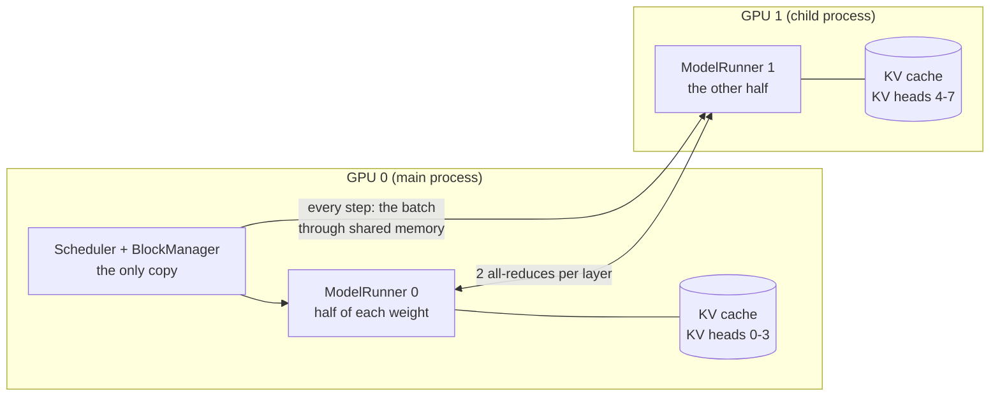
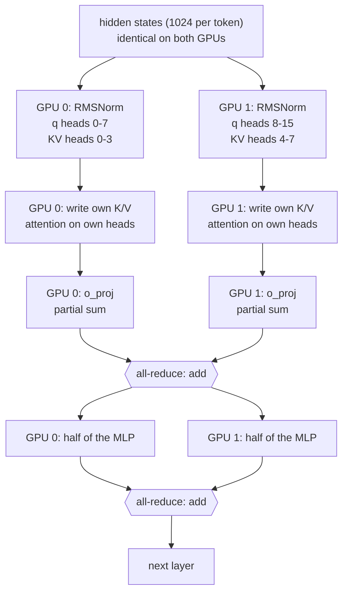

# 04 · How is a model split across GPUs, and where does the KV cache live?

> Examples: Qwen3-0.6B on 2 GPUs, nano-vllm @ [`bb823b3`](https://github.com/GeeeekExplorer/nano-vllm/commit/bb823b3e06983d71485a8e1f23715ebd87d98ef8) · Written: 2026-10-12 · Status: draft

## Question

When a model runs on several GPUs, how is it split, and is the KV cache copied to every GPU, kept on one, or split?

## Short answer

There are three basic ways to split. Data parallelism gives every GPU a full copy and its own requests. Pipeline parallelism gives each GPU a range of layers. Tensor parallelism, the only one nano-vllm supports, splits every layer by heads and columns. Under tensor parallelism the KV cache is split by KV head: each GPU stores the K and V of its own heads, for every token. Attention heads are independent, so a GPU never needs another GPU's KV cache; the GPUs exchange hidden states twice per layer instead.

## How it works

### 1. Three ways to split

| | What each GPU holds | Its KV cache |
|---|---|---|
| Data parallelism | A full copy of the model; its own requests | Full K/V of its own requests |
| Pipeline parallelism | A range of layers, say 1–14 and 15–28 | K/V of its own layers, for every request |
| Tensor parallelism | A slice of every layer: some heads, some columns | K/V of its own KV heads, for every request and layer |

Keeping the KV cache on one GPU and fetching it when needed does not work well: every decode step reads the whole history in every layer, and moving it between GPUs each time would be far too slow.

### 2. Processes in nano-vllm

With `tensor_parallel_size=2`, [`LLMEngine`](https://github.com/GeeeekExplorer/nano-vllm/blob/bb823b3e06983d71485a8e1f23715ebd87d98ef8/nanovllm/engine/llm_engine.py#L25-L27) starts one child process for GPU 1 and keeps GPU 0 for itself. Each process has its own model runner, its half of the weights, and its part of the KV cache. The scheduler, the block manager and the tokenizer exist only once, in the main process.

Every step, GPU 0's model runner writes the method name and the batch of `Sequence` objects into shared memory and wakes the others ([`write_shm`, `call`](https://github.com/GeeeekExplorer/nano-vllm/blob/bb823b3e06983d71485a8e1f23715ebd87d98ef8/nanovllm/engine/model_runner.py#L76-L89)); the others wait in [`loop`](https://github.com/GeeeekExplorer/nano-vllm/blob/bb823b3e06983d71485a8e1f23715ebd87d98ef8/nanovllm/engine/model_runner.py#L61-L66) and run the same method. Both build the same tensors from the same sequences, run their half of the model, and only GPU 0 samples. To keep the message small, a sequence in decode sends only its last token ([`Sequence.__getstate__`](https://github.com/GeeeekExplorer/nano-vllm/blob/bb823b3e06983d71485a8e1f23715ebd87d98ef8/nanovllm/engine/sequence.py#L72-L74)).

### 3. Splitting the weights

The pattern ([linear.py](https://github.com/GeeeekExplorer/nano-vllm/blob/bb823b3e06983d71485a8e1f23715ebd87d98ef8/nanovllm/layers/linear.py)) is: split the first matrix of a block by output columns, the second by input rows. The middle stays on each GPU without communication, and one all-reduce at the end adds up the partial results. Qwen3-0.6B on 2 GPUs:

| Part | Split | Each GPU holds | Communication |
|---|---|---|---|
| Embedding | by vocabulary | 75,968 of the 151,936 tokens; a token outside its range gives zeros | all-reduce ([embed_head.py L41](https://github.com/GeeeekExplorer/nano-vllm/blob/bb823b3e06983d71485a8e1f23715ebd87d98ef8/nanovllm/layers/embed_head.py#L41)) |
| QKV projection | by output (heads) | 8 query heads and 4 KV heads | none |
| q/k norm, rotary, attention | per head | its own heads | none |
| Output projection | by input | its 8 heads' outputs (1024 values) times its half of W_o: a partial sum | all-reduce ([linear.py L155](https://github.com/GeeeekExplorer/nano-vllm/blob/bb823b3e06983d71485a8e1f23715ebd87d98ef8/nanovllm/layers/linear.py#L155)) |
| RMSNorm | not split | a full copy | none |
| Gate and up projections | by output | 1536 of the 3072 intermediate values | none |
| Down projection | by input | a partial sum | all-reduce |
| LM head | by vocabulary | logits for half the vocabulary | gathered on GPU 0 ([embed_head.py L64](https://github.com/GeeeekExplorer/nano-vllm/blob/bb823b3e06983d71485a8e1f23715ebd87d98ef8/nanovllm/layers/embed_head.py#L64)) |

So one forward pass has 28 × 2 + 1 = 57 all-reduces and one gather. Between layers, both GPUs hold the same full hidden states.

### 4. The KV cache under tensor parallelism

[`allocate_kv_cache`](https://github.com/GeeeekExplorer/nano-vllm/blob/bb823b3e06983d71485a8e1f23715ebd87d98ef8/nanovllm/engine/model_runner.py#L110) divides the number of KV heads by the number of GPUs, so each GPU's cache holds 4 KV heads: 14 MiB per block instead of 28 MiB ([KV cache sizing](01-kv-cache-sizing.md)).

Block ids are global, because there is only one block manager. Block 5 on GPU 0 holds KV heads 0–3 of some 256 tokens; block 5 on GPU 1 holds KV heads 4–7 of the same tokens. The `slot_mapping` and block tables are identical on both GPUs, and each GPU writes and reads its own heads.

A GPU never needs another GPU's K/V: query head 0 attends only over KV head 0's history, and both are on GPU 0.

### 5. Limits

- The number of KV heads must divide evenly by the number of GPUs ([qwen3.py L34](https://github.com/GeeeekExplorer/nano-vllm/blob/bb823b3e06983d71485a8e1f23715ebd87d98ef8/nanovllm/models/qwen3.py#L34)): 8 KV heads allow up to 8 GPUs, one head each. nano-vllm does not support more GPUs than KV heads.
- Each GPU computes its own block count from its own free memory, but the block manager uses GPU 0's count. If GPU 1 has less free memory, the scheduler can hand out a block id that does not exist there, and the K/V write goes out of bounds. Reported in issue [#187](https://github.com/GeeeekExplorer/nano-vllm/issues/187); open PR [#215](https://github.com/GeeeekExplorer/nano-vllm/pull/215) takes the minimum across GPUs.

### 6. mini-sglang does it differently

In mini-sglang every GPU runs its own scheduler, so all of them must make exactly the same decision every step. PR [#113](https://github.com/sgl-project/mini-sglang/pull/113) fixed a case where they did not: decode batches were built from a Python set, so the row order could differ between GPUs.

## Code map

| File and function | Role |
|---|---|
| [`llm_engine.py`](https://github.com/GeeeekExplorer/nano-vllm/blob/bb823b3e06983d71485a8e1f23715ebd87d98ef8/nanovllm/engine/llm_engine.py) `__init__` | Starts one process per extra GPU |
| [`model_runner.py`](https://github.com/GeeeekExplorer/nano-vllm/blob/bb823b3e06983d71485a8e1f23715ebd87d98ef8/nanovllm/engine/model_runner.py) `call`, `write_shm`, `read_shm`, `loop` | GPU 0 tells the others what to run |
| [`linear.py`](https://github.com/GeeeekExplorer/nano-vllm/blob/bb823b3e06983d71485a8e1f23715ebd87d98ef8/nanovllm/layers/linear.py) `ColumnParallelLinear`, `QKVParallelLinear`, `MergedColumnParallelLinear`, `RowParallelLinear` | Weight splits; the all-reduce |
| [`embed_head.py`](https://github.com/GeeeekExplorer/nano-vllm/blob/bb823b3e06983d71485a8e1f23715ebd87d98ef8/nanovllm/layers/embed_head.py) | Vocabulary-split embedding and LM head |
| `model_runner.py` `allocate_kv_cache` | KV heads per GPU |

## How I checked

Read the code only. I have one GPU, so none of this has been run with two.

## Open questions

- How much of a decode step goes to the all-reduces on two GPUs connected by PCIe?

## References

- [nano-vllm Note 04](../nano-vllm/04-model-runner-and-cuda-graph.md)
- [KV cache sizing](01-kv-cache-sizing.md)
