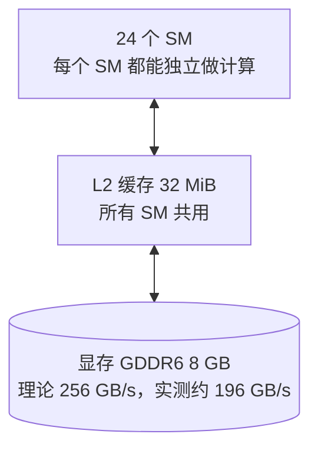

# GPU 问答：硬件由什么组成，kernel 为什么要那样写

为了看懂 nano-vllm [PR #281](../nano-vllm/issues/281-int8-weight-only-quantization.md) 的 Triton kernel，回头补的 GPU 硬件基础，用中文写，方便自己复习。数字都来自我的 RTX 4060 Laptop GPU，命令和原始输出在 [实验 002](../../experiments/002-int8-weight-only-pr281/) 的 `gpu_facts.py` 和 `results/gpu_facts.txt`。2026-10-14 整理。Triton 的写法和那个 kernel 在硬件上怎么跑，在 [QA-triton](QA-triton.md)。

**我当时的问题**："给我深入讲解一下 GPU 的一些关键组成和构造，比如 SM 之类的，以及做 kernel 需要用到哪些东西，对应着硬件的哪些操作……不然我根本不知道为什么要这样做，为什么这么做是合理的。"

**要点**

- GPU 是 24 个 SM（真正做计算的单元）加上一层共用的 L2 缓存，再连着 8 GB 显存。显存大，但慢：一次读取要等几百个时钟周期，总带宽实测约 196 GB/s。
- 线程 32 个一组成为 warp，几个 warp 组成一个线程块；一个线程块只在一个 SM 上跑，一个 SM 可以同时放好几个线程块。
- SM 靠"这个 warp 在等显存，就先跑别的 warp"来掩盖等待，所以每个 SM 上要有足够多的 warp。
- 写 kernel 的道理都从这里来：让 24 个 SM 都有活；读进芯片的数要多用几次（分块）；矩阵乘交给 Tensor Core；读和算要重叠。
- 每从显存读 1 个字节要做大约 90 次运算，计算单元才不会闲着。decode 时 M 很小，远远达不到，所以受带宽限制。

**目录**

1. 全局：24 个 SM、L2、显存
2. 一个 SM 里有什么
3. 线程怎么组织，和硬件怎么对应
4. 存储层级
5. 从硬件推出来的写 kernel 原则
6. 受带宽限制，还是受算力限制
7. 我这张卡的数字
8. 自测（还没答）

---

## 1. 全局：24 个 SM、L2、显存

| 部件 | 是什么 | 我的卡 |
|---|---|---|
| SM（Streaming Multiprocessor） | 真正做计算的单元，所有计算都发生在某个 SM 里 | 24 个 |
| L2 缓存 | 显存和 SM 之间的缓存，所有 SM 共用 | 32 MiB |
| 显存 | 模型权重、KV cache、每一步的输入输出都放在这里 | 8 GB GDDR6，128 位总线 |

显存的带宽：理论值 = 2 × 显存时钟 8001 MHz × 128 位 ÷ 8 = 256 GB/s。拷贝一个 512 MiB 的张量实测约 196 GB/s，大约是理论值的四分之三（有一次刚编译完 kernel 只测到 168，笔记本的频率会变）。

## 2. 一个 SM 里有什么

我这张卡是 Ada 架构（计算能力 8.9）。一个 SM 分成 4 个分区：

| 部件 | 每个分区 | 整个 SM | 干什么 |
|---|---|---|---|
| warp 调度器 | 1 | 4 | 每个时钟周期挑一个"准备好了"的 warp，发出它的下一条指令 |
| FP32 计算单元（CUDA core） | 32 | 128 | 普通的加减乘、类型转换 |
| Tensor Core | 1 | 4 | 专门做小块矩阵乘，一条指令算一个 16 × 8 的输出小块 |
| 寄存器 | | 65,536 个 × 4 字节 = 256 KB | 每个线程私有的变量，最快 |
| L1 / shared memory | | 128 KB，其中一个线程块最多能用约 99 KB 当 shared memory | 同一个线程块的线程共用的"片上小内存" |

全卡：24 × 128 = 3072 个 CUDA core，24 × 4 = 96 个 Tensor Core。

**Tensor Core 确实在干活的证据**：只靠 CUDA core，每秒最多 3072 × 2（一次乘加算两次运算）× 1.89 GHz = 11.6 万亿次（11.6 TFLOPS）。PR #281 的 kernel 单测里，cuBLAS 在大矩阵上跑到了 17–18 TFLOPS，超过了这个上限，所以它一定用了 Tensor Core。

## 3. 线程怎么组织，和硬件怎么对应

| 软件里的单位 | 是什么 | 对应的硬件 |
|---|---|---|
| 线程（thread） | 最小的执行单位，有自己的寄存器 | |
| warp | 32 个线程一组，同一时刻执行同一条指令 | 调度器调度的单位 |
| 线程块（block；Triton 里叫 program） | 若干个 warp，比如 4 个 = 128 个线程 | 整个线程块只在一个 SM 上跑；块里的线程共用 shared memory，能互相等待（同步） |
| grid | 一次启动的所有线程块 | 被分到 24 个 SM 上，放不下的排队等下一轮 |

**一个 SM 能同时放几个线程块**，看三样东西，哪个先用完就卡在哪：

| 限制 | 我的卡上每个 SM 的上限 |
|---|---|
| 线程数 | 1536 个（48 个 warp） |
| 寄存器 | 65,536 个 |
| shared memory | 约 100 KB（驱动还会给每个线程块额外预留 1 KB） |

例子：一个线程块 128 个线程、每个线程用 58 个寄存器、用 12 KB shared memory（PR #281 的 kernel 在 decode 时就是这样）。
- 按线程数：1536 ÷ 128 = 12 个；
- 按寄存器：65,536 ÷（58 × 128）≈ 8.8，最多 8 个；
- 按 shared memory：约 100 KB ÷（12 + 1）KB ≈ 7.7，最多 7 个。

所以一个 SM 最多同时放 7 个，也就是 28 个 warp。

**为什么要同时放很多 warp**：一个 warp 去读显存，要等几百个周期才拿到数据，这期间它什么也干不了。调度器每个周期都会找一个已经准备好的 warp 来执行，只要 SM 上还有别的 warp 在算，等待的时间就被填上了。如果一个 SM 上只有 4 个 warp，大家都在等显存，SM 就只能空转。

## 4. 存储层级

越靠近计算单元越快，也越小：

| 层 | 大小（我的卡） | 谁能看到 | 速度 |
|---|---|---|---|
| 寄存器 | 每个 SM 256 KB，分给上面所有线程 | 一个线程自己 | 最快，当场能用 |
| shared memory | 每个 SM 约 100 KB | 同一个线程块的线程 | 很快，在芯片上 |
| L2 缓存 | 32 MiB，全卡共用 | 所有 SM | 比显存快 |
| 显存 | 8 GB | 所有 SM | 最慢：要等几百个周期；总带宽约 196 GB/s |

写 kernel 时，寄存器和 shared memory 是自己（或编译器）安排的：把要反复用的数据先搬到这两层，再反复用。L2 是硬件自动管的。

## 5. 从硬件推出来的写 kernel 原则

| 原则 | 因为 |
|---|---|
| ① 线程块要够多，让 24 个 SM 都有活 | 线程块少于 24 个，就有 SM 闲着 |
| ② 每个 SM 上要驻留足够多的 warp | 要靠切换 warp 来掩盖读显存的等待；每个线程用的寄存器、每个线程块用的 shared memory 越多，能同时放的就越少 |
| ③ 少读显存：读进芯片的数要多用几次 | 显存又慢又窄。先把一小块数据搬进 shared memory 或寄存器，再反复使用，这就是"分块（tiling）" |
| ④ 一个 warp 的 32 个线程读相邻的地址 | 相邻地址的读取能合并成一次大的访问 |
| ⑤ 矩阵乘交给 Tensor Core | 它比 CUDA core 快得多（第 2 节） |
| ⑥ 读和算重叠 | 算这一块的时候，下一块已经在搬（异步拷贝），计算单元不用干等 |

PR #281 的 kernel 每一条都碰到了：o_proj 在 decode 时只启动 16 个线程块，违反了 ①②，所以不快；它的分块、Tensor Core、预读对应 ③⑤⑥。具体见 [QA-triton](QA-triton.md) 第 7、8 部分。

## 6. 受带宽限制，还是受算力限制

计算单元每秒能做约 17 万亿次运算（Tensor Core，实测），显存每秒只能送来约 1960 亿字节。17 万亿 ÷ 1960 亿 ≈ 90：**每从显存读 1 个字节，至少要做大约 90 次运算，计算单元才不会闲着。**

| 情况 | 每读 1 字节做几次运算 | 结果 |
|---|---|---|
| decode，M = 1：每个 bf16 权重（2 字节）只和 1 个数做一次乘加（2 次运算） | 约 1 次 | 远远不够，时间几乎全花在读权重上：受带宽限制 |
| M 行一起算：每个权重被 M 行各用一次 | 大约随 M 增长 | M 到几百的时候，读权重就不再是瓶颈 |
| prefill，M = 16384 | 远超 90 | 时间花在算上：受算力限制 |

PR #281 的 kernel 单测里，分界线大约在 M = 128 到 256，和这个估算是同一个数量级。还有一个顺带的观察：bf16 在 M 很小时（cuBLAS 用矩阵乘向量的 kernel）只跑到 100–140 GB/s，大约是实测上限 196 GB/s 的五到七成。

## 7. 我这张卡的数字

| 项目 | 值 | 从哪来 |
|---|---|---|
| 型号 | NVIDIA GeForce RTX 4060 Laptop GPU，计算能力 8.9（Ada） | `torch.cuda.get_device_properties` |
| SM 数 | 24 | 同上 |
| 显存 | 8,585,216,000 字节（8 GB） | 同上 |
| L2 缓存 | 33,554,432 字节（32 MiB） | 同上 |
| warp 大小 | 32 | 同上 |
| 每个 SM 最多线程数 | 1536 | 同上 |
| 每个 SM 寄存器数 | 65,536 | 同上 |
| 一个线程块最多能用的 shared memory | 101,376 字节（99 KB） | Triton 的 `get_device_properties` |
| SM 时钟 | 1890 MHz | 同上 |
| 显存时钟、总线宽度 | 8001 MHz、128 位 → 理论 256 GB/s | 同上 |
| 实测拷贝带宽 | 约 196 GB/s（512 MiB，连测 5 轮 194–197） | `gpu_facts.py` |
| 只用 CUDA core 的计算上限 | 11.6 TFLOPS | 3072 × 2 × 1.89 GHz |

## 8. 自测（还没答）

1. 一个线程块用 256 个线程、每个线程 64 个寄存器、32 KB shared memory。我的卡上一个 SM 最多能同时放几个？卡在哪一项？
2. 一个 kernel 只启动 12 个线程块，24 个 SM 里有几个是闲着的？如果每个线程块只有 4 个 warp，读显存的等待能掩盖得住吗？
3. 为什么一个 SM 上要同时放很多个 warp，而不是只放一个大的？
4. decode 时 M = 8，bf16 权重每读 1 个字节做几次运算？离大约 90 还差多远？

基础概念（kernel 和 CUDA graph 的区别、grid / block / thread、朴素矩阵乘、分块）在 [QA-cuda-graph](../nano-vllm/QA-cuda-graph.md) 的 "GPU kernel" 那一节。
