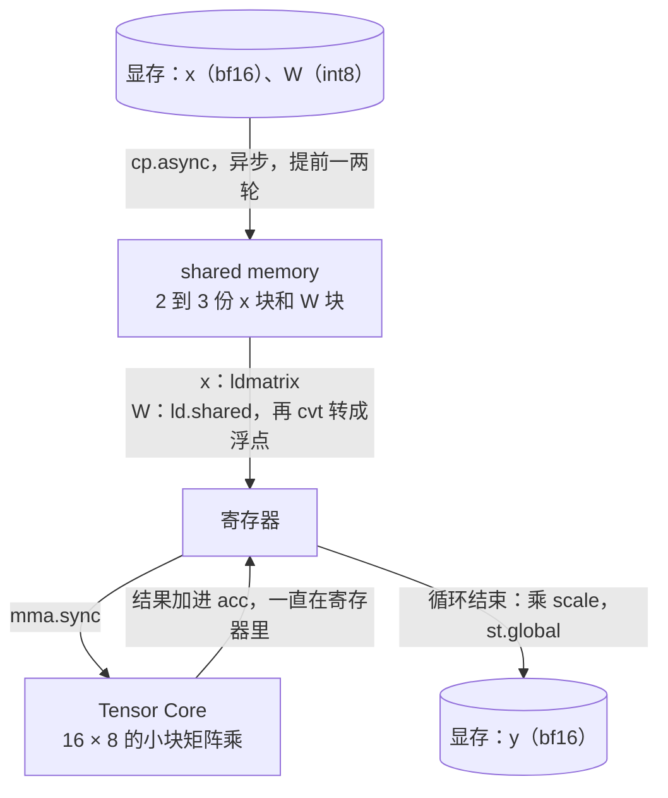

# Triton 问答：写法、常用操作，以及 PR #281 的 kernel 在硬件上怎么跑

为了看懂 nano-vllm [PR #281](../nano-vllm/issues/281-int8-weight-only-quantization.md) 的 Triton kernel（`w8a16_gemm.py`）补的 Triton 基础，用中文写，方便自己复习。硬件那一层在 [QA-gpu](QA-gpu.md)，这一页常常引用它；这个 kernel 一行一行的讲解在 [QA-quantization](../nano-vllm/QA-quantization.md) 第 5 部分。编译结果的数字来自我的 RTX 4060 Laptop GPU，命令和原始输出在 [实验 002](../../experiments/002-int8-weight-only-pr281/) 的 `gpu_facts.py` 和 `results/gpu_facts.txt`。2026-10-14 整理。

**我当时的问题**："`import triton.language as tl`、`@triton.jit`、`tl.constexpr`、`tl.program_id`、`tl.load(a_ptrs, mask=a_mask, other=0.0)`、`tl.dot`、`grid = (triton.cdiv(M, BM), triton.cdiv(N, BN))`，还有 `_w8a16_gemm_kernel[grid](...)` 这样调用又是怎么回事，为什么是这样用的？给我补充一下背景，然后把常见的一些操作整理一下。"

**要点**

- 用 CUDA 写 kernel 时，写的是"每一个线程做什么"；用 Triton 写的是"**一个线程块（program）对一整块数据做什么**"，线程之间怎么分工、shared memory、Tensor Core、异步拷贝都由编译器安排。
- 所有 Triton kernel 都是一个套路：`program_id` 算出自己负责哪一块 → `arange` 和指针算出一整块地址 → `mask` 挡住越界的位置 → `load` → 计算 → `store`。
- `kernel[grid](参数)` 启动：grid 决定启动几个 program；张量传进去变成显存地址，所以还要传 stride；`tl.constexpr` 参数在编译时固定。
- 在我的卡上，PR #281 的 `tl.load` 被编译成异步拷贝 `cp.async`，`tl.dot` 被编译成 Tensor Core 指令 `mma.sync`。
- 它测到的快慢，都能用"每个 SM 上同时放了几个线程块"和"数据被复用了几次"解释。

**目录**

1. Triton 是什么
2. 最小的例子：两个向量相加
3. 常用操作
4. 启动：`kernel[grid](...)`
5. PR #281 的 kernel 编译成了什么
6. 数据走的路线
7. 一个 SM 能同时放几个 program
8. 用硬件解释测到的快慢
9. 自测（还没答）

---

## 1. Triton 是什么

[QA-cuda-graph](../nano-vllm/QA-cuda-graph.md) 里那个朴素的 CUDA 矩阵乘，写的是**每个线程**要做什么：`row = blockIdx.y * blockDim.y + threadIdx.y`，一个线程算 C 里的一个数。想让它变快，分块、shared memory、Tensor Core 都要自己一行一行写。

Triton 是 OpenAI 做的一个在 Python 里写 GPU kernel 的语言和编译器，写的是**一个 program（线程块）对一整块数据做什么**：

| 你来决定 | 编译器替你做 |
|---|---|
| 一个 program 负责哪一块（`program_id`、`arange`） | 这一块里每个线程负责哪几个数 |
| 读哪些地址（指针 + 偏移、`load`） | 用什么指令读，要不要先放进 shared memory |
| 做什么运算（`dot`、`+`、`.to`） | `dot` 交给 Tensor Core，生成对应的机器指令 |
| 块多大、几个 warp、预读几轮（`constexpr`、`num_warps`、`num_stages`） | 按这些安排寄存器、shared memory 和异步拷贝 |

**编译过程**：带 `@triton.jit` 的函数第一次被调用时才编译：Python 代码 → Triton 自己的中间表示 → LLVM → PTX（NVIDIA 的汇编）→ 机器码。编译好的结果存进缓存（默认在 `<用户目录>/.triton/cache`），下次同样的参数直接拿来用。

## 2. 最小的例子：两个向量相加

Triton 官方教程的第一个例子。每个 kernel 都是这个套路：

```python
import triton
import triton.language as tl          # tl 里是 kernel 里能用的操作

@triton.jit                           # 这个函数在 GPU 上跑，第一次调用时编译
def add_kernel(x_ptr, y_ptr, out_ptr, n, BLOCK: tl.constexpr):
    pid = tl.program_id(0)                     # 我是第几个 program
    offs = pid * BLOCK + tl.arange(0, BLOCK)   # 我负责的下标：一整串
    mask = offs < n                            # 哪些下标没越界
    x = tl.load(x_ptr + offs, mask=mask)       # 读一整块 x
    y = tl.load(y_ptr + offs, mask=mask)
    tl.store(out_ptr + offs, x + y, mask=mask) # 写一整块结果

n = 1000
add_kernel[(triton.cdiv(n, 256),)](x, y, out, n, BLOCK=256)   # 启动 4 个 program
```

n = 1000、BLOCK = 256 时：

| program | `offs` | `mask` | 做了什么 |
|---|---|---|---|
| 0 | 0–255 | 全真 | 算 out[0:256] |
| 1 | 256–511 | 全真 | 算 out[256:512] |
| 2 | 512–767 | 全真 | 算 out[512:768] |
| 3 | 768–1023 | 768–999 为真，1000–1023 为假 | 只算 out[768:1000]，后 24 个位置不读也不写 |

PR #281 的 kernel 是同一个套路：多了一维（矩阵），中间多了一个沿 K 的循环和一次 `tl.dot`。

## 3. 常用操作

| 写法 | 意思 | PR #281 的 kernel 里 |
|---|---|---|
| `import triton.language as tl` | kernel 里能用的操作都在 `tl` 里 | |
| `@triton.jit` | 标记成 GPU kernel。第一次调用时编译成机器码并缓存 | 第 11 行 |
| 普通参数 | 运行时传进来的整数 | `M, N, K` 和 stride，第 14–17 行 |
| 张量参数 | 传进来时变成**显存地址**（指针）。kernel 只知道地址和元素类型，不知道形状 | `a_ptr` 等，第 13 行 |
| `tl.constexpr` | **编译时就固定的常数**。块的形状必须在编译时知道，编译器才能决定每个线程放几个数、开多少寄存器和 shared memory。换一个值就要重新编译一份 | `BLOCK_M/N/K`，第 18–20 行 |
| `tl.program_id(axis)` | 我是这一维的第几个 program（相当于 CUDA 的 `blockIdx`） | 第 22–23 行 |
| `tl.arange(0, n)` | 一整串 `[0, 1, …, n−1]`。n 必须是 2 的幂，而且是 constexpr | 第 25–27 行 |
| `a[:, None]`、`a[None, :]` | 和 numpy 一样的广播：一列加一行，得到一张二维表 | 第 29–30 行 |
| 指针 + 偏移 | 得到一整块地址。偏移的单位是**元素**：int8 指针加 1 是下一个字节，bf16 指针加 1 是往后 2 个字节 | 第 29–30 行 |
| `tl.load(ptrs, mask=, other=)` | 从显存读一整块。mask 为假的位置**根本不去读**，直接填 `other`。GPU 不检查越界：读错了地址会拿到垃圾，甚至直接报非法访问，所以边界要用 mask 挡住 | 第 38–39 行 |
| `tl.store(ptrs, value, mask=)` | 写一整块，mask 为假的位置不写 | 第 51 行 |
| `tl.zeros(shape, dtype)` | 一整块 0 | 第 32 行 |
| `tl.dot(a, b)` | 块和块做矩阵乘。每一维至少 16（Tensor Core 指令的最小形状），所以 M = 1 时也按 16 行算 | 第 40 行 |
| `x.to(dtype)` | 类型转换 | 第 40、46、51 行 |
| kernel 里的 `for` | 编译成 GPU 上的循环，配合 `num_stages` 做预读 | 第 34 行 |
| `triton.cdiv(a, b)` | 向上取整的除法，`(a + b − 1) // b`，在 CPU 上算 grid 用 | 第 82 行 |

## 4. 启动：`kernel[grid](...)`

```python
_w8a16_gemm_kernel[grid](                              # grid 决定启动几个 program
    x_2d, weight_int8, scale_1d, c,                    # 张量 → 显存地址
    M, N, K,                                           # 整数，按值传进去
    x_2d.stride(0), x_2d.stride(1),                    # stride：告诉 kernel 怎么从下标算地址
    weight_int8.stride(0), weight_int8.stride(1),
    c.stride(0), c.stride(1),
    BLOCK_M=BM, BLOCK_N=BN, BLOCK_K=BK,                # constexpr，参与编译
    num_stages=stages, num_warps=warps,                # 编译选项，不是 kernel 的参数
)
```

| 部分 | 为什么这样写 |
|---|---|
| `[grid]` | 方括号里写 grid，比如 `(1, 64)` 就是 1 × 64 个 program。对应 CUDA 的 `kernel<<<grid, block>>>(...)` |
| 张量 | Triton 自动取张量的显存地址，再按张量的类型（bf16、int8）决定指针的元素类型 |
| **stride** | kernel 只拿到一个起始地址，不知道这是几行几列。元素 (i, j) 在哪，要用 `起始 + i × stride(0) + j × stride(1)` 算。x 是 [M, 1024] 时，`stride(0) = 1024`（下一行隔 1024 个数），`stride(1) = 1`（下一列挨着） |
| `BLOCK_M=…` 这些 | 对应参数表里标了 `tl.constexpr` 的那几个 |
| `num_warps=4` | 每个 program 4 个 warp = 128 个线程 |
| `num_stages=3` | 循环里预读几轮（第 5 部分有实际数字） |

另外，Triton 会按整数参数的特征（是不是 1、能不能被 16 整除）分别编译，所以不同的 M 可能对应不同的编译版本。实测 M = 2017 和 2048 一样快（QA-quantization 6.6）。

## 5. PR #281 的 kernel 编译成了什么

用 qkv 的形状（N = 4096、K = 1024）在我的卡上启动一次，读出编译结果：

| | M ≤ 64 那组（16×64×64，`num_stages=3`） | M > 64 那组（64×64×64，`num_stages=4`） |
|---|---|---|
| 每个 program 的线程数 | 128（4 个 warp） | 128 |
| 每个线程用的寄存器 | 58 | 129 |
| 每个 program 用的 shared memory | 12,288 字节 | 36,864 字节 |

生成的 PTX 里出现的关键指令：

| 指令 | 是什么 | 对应 kernel 里的 |
|---|---|---|
| `cp.async.cg.shared.global …, 0x10` | 每个线程把 16 字节从显存（经过 L2）**异步**搬进 shared memory，发出去以后不用等 | `tl.load` 读 x 块和 W 块 |
| `ldmatrix.sync.aligned.m8n8.x4.shared.b16` | 把 shared memory 里的 bf16 小块，按 Tensor Core 要的排法装进寄存器 | x 块进 `tl.dot` 之前 |
| `ld.shared.v2.u32` | 从 shared memory 按 32 位一组读进寄存器 | int8 的 W 块进寄存器 |
| `cvt.rn.f32.s8` | 一个 int8 转成浮点 | `b_int8.to(a.dtype)` |
| `mma.sync.aligned.m16n8k16.row.col.f32.bf16.bf16.f32` | **Tensor Core 矩阵乘**：一个 warp 算一个 16 × 8 的输出小块，k 方向 16 个数，输入 bf16，累加 fp32 | `tl.dot`：一次 [16×64]·[64×64] 由很多条这样的指令拼成 |
| `bar.sync` | 线程块里所有线程在这里等齐 | 换下一块 shared memory 之前 |
| `st.global` | 写回显存 | `tl.store` |

**`num_stages` 的实际效果**：一轮的 x 块是 16 × 64 × 2 = 2 KB，W 块是 64 × 64 × 1 = 4 KB，共 6 KB；小配置用了 12,288 字节，正好是 2 份。大配置一轮 8 + 4 = 12 KB，用了 36,864 字节，正好是 3 份。也就是说，算其中一份的时候，另外一两份已经在用 `cp.async` 往 shared memory 里搬了。

## 6. 数据走的路线



| 步骤 | 在哪一层 | 为什么这样做（QA-gpu 第 5 部分的原则） |
|---|---|---|
| 一块 x 和一块 W 搬进 shared memory | 显存 → 芯片 | ③ 只从显存读一次，后面在芯片上反复用 |
| 搬的同时，算前一块 | | ⑥ 读和算重叠 |
| 从 shared memory 装进寄存器，交给 Tensor Core | 芯片内 | ⑤ 矩阵乘交给 Tensor Core |
| 16 轮累加都在寄存器里 | 芯片内 | ③ 中间结果从不回显存 |
| 最后乘 scale，写回 | 芯片 → 显存 | 每个输出只写一次 |

## 7. 一个 SM 能同时放几个 program

按 [QA-gpu](QA-gpu.md) 第 3 部分的三个上限算：

| | 小配置（decode） | 大配置（prefill） |
|---|---|---|
| 按线程数（1536 ÷ 128） | 12 个 | 12 个 |
| 按寄存器（65,536 ÷ 每个 program 的寄存器） | 65,536 ÷（58 × 128）≈ 8 个 | 65,536 ÷（129 × 128）≈ 3 个 |
| 按 shared memory（约 100 KB ÷ 每个 program 的，另加 1 KB 预留） | 100 ÷ 13 ≈ 7 个 | 100 ÷ 37 ≈ 2 个 |
| **一个 SM 同时最多** | **约 7 个 = 28 个 warp** | **2 个 = 8 个 warp** |

实际上能不能放满，还要看启动了多少个 program：

| 情况 | program 数 | 分到 24 个 SM 上 |
|---|---|---|
| qkv，decode 1 个序列 | 64 | 每个 SM 两三个，约 8–12 个 warp |
| **o_proj，decode 1 个序列** | **16** | **8 个 SM 完全闲着，另外 16 个 SM 各只有 1 个 program = 4 个 warp** |
| qkv，prefill 16384 个 token | 16,384 | 每次 24 × 2 = 48 个同时跑，要分约 342 轮 |

## 8. 用硬件解释测到的快慢

| 现象（QA-quantization 第 6 部分） | 硬件上的原因 |
|---|---|
| decode 时 qkv 快 1.85 倍 | 64 个 program，24 个 SM 都有活；W 只从显存读一次，而且是 int8，字节数是 bf16 的一半 |
| o、down 不快，只跑到约 50 GB/s | 只有 16 个 program：8 个 SM 闲着；有活的 SM 上只有 4 个 warp，读显存的时候找不到别的 warp 来填补等待 |
| M = 1 时多算了 15 行 | `mma.sync` 最小是 m16，`tl.dot` 每一维至少 16，1 行也要按 16 行算。不过这时瓶颈在读权重，多算的几乎不花时间 |
| M = 16384 时比 cuBLAS 慢一倍 | 每个 SM 只能同时放 2 个 program（8 个 warp）；64 × 64 的块偏小，读进来的每个数只在这块里被用 64 次，块更大就能用更多次；每一轮还要多做一次 int8 → 浮点的转换。cuBLAS 用的块更大、调得更细（推测，没用 profiler 看过） |

## 9. 自测（还没答）

1. 向量相加的例子里，n = 1000、BLOCK = 128：grid 是多少？最后一个 program 有几个位置被 mask 挡掉？
2. 为什么 `BLOCK_M` 必须是 `tl.constexpr`，而 M 不用？
3. 启动时为什么要传 stride？如果传进去的 x 是转置过、不连续的（`x.T`），kernel 的代码要改吗？要改的是什么？
4. 小配置的 shared memory 如果从 12 KB 变成 24 KB（比如 `num_stages` 加大），一个 SM 能同时放几个 program？对 decode 是好事还是坏事？
