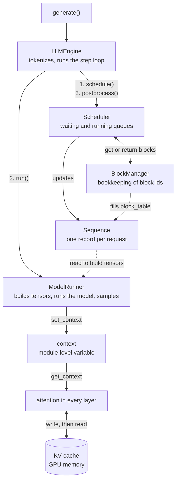
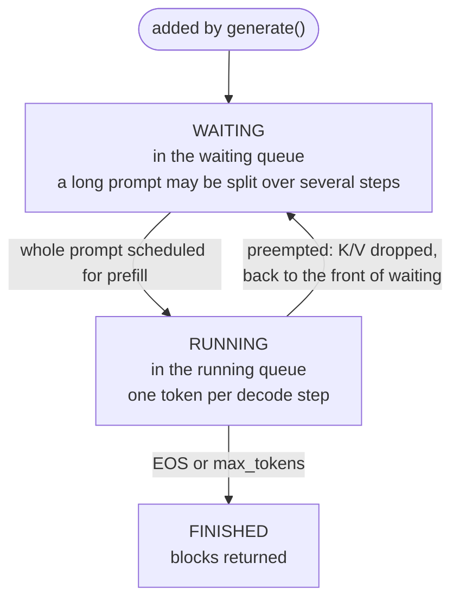

# 01 · What happens to a request between `generate()` and the returned text?

> Project: nano-vllm @ [`bb823b3`](https://github.com/GeeeekExplorer/nano-vllm/commit/bb823b3e06983d71485a8e1f23715ebd87d98ef8) · Written: 2026-10-12 · Status: draft

## Question

What happens to a request between `generate()` and the returned text?

## Short answer

`generate()` tokenizes every prompt, wraps each one in a `Sequence`, and puts them all in a waiting queue. Then the engine repeats one step until nothing is left: the scheduler picks the sequences for this step and how many tokens each computes, the model runner turns them into tensors and runs the model once, and the scheduler records the sampled tokens and frees the sequences that finished. Every step is decided from scratch, prefill is tried first, and a step is either all prefill or all decode. The CPU does the bookkeeping and the GPU does the math, and in nano-vllm the GPU waits while the CPU does its part.

## How it works

### 1. The components

| Component | File (lines) | Job | Runs on |
|---|---|---|---|
| `LLMEngine` | [llm_engine.py](https://github.com/GeeeekExplorer/nano-vllm/blob/bb823b3e06983d71485a8e1f23715ebd87d98ef8/nanovllm/engine/llm_engine.py) (90) | `generate()`, tokenizer, the step loop; starts the extra processes for tensor parallelism. It makes no decisions | CPU |
| `Sequence` | [sequence.py](https://github.com/GeeeekExplorer/nano-vllm/blob/bb823b3e06983d71485a8e1f23715ebd87d98ef8/nanovllm/engine/sequence.py) (83) | One record per request: its tokens, a few counters, its block table, its status. It does nothing itself | CPU |
| `Scheduler` | [scheduler.py](https://github.com/GeeeekExplorer/nano-vllm/blob/bb823b3e06983d71485a8e1f23715ebd87d98ef8/nanovllm/engine/scheduler.py) (92) | Picks the sequences for each step, prefill or decode; preempts when blocks run out; updates the sequences after the step | CPU |
| `BlockManager` | [block_manager.py](https://github.com/GeeeekExplorer/nano-vllm/blob/bb823b3e06983d71485a8e1f23715ebd87d98ef8/nanovllm/engine/block_manager.py) (120) | Hands out KV cache block ids and keeps the books: free blocks, reference counts, the prefix cache. It never touches GPU memory | CPU |
| `ModelRunner` | [model_runner.py](https://github.com/GeeeekExplorer/nano-vllm/blob/bb823b3e06983d71485a8e1f23715ebd87d98ef8/nanovllm/engine/model_runner.py) (257) | The only part that uses the GPU: loads the model, allocates the KV cache, records CUDA graphs; each step builds tensors, runs the model, samples | CPU and GPU |

The scheduler and the block manager deal only in numbers: which sequence, how many tokens, which block ids. The model runner turns those numbers into tensors for the GPU. The `Sequence` is the record they share, and a module-level context carries each step's numbers into the attention layers (section 5).



### 2. From `generate()` to the waiting queue

[`generate()`](https://github.com/GeeeekExplorer/nano-vllm/blob/bb823b3e06983d71485a8e1f23715ebd87d98ef8/nanovllm/engine/llm_engine.py#L60-L90) adds every request before it runs a single step. [`add_request`](https://github.com/GeeeekExplorer/nano-vllm/blob/bb823b3e06983d71485a8e1f23715ebd87d98ef8/nanovllm/engine/llm_engine.py#L43-L47) tokenizes the prompt, wraps it in a `Sequence` with status `WAITING` and an empty block table, and appends it to the scheduler's waiting queue.

The queue is first come, first served. The scheduler never skips the head to find a shorter request that would fit; if the head does not fit, nobody behind it gets in (that is how one oversized request blocked everything in [#274](issues/274-kv-cache-exhausted-assert.md)).

`seq_id` comes from a global counter, and the warmup at startup uses the first few ids. At the end, `generate()` sorts the outputs by `seq_id` ([L88](https://github.com/GeeeekExplorer/nano-vllm/blob/bb823b3e06983d71485a8e1f23715ebd87d98ef8/nanovllm/engine/llm_engine.py#L88)), so the results come back in the order of the prompts.

### 3. One step is four lines

[`LLMEngine.step()`](https://github.com/GeeeekExplorer/nano-vllm/blob/bb823b3e06983d71485a8e1f23715ebd87d98ef8/nanovllm/engine/llm_engine.py#L49-L55):

```python
seqs, is_prefill = self.scheduler.schedule()                       # who runs, prefill or decode
num_tokens = ...                                                   # only for the throughput display
token_ids = self.model_runner.call("run", seqs, is_prefill)        # one new token per sequence
self.scheduler.postprocess(seqs, token_ids, is_prefill)            # record tokens, free finished ones
outputs = [(seq.seq_id, seq.completion_token_ids) for seq in seqs if seq.is_finished]
```

`schedule()` starts from scratch every time and tries prefill first: only when no waiting sequence fits does it build a decode step. So there is no decode loop. A long run of decode steps happens because every prefill attempt in it failed, usually for lack of free blocks. [Note 02](02-scheduler.md) covers the rules.

### 4. The Sequence: the record everyone shares

| Field | Meaning | Written by | Read by |
|---|---|---|---|
| `token_ids`, `num_tokens`, `last_token` | All tokens so far, prompt and generated | `append_token`, called from `postprocess` | ModelRunner, to pick this step's tokens |
| `num_cached_tokens` | How many tokens already have their K/V in the cache | `allocate` (prefix hits), `postprocess` (adds this step's tokens), `deallocate` (back to 0) | Scheduler, ModelRunner, `hash_blocks` |
| `num_scheduled_tokens` | How many tokens this step computes | `schedule`; reset in `postprocess` | ModelRunner, `hash_blocks` |
| `block_table` | The block ids holding this sequence's K/V | BlockManager | ModelRunner |
| `status` | `WAITING`, `RUNNING` or `FINISHED` | Scheduler | LLMEngine |

One rule explains most of the counters: **a sampled token has no K/V yet.** Its K/V is computed in the next step, when it is the input. Take a 500-token prompt. The prefill step computes K/V for the 500 prompt tokens and samples token 501. `postprocess` then sets `num_cached_tokens` to 500 and appends token 501, so `num_tokens` is 501. The first decode step feeds token 501 into the model, writes its K/V, and samples token 502.

The same rule decides when a sequence needs a new block. A 256-token prompt fills block 0 exactly; its first sampled token is token 257, whose K/V is written in the first decode step and is the first entry of block 1. In the scheduler simulation, that sequence has length 257 after prefill and gets its second block in the first decode step.



### 5. How per-step data reaches attention: the context

The model's `forward()` takes only token ids and positions, like any transformer. Attention also needs to know, for this step, where to write each new token's K/V, how long each sequence is, and which blocks hold its history. nano-vllm passes these through a module-level variable in [context.py](https://github.com/GeeeekExplorer/nano-vllm/blob/bb823b3e06983d71485a8e1f23715ebd87d98ef8/nanovllm/utils/context.py) (27 lines):

| When | Where | What |
|---|---|---|
| End of preparing a step | [model_runner.py L169](https://github.com/GeeeekExplorer/nano-vllm/blob/bb823b3e06983d71485a8e1f23715ebd87d98ef8/nanovllm/engine/model_runner.py#L169) (prefill), [L187](https://github.com/GeeeekExplorer/nano-vllm/blob/bb823b3e06983d71485a8e1f23715ebd87d98ef8/nanovllm/engine/model_runner.py#L187) (decode) | `set_context(...)` |
| In every attention layer and in the LM head | [attention.py L60](https://github.com/GeeeekExplorer/nano-vllm/blob/bb823b3e06983d71485a8e1f23715ebd87d98ef8/nanovllm/layers/attention.py#L60), [embed_head.py L57](https://github.com/GeeeekExplorer/nano-vllm/blob/bb823b3e06983d71485a8e1f23715ebd87d98ef8/nanovllm/layers/embed_head.py#L57) | `get_context()` |
| After sampling | [model_runner.py L219](https://github.com/GeeeekExplorer/nano-vllm/blob/bb823b3e06983d71485a8e1f23715ebd87d98ef8/nanovllm/engine/model_runner.py#L219) | `reset_context()` |

With CUDA graphs the picture changes: during replay the Python attention code does not run at all, and the context is only used to copy this step's values into the graph's fixed buffers ([Note 04](04-model-runner-and-cuda-graph.md)).

### 6. Between steps, the GPU waits for the CPU

After the model runs, [`ModelRunner.run`](https://github.com/GeeeekExplorer/nano-vllm/blob/bb823b3e06983d71485a8e1f23715ebd87d98ef8/nanovllm/engine/model_runner.py#L218) calls `.tolist()` on the sampled tokens. Copying them to the CPU means waiting until the GPU has finished the whole step. Then the CPU, in Python, runs `postprocess`, schedules the next step, and builds its input tensors. Only then does the next step reach the GPU, which sits idle in the meantime.

The wait is needed because the next step depends on this one: its input is the token just sampled (a decode step feeds each sequence's `last_token`), and the scheduler has to know which sequences hit EOS and which crossed into a new block. In nano-vllm all of that goes through the `Sequence` objects on the CPU.

I have not measured this gap in nano-vllm yet. For scale: on the same laptop GPU, one decode step of one request takes about 8 ms in mini-sglang ([QA-overlap](../mini-sglang/QA-overlap.md), in Chinese), so a few milliseconds of Python between steps is a real share. CUDA graphs ([Note 04](04-model-runner-and-cuda-graph.md)) cut the cost of launching kernels inside a step; they do nothing for this gap between steps.

mini-sglang removes most of the gap with overlap scheduling: it launches step k+1 before it processes the results of step k. The sampled tokens stay on the GPU, written into a token pool that the next step reads from, so step k+1 does not need them on the CPU. The CPU does step k's bookkeeping while the GPU computes step k+1. The cost is that the scheduler always works with information one step old: a sequence that produced EOS in step k has already been put into step k+1, and a prefix computed in step k reaches the radix tree too late for a request admitted in step k+1, which then computes it again. That late insertion is where the bug fixed by mini-sglang PRs [#142](https://github.com/sgl-project/mini-sglang/pull/142) and [#154](https://github.com/sgl-project/mini-sglang/pull/154) comes from.

```mermaid
%%{init: {"gantt": {"displayMode": "compact", "useWidth": 860, "barHeight": 24, "fontSize": 12, "sectionFontSize": 13, "leftPadding": 130}}}%%
gantt
  dateFormat x
  axisFormat %L
  section nano-vllm CPU
  prep 1 :0, 4
  wait :4, 12
  proc 1 + prep 2 :12, 16
  wait :16, 24
  proc 2 + prep 3 :24, 28
  section nano-vllm GPU
  idle :crit, 0, 4
  step 1 :4, 12
  idle :crit, 12, 16
  step 2 :16, 24
  idle :crit, 24, 28
  section overlap CPU
  prep 1 :0, 4
  prep 2 :4, 8
  wait :8, 12
  proc 1 + prep 3 :12, 16
  wait :16, 20
  proc 2 + prep 4 :20, 24
  wait :24, 28
  section overlap GPU
  idle :crit, 0, 4
  step 1 :4, 12
  step 2 :12, 20
  step 3 :20, 28
```



Illustrative timing in ms, not a measurement: CPU work ("prep" = schedule and build tensors, "proc" = process the results) 4 ms per step, GPU 8 ms per step. In the same 28 ms, the loop that waits finishes two steps and the overlapped loop three.

## Code map

| File and function | Role |
|---|---|
| [`llm_engine.py`](https://github.com/GeeeekExplorer/nano-vllm/blob/bb823b3e06983d71485a8e1f23715ebd87d98ef8/nanovllm/engine/llm_engine.py) `generate`, `add_request`, `step` | Queue all requests, run the step loop, return sorted results |
| [`sequence.py`](https://github.com/GeeeekExplorer/nano-vllm/blob/bb823b3e06983d71485a8e1f23715ebd87d98ef8/nanovllm/engine/sequence.py) `Sequence` | The per-request record |
| [`scheduler.py`](https://github.com/GeeeekExplorer/nano-vllm/blob/bb823b3e06983d71485a8e1f23715ebd87d98ef8/nanovllm/engine/scheduler.py) `schedule`, `postprocess` | Before and after each step ([Note 02](02-scheduler.md)) |
| [`block_manager.py`](https://github.com/GeeeekExplorer/nano-vllm/blob/bb823b3e06983d71485a8e1f23715ebd87d98ef8/nanovllm/engine/block_manager.py) | Block ids and the prefix cache ([Note 03](03-block-manager-and-prefix-cache.md)) |
| [`model_runner.py`](https://github.com/GeeeekExplorer/nano-vllm/blob/bb823b3e06983d71485a8e1f23715ebd87d98ef8/nanovllm/engine/model_runner.py) `run` | Tensors, model, sampling ([Note 04](04-model-runner-and-cuda-graph.md)) |
| [`utils/context.py`](https://github.com/GeeeekExplorer/nano-vllm/blob/bb823b3e06983d71485a8e1f23715ebd87d98ef8/nanovllm/utils/context.py) | Per-step data for the attention layers |

## How I checked

- Drove the real scheduler without a GPU through 1000 requests in a 1024-block cache: [experiment 001](../../experiments/001-preemption-1000-requests/). It shows prefill running for 16 steps before the first decode step, and the queues at every step.
- Checked the counters with the same simulation: a 256-token prompt has length 257 after prefill and gets its second block in the first decode step.
- Not measured yet: how long the GPU waits between two decode steps.

## Compared with other engines

- mini-sglang overlaps the CPU work of one step with the GPU work of the next (section 6), at the cost of a scheduler that is one step behind ([QA-overlap](../mini-sglang/QA-overlap.md), in Chinese).
- mini-sglang also moves tokenizing and detokenizing into a separate process, so the scheduler's loop does not pay for them ([QA-processes](../mini-sglang/QA-processes.md), in Chinese). In nano-vllm, `generate()` tokenizes everything before the first step and detokenizes after the last.

## Open questions

- How long is the gap between two decode steps in nano-vllm, and how does it grow with the number of sequences?

## References

- [QA-scheduling](QA-scheduling.md) (in Chinese): parts 1 and 2 walk through one run of the scheduler
- [Experiment 001](../../experiments/001-preemption-1000-requests/)
