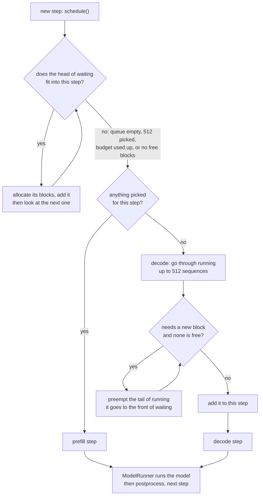

# 02 · How does the scheduler choose prefill or decode, and when does it preempt?

> Project: nano-vllm @ [`bb823b3`](https://github.com/GeeeekExplorer/nano-vllm/commit/bb823b3e06983d71485a8e1f23715ebd87d98ef8) · Written: 2026-10-12 · Status: draft

## Question

How does the scheduler choose prefill or decode, and when does it preempt?

## Short answer

Every step, [`schedule()`](https://github.com/GeeeekExplorer/nano-vllm/blob/bb823b3e06983d71485a8e1f23715ebd87d98ef8/nanovllm/engine/scheduler.py#L25-L73) first tries to build a prefill step from the head of the waiting queue, in arrival order, until the queue is empty, 512 sequences are picked, the token budget of 16,384 is used up, or the free blocks run out. Only if it picked nothing does it build a decode step for up to 512 running sequences. A decode step needs a new block for a sequence whose next K/V starts a new block; if none is free, the scheduler preempts the most recently admitted sequence, which drops its K/V and goes back to the front of the waiting queue. After the model runs, `postprocess` records the new tokens and frees the sequences that finished.

## How it works

### 1. Prefill first

Prefill and decode are never mixed in one step, and prefill always gets the first try:



### 2. Who gets into a prefill step

The prefill half ([L30-L52](https://github.com/GeeeekExplorer/nano-vllm/blob/bb823b3e06983d71485a8e1f23715ebd87d98ef8/nanovllm/engine/scheduler.py#L30-L52)) looks at the head of the waiting queue, one sequence at a time:

1. **Prefix cache and free blocks.** `can_allocate` counts how many leading blocks of the prompt are already in the cache, and returns -1 if there are not enough free blocks for the rest ([Note 03](03-block-manager-and-prefix-cache.md)). On -1, the loop stops.
2. **Tokens to compute** = the prompt minus the cached blocks.
3. **Does it fit the budget?** If the tokens do not fit in what is left of the 16,384-token budget and this is not the first sequence of the step, the loop stops ([L42](https://github.com/GeeeekExplorer/nano-vllm/blob/bb823b3e06983d71485a8e1f23715ebd87d98ef8/nanovllm/engine/scheduler.py#L42)). Only the first sequence may be split: it computes as many tokens as the budget allows and continues in the next step (chunked prefill).
4. **Allocate** its blocks, set `num_scheduled_tokens`. If the whole prompt is scheduled, the sequence moves to the running queue; a split one stays at the head of the waiting queue.

An example from the scheduler simulation, with `max_model_len` raised so that long prompts are allowed. Three prompts of 10,000, 8,000 and 300 tokens:

| Step | Scheduled | Why |
|---|---|---|
| 1 | first: 10,000 | The second needs 8,000; only 6,384 are left and it is not first, so the loop stops. It is not split |
| 2 | second: 8,000, third: 300 | Both fit |

With a 20,000-token first prompt instead:

| Step | Scheduled | Why |
|---|---|---|
| 1 | first: 16,384 | The first sequence is split to fill the budget; nothing is left for anyone else |
| 2 | first: 3,616, second: 8,000, third: 300 | 11,916 tokens in total, within the budget |

The split sequence still produces a token in step 1: the LM head takes the last position of every sequence in the step ([Note 04](04-model-runner-and-cuda-graph.md)). `postprocess` throws that token away, because the prompt is not finished (section 5).

A consequence of "only the first may be split": with the default settings, chunked prefill never happens. `max_model_len` is 4096 and the budget is 16,384, and the first sequence of a step always sees the whole budget. It only happens to prompts longer than 16,384 tokens, which `max_model_len` is meant to rule out but which nothing checks ([#190](issues/190-cuda-graph-block-tables.md)).

### 3. The decode step

The decode half ([L57-L73](https://github.com/GeeeekExplorer/nano-vllm/blob/bb823b3e06983d71485a8e1f23715ebd87d98ef8/nanovllm/engine/scheduler.py#L57-L73)) takes sequences from the front of the running queue, up to 512. Each computes one token: the one sampled in the previous step, whose K/V is not in the cache yet. If that token is the first of a new block, which happens when `len(seq) % 256 == 1`, the sequence needs one more block ([`can_append` / `may_append`](https://github.com/GeeeekExplorer/nano-vllm/blob/bb823b3e06983d71485a8e1f23715ebd87d98ef8/nanovllm/engine/block_manager.py#L103-L108)). At the end, the scheduled sequences go back to the front of the running queue in their original order.

A detail I found while testing: the limit of 512 applies per step, not to the running queue. Prefill only counts the sequences picked in the current step, so if the cache has room, more than 512 sequences end up running. Decode always takes the first 512, so the others hold their blocks and wait until some of the first ones finish. In [experiment 001](../../experiments/001-preemption-1000-requests/) with 2048 blocks, all 1000 requests get in, the last 488 do not decode at all, and they are the ones preempted when the first 512 need more blocks. Open PR [#271](https://github.com/GeeeekExplorer/nano-vllm/pull/271) proposes counting the running sequences when admitting new ones.

### 4. Preemption

When a sequence needs a block and none is free ([L60-L64](https://github.com/GeeeekExplorer/nano-vllm/blob/bb823b3e06983d71485a8e1f23715ebd87d98ef8/nanovllm/engine/scheduler.py#L60-L64)):

- The scheduler preempts the tail of the running queue: the most recently admitted sequence. If the sequence that needs the block is the only one left, it preempts that one.
- [`preempt`](https://github.com/GeeeekExplorer/nano-vllm/blob/bb823b3e06983d71485a8e1f23715ebd87d98ef8/nanovllm/engine/scheduler.py#L75-L79) sets it back to `WAITING`, returns its blocks, and puts it at the **front** of the waiting queue. Its K/V is gone, but its tokens, including the ones it generated, are kept.
- **The current step stays a decode step**; the remaining sequences use the freed blocks.
- **The next step** tries prefill first, and the preempted sequence is at the head of the queue. If its blocks fit, it comes back and recomputes its prompt and generated tokens together. If its old blocks have not been handed out yet, the prefix cache can save part of that ([Note 03](03-block-manager-and-prefix-cache.md)).

A small example, checked in the scheduler simulation. The cache has 4 blocks. A (prompt 300, 300 tokens to generate) and B (prompt 200, 300 tokens) arrive together, A first.

| Step | What happens | Blocks |
|---|---|---|
| 1 | Prefill both | A: 0, 1; B: 2; free: 3 |
| 58 | B reaches length 257 and needs a second block | B takes 3; nothing free |
| 214 | A reaches length 513 and needs a third block. B is preempted; this step runs A alone | B's blocks return as 3, then 2; A takes 3 |
| 215–300 | Prefill is tried every step; B (413 tokens) needs 2 blocks and 1 is free | A finishes at step 300, length 600 |
| 301 | B comes back. Block 2 still holds its first 256 tokens, so only 157 tokens are computed | B: 2, 3 |
| 387 | B finishes, length 500 | |

### 5. Postprocess

[`postprocess`](https://github.com/GeeeekExplorer/nano-vllm/blob/bb823b3e06983d71485a8e1f23715ebd87d98ef8/nanovllm/engine/scheduler.py#L81-L92), for each sequence of the step:

```python
self.block_manager.hash_blocks(seq)                       # register blocks that just became full
seq.num_cached_tokens += seq.num_scheduled_tokens         # these tokens now have K/V in the cache
seq.num_scheduled_tokens = 0
if is_prefill and seq.num_cached_tokens < seq.num_tokens:
    continue                                              # a split prompt: drop the sampled token
seq.append_token(token_id)
if (not seq.ignore_eos and token_id == self.eos) or seq.num_completion_tokens == seq.max_tokens:
    ...                                                   # FINISHED, return its blocks
```

### 6. A worked example: 1000 requests in 1024 blocks

[Experiment 001](../../experiments/001-preemption-1000-requests/) runs the real scheduler without a model: 1000 requests of 500 prompt tokens and 300 generated tokens, 1024 blocks.

- Steps 1–16 are all prefill, 32 sequences per step (32 × 500 = 16,000 tokens), until 512 sequences hold all 1024 blocks.
- Steps 17–28 decode those 512.
- At step 29 every sequence reaches length 513 and needs a third block. 171 are preempted, each freeing 2 blocks for two others.
- At step 285 they need a fourth block: 85 more are preempted.
- At step 315 the remaining 256 finish together, and the preempted sequences come back first.

The whole run takes 1030 steps with 569 preemptions, and prefills 840,950 tokens for 500,000 tokens of prompts.

### 7. Design choices

- **Prefill first.** New requests get their first token sooner (time to first token), but every prefill step pauses all running sequences (time per output token). In experiment 001, steps 359–363 are prefill, and 228 sequences that were decoding wait five steps.
- **No mixed steps.** A step is all prefill or all decode, which keeps the model runner simple: prefill is always eager, decode can use CUDA graphs.
- **Admit first, preempt later.** nano-vllm admits a request as soon as its prompt fits and preempts if the cache runs out while decoding. Preempted requests are recomputed, not swapped to CPU memory.
- **First come, first served.** A request that can never fit blocks everyone behind it, and preempting itself does not help ([#274](issues/274-kv-cache-exhausted-assert.md)).

## Code map

| File and function | Role |
|---|---|
| [`scheduler.py`](https://github.com/GeeeekExplorer/nano-vllm/blob/bb823b3e06983d71485a8e1f23715ebd87d98ef8/nanovllm/engine/scheduler.py) `schedule` | Prefill half, then decode half |
| `scheduler.py` `preempt` | Back to waiting, blocks returned |
| `scheduler.py` `postprocess` | Counters, tokens, finished sequences |
| [`block_manager.py`](https://github.com/GeeeekExplorer/nano-vllm/blob/bb823b3e06983d71485a8e1f23715ebd87d98ef8/nanovllm/engine/block_manager.py) `can_allocate`, `allocate`, `can_append`, `may_append`, `deallocate` | What the scheduler asks the block manager |

## How I checked

- [Experiment 001](../../experiments/001-preemption-1000-requests/): the real scheduler with a fake model, 1000 requests, three cache sizes.
- The two small examples above (the three long prompts, and A and B in 4 blocks) were run through the same kind of simulation; the steps and numbers in the tables are its output.

## Compared with other engines

- **mini-sglang reserves instead of preempting.** A request is admitted only if its prompt plus `max_tokens` fits in the cache ([prefill.py L47-L50](https://github.com/sgl-project/mini-sglang/blob/9a91cfafe754aa85daee49998176275667eb58f2/python/minisgl/scheduler/prefill.py#L47-L50)), so it never has to preempt, at the cost of reserving memory that may not be used if a request stops early.
- **mini-sglang is also prefill first**, with a TODO to support other policies ([scheduler.py L219-L224](https://github.com/sgl-project/mini-sglang/blob/9a91cfafe754aa85daee49998176275667eb58f2/python/minisgl/scheduler/scheduler.py#L219-L224)).
- SGLang and vLLM can mix prefill and decode in one step; I have not read that code yet. [QA-scheduling](QA-scheduling.md) part 6 (in Chinese) compares the four engines as far as I know them.

## Open questions

- How large are the pauses that prefill-first causes for running sequences on a real GPU, in milliseconds rather than steps?
- What would nano-vllm need to mix prefill and decode in one step?

## References

- [QA-scheduling](QA-scheduling.md) (in Chinese): the scheduler step by step, with the #208 and #219 case study
- [#274 write-up](issues/274-kv-cache-exhausted-assert.md): what happens when a request can never fit
