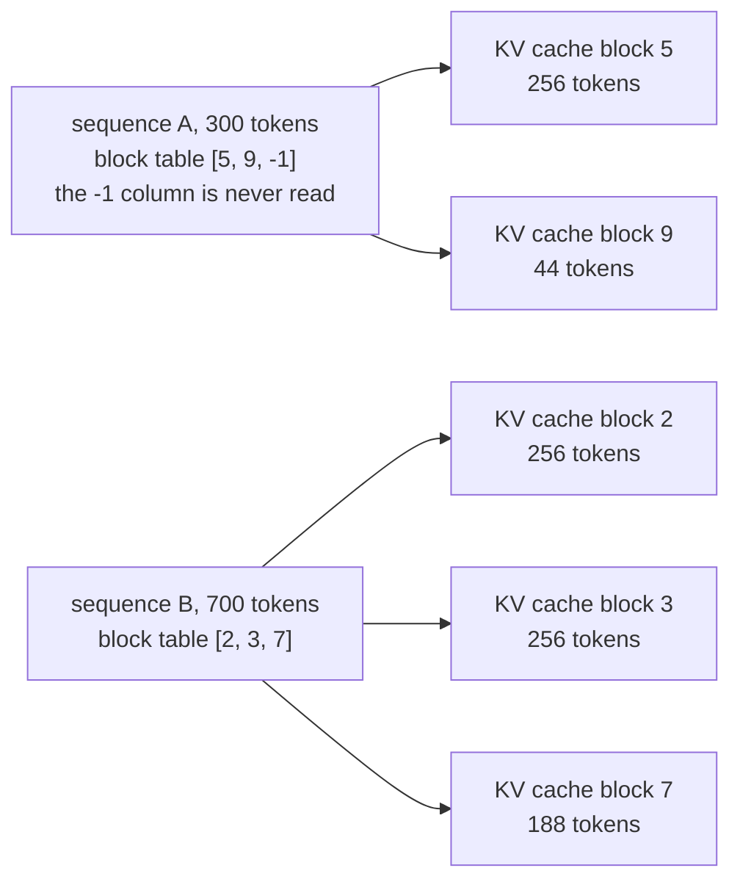

# 03 · How are KV cache blocks allocated, shared by prefix hash, and freed?

> Project: nano-vllm @ [`bb823b3`](https://github.com/GeeeekExplorer/nano-vllm/commit/bb823b3e06983d71485a8e1f23715ebd87d98ef8) · Written: 2026-10-12 · Status: draft

## Question

How are KV cache blocks allocated, shared by prefix hash, and freed?

## Short answer

The [`BlockManager`](https://github.com/GeeeekExplorer/nano-vllm/blob/bb823b3e06983d71485a8e1f23715ebd87d98ef8/nanovllm/engine/block_manager.py) hands out ids of 256-token blocks and keeps the books: a queue of free blocks, a reference count per block, and a hash table from "this exact prefix" to the block that holds it. A block is registered in the hash table once it is full, and its hash includes the previous block's hash, so a lookup only matches a prefix that is identical from the first token. A new request reuses the blocks that match instead of computing them: its prefill runs only the uncached tokens and reads the rest of the K/V from the cache. Freeing is lazy: a freed block keeps its content and its hash until it is handed out again, so later requests, even a preempted request coming back, can still hit it.

## How it works

### 1. The books

| Structure | What it holds |
|---|---|
| `blocks` | One `Block` per id: `ref_count` (how many sequences use it), `hash` (-1 until registered), `token_ids` (to confirm a hash match) |
| `free_block_ids` | A queue: new blocks are taken from the front, freed blocks go to the back |
| `used_block_ids` | The blocks some sequence is using |
| `hash_to_block_id` | The prefix cache: chained hash of a full block → its id |

The block manager never touches GPU memory. A block id is just a position: block `b` is the 256 slots starting at `b × 256` in every layer's K and V cache tensors. The model runner turns block ids into those slot numbers ([Note 04](04-model-runner-and-cuda-graph.md)).

### 2. Block tables point into one big tensor

Each sequence has a block table, the list of its block ids in order. In a decode step, the tables of all sequences are padded with -1 to the same width:



Attention also receives each sequence's length and stops reading there, so a -1 is never used as a block id ([Note 04](04-model-runner-and-cuda-graph.md)).

### 3. Prefix hashing

- **Chained hashes.** [`compute_hash`](https://github.com/GeeeekExplorer/nano-vllm/blob/bb823b3e06983d71485a8e1f23715ebd87d98ef8/nanovllm/engine/block_manager.py#L35-L41) hashes a block's 256 token ids together with the previous block's hash. Block 3 of one prompt can only match block 3 of another if blocks 0 to 3 are all identical.
- **Only full blocks are registered**, and only after the step that filled them: [`hash_blocks`](https://github.com/GeeeekExplorer/nano-vllm/blob/bb823b3e06983d71485a8e1f23715ebd87d98ef8/nanovllm/engine/block_manager.py#L110-L120) runs in `postprocess`. After a 500-token prefill, block 0 is registered and block 1, with 244 tokens, is not; it is registered later, in the decode step that writes its 256th token.
- **Lookup** happens once, when a request is admitted: [`can_allocate`](https://github.com/GeeeekExplorer/nano-vllm/blob/bb823b3e06983d71485a8e1f23715ebd87d98ef8/nanovllm/engine/block_manager.py#L58-L73) walks the prompt's blocks from the start, looks up each chained hash, compares the token ids to rule out a collision, and stops at the first miss. It checks only the first `num_blocks - 1` blocks, so the last block is always computed: at least the last prompt token has to go through the model to produce the logits for the next token.
- **Allocation** ([`allocate`](https://github.com/GeeeekExplorer/nano-vllm/blob/bb823b3e06983d71485a8e1f23715ebd87d98ef8/nanovllm/engine/block_manager.py#L75-L92)): a hit block that another sequence is using gets `ref_count + 1`; a hit block that sits in the free queue is taken back out of it; every other block is a new one from the front of the free queue. `num_cached_tokens` is set to the number of hit blocks × 256.

### 4. A prefix hit skips the computation

Take two requests with the same 600-token prompt, where the second arrives after the first has finished. In the scheduler simulation, the second one hits 2 blocks (512 tokens) and its prefill step computes 88 tokens. Its third block is not a hit: it is never checked (only the first `num_blocks - 1 = 2` are), and the first request's third block also holds generated tokens, so its content differs anyway.

The 512 cached tokens do not go through the model at all in that step. Every layer works on 88 tokens:

| What | Without a hit | With 2 blocks hit | Code |
|---|---|---|---|
| Tokens to compute | 600 | 600 − 2 × 256 = 88 | [scheduler.py L39](https://github.com/GeeeekExplorer/nano-vllm/blob/bb823b3e06983d71485a8e1f23715ebd87d98ef8/nanovllm/engine/scheduler.py#L39) |
| `input_ids`, `positions` | 600 tokens, positions 0–599 | 88 tokens, positions 512–599 | [model_runner.py L139-L144](https://github.com/GeeeekExplorer/nano-vllm/blob/bb823b3e06983d71485a8e1f23715ebd87d98ef8/nanovllm/engine/model_runner.py#L139-L144) |
| `cu_seqlens_q` / `cu_seqlens_k` | [0, 600] / [0, 600] | [0, 88] / [0, 600] | [L145-L146](https://github.com/GeeeekExplorer/nano-vllm/blob/bb823b3e06983d71485a8e1f23715ebd87d98ef8/nanovllm/engine/model_runner.py#L145-L146) |
| `slot_mapping` | 600 slots | 88 slots, all in the third block | [L151-L161](https://github.com/GeeeekExplorer/nano-vllm/blob/bb823b3e06983d71485a8e1f23715ebd87d98ef8/nanovllm/engine/model_runner.py#L151-L161) |
| `block_tables` | not passed | passed | [L162-L163](https://github.com/GeeeekExplorer/nano-vllm/blob/bb823b3e06983d71485a8e1f23715ebd87d98ef8/nanovllm/engine/model_runner.py#L162-L163) |
| K and V in attention | the ones just computed | the 88 new ones are written to the cache first, then all 600 are read from the cache | [attention.py L63-L70](https://github.com/GeeeekExplorer/nano-vllm/blob/bb823b3e06983d71485a8e1f23715ebd87d98ef8/nanovllm/layers/attention.py#L63-L70) |

The cached tokens can be skipped because later tokens need only one thing from earlier ones: their K and V in each layer, read by attention. The earlier tokens' hidden states and MLP outputs are never used by later tokens. K is stored after the rotary embedding, so the cached K are ready to use. The model work for this prefill is about 88 / 600 of a cache miss.

### 5. Freeing is lazy

[`deallocate`](https://github.com/GeeeekExplorer/nano-vllm/blob/bb823b3e06983d71485a8e1f23715ebd87d98ef8/nanovllm/engine/block_manager.py#L94-L101) goes through the sequence's blocks from last to first and lowers each `ref_count`; a block that reaches 0 goes to the back of the free queue ([`_deallocate_block`](https://github.com/GeeeekExplorer/nano-vllm/blob/bb823b3e06983d71485a8e1f23715ebd87d98ef8/nanovllm/engine/block_manager.py#L53-L56)). The sequence's own block table is cleared. The block's content and its hash table entry stay.

They are dropped only when the block is handed out as a new block, in [`_allocate_block`](https://github.com/GeeeekExplorer/nano-vllm/blob/bb823b3e06983d71485a8e1f23715ebd87d98ef8/nanovllm/engine/block_manager.py#L43-L51):

```python
block_id = self.free_block_ids.popleft()                  # the oldest free block
...
if block.hash != -1 and self.hash_to_block_id.get(block.hash) == block_id:
    del self.hash_to_block_id[block.hash]                 # only now is the hash dropped
block.reset()                                             # its content will be overwritten
```

Because freed blocks go to the back of the queue and new ones come from the front, a freed block survives as long as possible. Two consequences:

- A finished request's prefix stays reusable until its blocks reach the front of the free queue.
- A preempted request can hit its own old blocks when it comes back. In the 4-block example of [Note 02](02-scheduler.md#4-preemption), B is preempted with 413 tokens and blocks [2, 3]. They return as 3, then 2, and A takes 3. Block 2, B's first 256 tokens, stays in the free queue with its hash, so when B comes back it computes 157 tokens instead of 413.

### 6. When sharing fails within one step

Hashes are registered after the step, so two requests with the same prompt in the same prefill step cannot see each other: each computes its own copy, and the hash table keeps the second copy. The earlier code registered at allocation instead, which let the second request reuse blocks the first had not computed yet. Why that still gave correct results in nano-vllm, and what each choice costs, is in the [#219 write-up](issues/219-same-step-prefix-sharing.md).

## Code map

| File and function | Role |
|---|---|
| [`block_manager.py`](https://github.com/GeeeekExplorer/nano-vllm/blob/bb823b3e06983d71485a8e1f23715ebd87d98ef8/nanovllm/engine/block_manager.py) `Block` | `ref_count`, `hash`, `token_ids` |
| `compute_hash` | Chained hash of one block |
| `can_allocate`, `allocate` | Prefix lookup at admission; take hit blocks and new blocks |
| `can_append`, `may_append` | One more block in a decode step |
| `hash_blocks` | Register blocks that just became full |
| `deallocate`, `_deallocate_block` | Lower `ref_count`, return to the free queue |
| `_allocate_block` | Hand out a block; drop its old hash |

## How I checked

- In the scheduler simulation: the second of two identical 600-token prompts, after the first has finished, gets `num_cached_tokens = 512`, computes 88 tokens, and has block table [0, 1, 4].
- The preemption example in [Note 02](02-scheduler.md#4-preemption): B comes back with 256 cached tokens and computes 157.
- [#219](issues/219-same-step-prefix-sharing.md): sharing within one step, on the scheduler and on the real engine.

## Compared with other engines

mini-sglang keeps its prefix cache in a radix tree with one token per page, so a prefix can match at any token, not only at block boundaries, and unfinished requests are inserted too ([QA-kv-cache](../mini-sglang/QA-kv-cache.md), in Chinese).

## Open questions

- A fully cached prompt whose length is a multiple of 256 still recomputes its whole last block, because only the first `num_blocks - 1` blocks are looked up. Recomputing just the last token would save up to 255 tokens per request; how much code would that take?

## References

- [QA-scheduling](QA-scheduling.md) (in Chinese): parts 3 to 5, block by block
- [#219 write-up](issues/219-same-step-prefix-sharing.md)
