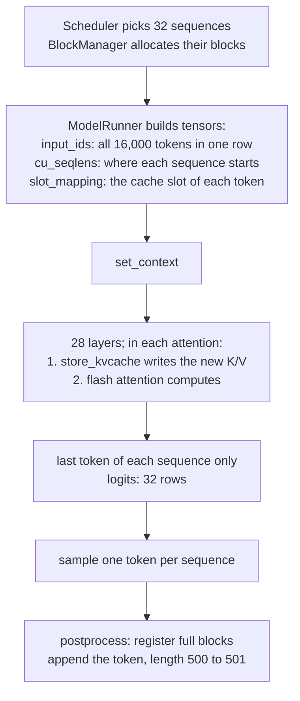

# 04 · What does ModelRunner prepare for each step, and where is CUDA Graph used?

> Project: nano-vllm @ [`bb823b3`](https://github.com/GeeeekExplorer/nano-vllm/commit/bb823b3e06983d71485a8e1f23715ebd87d98ef8) · Written: 2026-10-12 · Status: draft

## Question

What does ModelRunner prepare for each step, and where is CUDA Graph used?

## Short answer

At startup, the model runner runs the largest possible prefill once to measure peak memory, gives the rest of the GPU to one KV cache tensor that it slices per layer, and records one CUDA graph per decode batch size. Each step, it flattens the scheduled sequences into a few tensors: token ids, positions, where each sequence starts (`cu_seqlens`), the cache slot of every new token (`slot_mapping`), and block tables. The last three reach the attention layers through a module-level context. In every layer, attention first writes the new tokens' K/V into the cache, then reads what it needs. Prefill always runs eagerly; a decode step copies its values into the recorded graph's fixed buffers and replays the graph.

## How it works

### 1. Startup

[`ModelRunner.__init__`](https://github.com/GeeeekExplorer/nano-vllm/blob/bb823b3e06983d71485a8e1f23715ebd87d98ef8/nanovllm/engine/model_runner.py#L17-L48), in order:

| Step | What | Why |
|---|---|---|
| 1 | Set up the process group, pick the GPU, make bf16 and CUDA the defaults | Everything created next lives on the GPU |
| 2 | Build Qwen3 and load the weights | |
| 3 | [`warmup_model`](https://github.com/GeeeekExplorer/nano-vllm/blob/bb823b3e06983d71485a8e1f23715ebd87d98ef8/nanovllm/engine/model_runner.py#L91-L101): one prefill of 4 sequences × 4096 tokens = 16,384 tokens, the largest step the scheduler can produce | Measures the peak memory of a step; also triggers the first `torch.compile` and Triton compilations |
| 4 | [`allocate_kv_cache`](https://github.com/GeeeekExplorer/nano-vllm/blob/bb823b3e06983d71485a8e1f23715ebd87d98ef8/nanovllm/engine/model_runner.py#L103-L121): block count = (total × 0.9 − used − (peak − current)) ÷ bytes per block. One tensor `[2, layers, blocks, 256, KV heads, head_dim]`; layer i's attention gets `kv_cache[0, i]` as its K cache and `kv_cache[1, i]` as its V cache | The addresses never change after this ([KV cache sizing](../fundamentals/01-kv-cache-sizing.md)) |
| 5 | [`capture_cudagraph`](https://github.com/GeeeekExplorer/nano-vllm/blob/bb823b3e06983d71485a8e1f23715ebd87d98ef8/nanovllm/engine/model_runner.py#L223-L257), unless `enforce_eager` | Section 6 |

The scheduler is created only after the model runner ([llm_engine.py L31-L34](https://github.com/GeeeekExplorer/nano-vllm/blob/bb823b3e06983d71485a8e1f23715ebd87d98ef8/nanovllm/engine/llm_engine.py#L31-L34)), because its block manager needs the block count from step 4.

### 2. Preparing a prefill step

[`prepare_prefill`](https://github.com/GeeeekExplorer/nano-vllm/blob/bb823b3e06983d71485a8e1f23715ebd87d98ef8/nanovllm/engine/model_runner.py#L129-L170) takes, for each sequence, the tokens from `num_cached_tokens` to `num_cached_tokens + num_scheduled_tokens`. With 32 new 500-token prompts:

| Tensor | Example | Used by |
|---|---|---|
| `input_ids` | the 32 prompts concatenated: 16,000 tokens in one row | the model |
| `positions` | `[0..499, 0..499, ...]` | rotary embedding |
| `cu_seqlens_q`, `cu_seqlens_k` | `[0, 500, 1000, ..., 16000]`: where each sequence starts in the row. They differ when part of a prompt is cached: k then counts the cached tokens too | flash attention, to keep sequences apart |
| `slot_mapping` | the cache slot of every new token, `block id × 256 + offset`. First prompt with blocks [0, 1]: 0–255, 256–499; second with [2, 3]: 512–767, 768–1011 | `store_kvcache` |
| `block_tables` | only when some prompt has cached blocks | flash attention, to read the cached K/V |

### 3. Preparing a decode step

[`prepare_decode`](https://github.com/GeeeekExplorer/nano-vllm/blob/bb823b3e06983d71485a8e1f23715ebd87d98ef8/nanovllm/engine/model_runner.py#L172-L188) feeds one token per sequence. Two sequences: A with 300 tokens and blocks [5, 9], B with 700 tokens and blocks [2, 3, 7]:

| Tensor | Value | Meaning |
|---|---|---|
| `input_ids` | the last token of A and of B | the tokens sampled in the previous step |
| `positions` | `[299, 699]` | |
| `slot_mapping` | `[9×256 + 43, 7×256 + 187]` | where this token's K/V goes |
| `context_lens` | `[300, 700]` | how much history each sequence has, this token included |
| `block_tables` | `[[5, 9, -1], [2, 3, 7]]` | padded with -1 to the same width; the only padding in the step |

### 4. Inside attention: write, then read

[`Attention.forward`](https://github.com/GeeeekExplorer/nano-vllm/blob/bb823b3e06983d71485a8e1f23715ebd87d98ef8/nanovllm/layers/attention.py#L59-L75) first calls `store_kvcache`, which writes the K/V of this step's tokens into the slots in `slot_mapping`, and then calls flash attention: `flash_attn_varlen_func` for prefill, `flash_attn_with_kvcache` for decode.

**`store_kvcache_kernel`** ([L10-L30](https://github.com/GeeeekExplorer/nano-vllm/blob/bb823b3e06983d71485a8e1f23715ebd87d98ef8/nanovllm/layers/attention.py#L10-L30)) is the only hand-written kernel in nano-vllm, a few lines of Triton:

- One program per token. It reads the token's slot, returns if the slot is -1, and copies one row of K and one row of V (8 KV heads × 128 = 1024 values, 2 KB each in bf16) into that slot. It only moves data.
- The -1 check is the reason to write a kernel. In plain PyTorch, `k_cache[slot_mapping] = key` treats -1 as "the last row" (I checked on a small tensor), so a padding row would overwrite the last slot of the cache. Filtering the -1 out first gives a tensor whose length the CPU only knows after the GPU computes it, which forces a sync and cannot be recorded in a CUDA graph.
- K and V get separate strides. V is not changed after the QKV projection, so it is still a view into that projection's output, where consecutive tokens are 4096 values apart (q 2048 + k 1024 + v 1024). The kernel reads it in place instead of copying it first.
- `tl.arange(0, D)` requires D to be a power of 2 (Triton rejects other ranges), which holds for 1024.

**How flash attention handles rows of different lengths.** The inputs are regular tensors; the lengths and the block lookups are data. In decode, `flash_attn_with_kvcache` gets the whole K cache `[blocks, 256, 8, 128]`, the padded block table, and `cache_seqlens = context_lens`. In flash-attn 2.8.3:

1. The GPU launches one group of threads (a thread block) per sequence and KV head, and per split when the sequence dimension is split ([launch template L107](https://github.com/Dao-AILab/flash-attention/blob/v2.8.3/csrc/flash_attn/src/flash_fwd_launch_template.h#L107)).
2. Each reads its own sequence length from `cache_seqlens` ([block_info.h L23-L24](https://github.com/Dao-AILab/flash-attention/blob/v2.8.3/csrc/flash_attn/src/block_info.h#L23-L24)) and works out how many 128-token tiles to process ([flash_fwd_kernel.h L532](https://github.com/Dao-AILab/flash-attention/blob/v2.8.3/csrc/flash_attn/src/flash_fwd_kernel.h#L532)).
3. For each tile, it looks up the block in the block table and computes the address: block id × block stride + offset in the block ([L585-L590](https://github.com/Dao-AILab/flash-attention/blob/v2.8.3/csrc/flash_attn/src/flash_fwd_kernel.h#L585-L590)).
4. In the last, partly filled tile, it loads only the valid rows and masks the rest ([L873-L875](https://github.com/Dao-AILab/flash-attention/blob/v2.8.3/csrc/flash_attn/src/flash_fwd_kernel.h#L873-L875), [L889](https://github.com/Dao-AILab/flash-attention/blob/v2.8.3/csrc/flash_attn/src/flash_fwd_kernel.h#L889)).

Sequence A (300 tokens) needs 3 tiles: tokens 0–255 in block 5, 256–299 in block 9. The third column of its table (the -1) would be needed only for token 512 and beyond, so it is never read. A row with length 0, such as a CUDA graph padding row, exits at once ([L537-L540](https://github.com/Dao-AILab/flash-attention/blob/v2.8.3/csrc/flash_attn/src/flash_fwd_kernel.h#L537-L540)). Prefill works the same way with `cu_seqlens`: each thread block finds its sequence's start in the concatenated row.

### 5. Only the last token gets logits; sampling

- In prefill, the LM head keeps only the last position of each sequence, `cu_seqlens_q[1:] - 1` ([embed_head.py L56-L60](https://github.com/GeeeekExplorer/nano-vllm/blob/bb823b3e06983d71485a8e1f23715ebd87d98ef8/nanovllm/layers/embed_head.py#L56-L60)): 32 rows of logits for 16,000 tokens. A prompt split by chunked prefill also gets a row; `postprocess` drops its token ([Note 02](02-scheduler.md)).
- The [sampler](https://github.com/GeeeekExplorer/nano-vllm/blob/bb823b3e06983d71485a8e1f23715ebd87d98ef8/nanovllm/layers/sampler.py) divides the logits by the temperature, takes the softmax, divides each probability by a random draw from an exponential distribution, and takes the argmax. That picks token i with probability p_i, in one expression with no branches. A temperature of 0 would divide by zero, so `SamplingParams` rejects it ([sampling_params.py L10-L11](https://github.com/GeeeekExplorer/nano-vllm/blob/bb823b3e06983d71485a8e1f23715ebd87d98ef8/nanovllm/sampling_params.py#L10-L11)).

### 6. CUDA Graph

Decode steps are many small kernels: with one sequence, a step launches 394 kernels and one copy ([#190](issues/190-cuda-graph-block-tables.md#inside-a-recorded-graph)), and launching them one by one from Python takes a large share of the step. A CUDA graph records the whole sequence of launches once, with their arguments and buffer addresses, and replays it with one call.

**What is recorded** ([`capture_cudagraph`](https://github.com/GeeeekExplorer/nano-vllm/blob/bb823b3e06983d71485a8e1f23715ebd87d98ef8/nanovllm/engine/model_runner.py#L223-L257)):

- One graph per batch size: 1, 2, 4, 8, then every multiple of 16 up to 512, 36 graphs in all ([L234](https://github.com/GeeeekExplorer/nano-vllm/blob/bb823b3e06983d71485a8e1f23715ebd87d98ef8/nanovllm/engine/model_runner.py#L234)). They are recorded from the largest down and share one memory pool.
- Fixed input buffers sized for 512 sequences: `input_ids`, `positions`, `slot_mapping`, `context_lens`, and `block_tables` of 512 × 16, because `max_model_len` 4096 ÷ 256 = 16 blocks. The last hidden states go to an `outputs` buffer.

**What happens in a decode step** ([`run_model`](https://github.com/GeeeekExplorer/nano-vllm/blob/bb823b3e06983d71485a8e1f23715ebd87d98ef8/nanovllm/engine/model_runner.py#L196-L212)): with 100 sequences, it picks the 112 graph, fills `slot_mapping` with -1 and `context_lens` with 0, copies the 100 real rows over them, replays, and passes `outputs[:100]` to the LM head. The 12 extra rows write nothing (slot -1) and read nothing (length 0).

**What is fixed and what changes.** The graph fixes which kernels run, how each is launched, and which addresses it reads and writes; so the shapes are fixed too, 112 rows and 16 columns. Each step changes only the values in the buffers. The next step, where every sequence is one token longer and one has a new block, is the same graph with new values; the kernels read lengths and block ids from memory when they run.

**When the graph is not used, or breaks:**

- Prefill is always eager, and so is decode with more than 512 sequences or with `enforce_eager` ([L197](https://github.com/GeeeekExplorer/nano-vllm/blob/bb823b3e06983d71485a8e1f23715ebd87d98ef8/nanovllm/engine/model_runner.py#L197)).
- A sequence longer than `max_model_len` needs a 17th block column, and copying its table into the 16-column buffer fails. Nothing stops a sequence from getting there: [#190](issues/190-cuda-graph-block-tables.md).

### 7. Where the kernels come from

The scheduler, the block manager and the list building in `prepare_*` run on the CPU and launch no kernels; `.cuda()` is a copy. The kernels come from the model and the sampler, from four sources. Numbers refer to the 14 kernels of each layer in a batch-1 decode graph ([#190](issues/190-cuda-graph-block-tables.md#inside-a-recorded-graph)):

| Source | In the code | Kernels of a layer |
|---|---|---|
| PyTorch, backed by cuBLAS | the projections in `linear.py`, the embedding, the LM head | 2, 10, 12, 14: the four projections |
| Triton kernels generated by `torch.compile` | the five `@torch.compile` functions: two RMSNorms, rotary embedding, SiLU-and-multiply, sampler | 1, 3, 4, 11 (RMSNorm), 5, 6 (rotary), 13 (SiLU and multiply); the sampler runs outside the graph |
| flash-attn, compiled CUDA | [attention.py L67](https://github.com/GeeeekExplorer/nano-vllm/blob/bb823b3e06983d71485a8e1f23715ebd87d98ef8/nanovllm/layers/attention.py#L67) (prefill), [L72](https://github.com/GeeeekExplorer/nano-vllm/blob/bb823b3e06983d71485a8e1f23715ebd87d98ef8/nanovllm/layers/attention.py#L72) (decode) | 8, 9: split attention and combine |
| Hand-written Triton | `store_kvcache_kernel` | 7 |

### 8. With more than one GPU

Each GPU runs its own model runner with half of every attention and MLP weight and the K/V of half the KV heads; the scheduler stays in the main process. See [Parallelism](../fundamentals/04-parallelism.md).

## Code map

| File and function | Role |
|---|---|
| [`model_runner.py`](https://github.com/GeeeekExplorer/nano-vllm/blob/bb823b3e06983d71485a8e1f23715ebd87d98ef8/nanovllm/engine/model_runner.py) `__init__`, `warmup_model`, `allocate_kv_cache` | Startup and KV cache sizing |
| `prepare_prefill`, `prepare_decode`, `prepare_block_tables`, `prepare_sample` | Sequences to tensors |
| `run_model`, `run` | Eager or graph; sampling |
| `capture_cudagraph` | Recording the decode graphs |
| [`attention.py`](https://github.com/GeeeekExplorer/nano-vllm/blob/bb823b3e06983d71485a8e1f23715ebd87d98ef8/nanovllm/layers/attention.py) `store_kvcache_kernel`, `Attention.forward` | Write K/V, then flash attention |
| [`embed_head.py`](https://github.com/GeeeekExplorer/nano-vllm/blob/bb823b3e06983d71485a8e1f23715ebd87d98ef8/nanovllm/layers/embed_head.py) `ParallelLMHead.forward` | Logits for the last token of each sequence |
| [`sampler.py`](https://github.com/GeeeekExplorer/nano-vllm/blob/bb823b3e06983d71485a8e1f23715ebd87d98ef8/nanovllm/layers/sampler.py) | Temperature sampling |
| [`utils/context.py`](https://github.com/GeeeekExplorer/nano-vllm/blob/bb823b3e06983d71485a8e1f23715ebd87d98ef8/nanovllm/utils/context.py) | Per-step data for the layers |

## How I checked

- Dumped the recorded decode graphs for batch sizes 1 and 16 while working on [#190](issues/190-cuda-graph-block-tables.md#inside-a-recorded-graph), and mapped every kernel to a line of the model.
- Checked on a small tensor that indexing with -1 writes the last row.
- Read the flash-attn 2.8.3 source for the paged KV path (links in section 4).
- Not measured yet: how much faster a decode step is with the graph than without it.

## Compared with other engines

mini-sglang uses FlashInfer instead of flash-attn, with a page size of 1, and writes K/V with its own CUDA kernel, one warp per token ([QA-kv-cache](../mini-sglang/QA-kv-cache.md), in Chinese).

## Open questions

- How much time does the CUDA graph save per decode step on my laptop, and how does that change with the batch size?

## References

- [#190 write-up](issues/190-cuda-graph-block-tables.md): what a recorded graph contains, and why a sequence past `max_model_len` breaks it
- [QA-cuda-graph](QA-cuda-graph.md) (in Chinese)
- [#170 write-up](issues/170-rmsnorm-fp32-residual.md): the RMSNorm kernels
