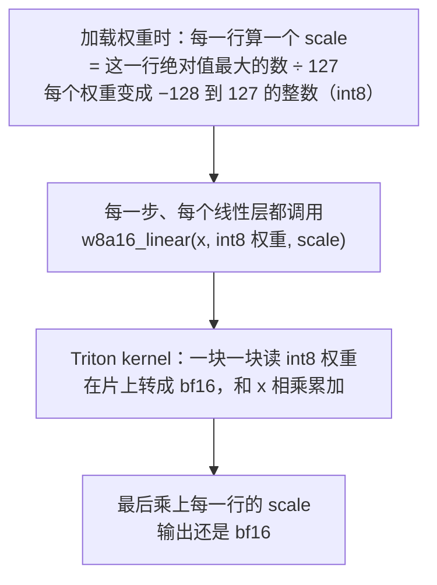

# nano-vllm 问答：INT8 量化（PR #281）

测试 [PR #281](https://github.com/GeeeekExplorer/nano-vllm/pull/281)（W8A16 量化，带一个自己写的 Triton kernel）时问过的问题和答案，用中文写，方便自己复习。代码对应 main [`bb823b3`](https://github.com/GeeeekExplorer/nano-vllm/commit/bb823b3e06983d71485a8e1f23715ebd87d98ef8) 和 PR 的 `c3b7110`。2026-10-14 整理。脚本和原始数据在 [实验 002](../../experiments/002-int8-weight-only-pr281/)，英文总结在 [#281 write-up](issues/281-int8-weight-only-quantization.md)。

**结论先说**

- PR 把每个线性层的权重压成 int8，用自己写的 Triton kernel 来乘。在我的 Windows + RTX 4060 笔记本上能跑，kernel 本身算得和 bf16 一样准；量化带来的误差大约是 bf16 舍入误差的 5 倍。
- 权重省了 413 MiB，nano-vllm 把它变成了 17 个 KV block（163 → 180）。
- 端到端基本打平：43.30 s 对 43.98 s，在波动范围里。PR 说的 +7.3% 没复现出来。
- 拆开看：decode 快了 2.2 s，主要是因为 block 多了、抢占少了、batch 大了；prefill 慢了 1.5 s，几乎全在开头两个 16k token 的大步里，PR 的 kernel 在那里比 cuBLAS 慢一倍。
- prefill 和 decode 必须放在一起看：同一个优化，换一个负载，结论可能反过来。

**目录**

1. 全局：这个 PR 做了什么
2. 术语
3. 显存：为什么 block 从 163 变成 180
4. 输出对不对
5. kernel 的代码：一步一步在算什么
6. 只测 kernel
7. 端到端：时间花在哪了
8. 我的理解和纠正
   1. 8.1 · KV cache 的 block 为什么不一样
   2. 8.1 · 峰值是不是也变少了很多
   3. 8.2 · M 是 batch 里最长的那个序列吗
   4. 8.2 · M 小受带宽限制、M 大受算力限制，对吗
   5. 8.2 · 那几个误差是什么意思
   6. 8.3 · PR 说的 +7% 怎么理解
   7. 8.3 · 难道我没有用这个 kernel 吗

---

## 1. 全局：这个 PR 做了什么



| | bf16（main） | int8（PR） |
|---|---|---|
| 线性层的权重 | 每个数 2 字节 | 每个数 1 字节，每行再加一个 fp32 的 scale |
| 怎么乘 | `F.linear`，交给 cuBLAS | PR 的 Triton kernel |
| 被量化的层 | | 每层的 qkv、o、gate_up、down |
| 没被量化的 | | embedding、LM head（和 embedding 共用同一份权重）、RMSNorm |
| 激活值（每一步算出来的中间结果） | bf16 | 还是 bf16 |

为什么这样能变快：decode 每一步都要把所有权重从显存读一遍，M 小的时候，时间几乎全花在读权重上，权重小一半，读的时间就少一半。M 大的时候时间花在乘加上，省一半的权重字节就没用了，比的是谁算得快（第 6 部分）。

## 2. 术语

| 词 | 意思 |
|---|---|
| W8A16 | 权重（weight）8 位，激活（activation）16 位 |
| scale | 每一行权重一个缩放系数。int8 的整数乘上 scale，就还原成原来的数（有误差） |
| 反量化 | 把 int8 权重乘上 scale，还原成 bf16 |
| 融合 kernel | 反量化和乘法在同一个 kernel 里做：int8 权重只从显存读一次，在片上转换完马上用 |
| M | 这一步一共有多少个 token，也就是线性层输入 x 的行数。decode 时等于 batch 大小，prefill 时等于这一步所有 prompt 的 token 总数（6.1） |
| 受带宽限制（memory-bound） | 时间主要花在从显存搬数据上 |
| 受算力限制（compute-bound） | 时间主要花在乘加计算上 |
| 线程块、SM | kernel 把活分成很多线程块；GPU 有若干个 SM（这张卡 24 个），每个 SM 同时跑线程块。线程块比 SM 少，就有 SM 闲着 |
| used / reserved / current / peak | 显存的四个数，见 3.1 |
| GB/s、TFLOPS | 每秒搬了多少数据、每秒做了多少万亿次运算 |

## 3. 显存：为什么 block 从 163 变成 180

### 3.1 公式和四个数

开 KV cache 时，block 数是这样算的（Note 04）：

```
block 数 = (总显存 × 0.9 − used − (peak − current)) ÷ 28 MiB
```

这几个数都是在开 KV cache 之前那一刻取的：

| 数 | 怎么来的 | 含义 |
|---|---|---|
| `used` | `torch.cuda.mem_get_info()`：总显存 − 空闲 | **驱动看到的**：整张卡已经被占用的，包括 CUDA 上下文、加载的 kernel 代码、PyTorch 缓存着的、别的程序占的 |
| `reserved` | `torch.cuda.memory_reserved()` | PyTorch 向驱动要来、自己管着的显存（有的分给了张量，有的空着缓存起来） |
| `current` | `memory_stats()["allocated_bytes.all.current"]` | **PyTorch 看到的**：此刻还活着的张量占多少，这时基本就是权重 |
| `peak` | `memory_stats()["allocated_bytes.all.peak"]` | warmup 那次 16384 token 的 prefill 期间，活着的张量最多时占多少 = 权重 + 最大一步的临时显存 |

### 3.2 代进去

| | used | reserved | current | peak | peak − current | 算出来 | 实际 |
|---|---|---|---|---|---|---|---|
| bf16 | 2346 | 1234 | 1165 | 1613 | 448 | (8188 × 0.9 − 2346 − 448) ÷ 28 = 163.4 | 163 |
| int8 | 1872 | 760 | 752 | 1201 | 449 | (8188 × 0.9 − 1872 − 449) ÷ 28 = 180.3 | 180 |

（单位 MiB，总显存 8188 MiB。）

### 3.3 `current` 里装的是什么

| 内容 | bf16 | int8 |
|---|---|---|
| embedding 151936 × 1024（和 LM head 共用） | 296.8 | 296.8（没量化） |
| 28 层线性层，一共 4.4 亿个参数 | 840.0 | 420.0，加 scale 1.3 |
| 位置编码的 cos/sin 表：40960 个位置 × 128，fp32 | 20.0 | 20.0 |
| RMSNorm | 0.1 | 0.1 |
| 合计 | 1156.9 | 738.2 |
| 实测 | 1165 | 752 |

小发现：cos/sin 表是按模型支持的 40960 个位置建的，但 `max_model_len` 只有 4096，有 18 MiB 永远用不到。

### 3.4 `peak − current` 是什么

就是 warmup 那次 16384 token 的 prefill 跑到 MLP 时，同时活着的几个大张量：gate_up 的输出 16384 × 6144 × 2 字节 = 192 MiB，SiLU 之后 96 MiB，进 MLP 的 hidden、residual、down 的输出各 32 MiB，加起来约 384 MiB，再加零碎的约 448。int8 只量化权重，激活还是 bf16，所以这一项两边几乎一样。

### 3.5 多出来的 17 个 block 从哪来

- 权重少了 413 MiB（current 1165 → 752），按 28 MiB 一个 block 算是 15 个。
- 另外 61 MiB：`used − reserved`（PyTorch 以外的部分）两边都是 1112 MiB，一点没变；变的是 `reserved − current`，也就是 PyTorch 缓存着、但没分给任何张量的显存，bf16 是 69 MiB，int8 是 8 MiB。公式把这部分也算进了 `used`，所以 bf16 少开了 2 个 block。

（一开始我猜这 61 MiB 是 cuBLAS 少加载了一些 kernel 代码，打印 `reserved` 之后发现猜错了。）

## 4. 输出对不对

### 4.1 greedy 第 45 个 token 分叉

同一个 600 token 的 prompt（#190 笔记 Background 那一节），把采样换成 argmax，生成 64 个 token：

- main 和 PR 不开量化：64 个 token 一模一样。
- PR 开 int8：前 44 个一样，第 45 个开始不同。bf16 写 "The number of operations is **395**"，int8 写 "is **42**"。分叉点在一个数字上，前面那个空格两边还是一样的。

### 4.2 三种误差

同一个输入 x，算四个结果：

| | 怎么算 | 是什么 |
|---|---|---|
| A | 原来的 bf16 权重，fp32 精确地算 | 标准答案 |
| B | 原来的 bf16 权重，`F.linear` | nano-vllm 现在的做法 |
| C | int8 权重，PR 的 kernel | PR 的做法 |
| D | int8 权重，fp32 精确地算 | "假如 kernel 一点舍入都没有" |

相对误差 = 两个结果的差 ÷ 正确答案的大小，1.7e-3 就是 0.17%。

| 比较 | 结果 | 说明什么 |
|---|---|---|
| B 和 A：bf16 自己的舍入 | 0.17% | bf16 只有大约 3 位有效数字，乘加时一路舍入，现在的 nano-vllm 本来就有 |
| C 和 D：kernel 自身 | 0.17% | 和 bf16 的舍入一样大：kernel 写得没问题 |
| C 和 A：量化带来的 | 0.8% | 权重压成 int8 引入的，是舍入误差的 5 倍左右 |

量化误差从哪来：某一行最大的权重是 0.08，scale = 0.08 ÷ 127 ≈ 0.00063，这一行的权重只能取 0.00063 的整数倍。0.01234 ÷ 0.00063 ≈ 19.6，变成 20，还原回来 0.0126，差了 2%；同一个数存成 bf16 最多差约 0.2%。小的权重损失大；一行上千个误差加起来会互相抵消一部分，输出差约 0.8%（随机权重上测的，真实权重里有特别大的值，可能更差）。

### 4.3 为什么"第几个 token 分叉"不是好的衡量

[#219](issues/219-same-step-prefix-sharing.md) 用的是同一个 prompt：在 bf16 里光是换了 attention 的计算路径或者 prefill 的 token 数，第 13 或 22 个 token 就分叉了。分叉点主要取决于什么时候碰上两个候选分数很接近的位置，说明不了 int8 差多少。更好的办法是 teacher forcing：同一段文字两边都只做 prefill，比每一个位置的 top-1 和 logits（没做）。

## 5. kernel 的代码：一步一步在算什么

代码在 PR 的 [`nanovllm/layers/w8a16_gemm.py`](https://github.com/AliMizan/nano-vllm/blob/c3b7110a57ab603048774d1b52a434670f92d3ed/nanovllm/layers/w8a16_gemm.py)，一共 97 行：前 51 行是在 GPU 上跑的 kernel，后面是调用它的 Python 函数。它就是 [QA-cuda-graph](QA-cuda-graph.md) "GPU kernel"那一节里第 3、5、6 小节讲的东西：朴素矩阵乘 → 分块 + shared memory → 用 Triton 按块来写。新的地方只有三处：读 int8、在片上转成 bf16、最后乘 scale。

### 5.1 它算的是什么

就是线性层 `y = x · Wᵀ`，只不过权重存成了 int8。以 qkv 这一层为例：

| | 形状 | 类型 |
|---|---|---|
| x（这一步的输入） | [M, 1024] | bf16 |
| W（权重） | [4096, 1024] | **int8** |
| scale（每一行权重一个） | [4096] | fp32 |
| y（输出） | [M, 4096] | bf16 |

输出的每一个数：

```
y[m, n] = Σ_k  x[m, k] · W真[n, k]          W真 ≈ q[n, k] · scale[n]
        ≈ scale[n] · Σ_k  x[m, k] · q[n, k]
```

q 是存下来的 int8 整数。**scale[n] 对这一行所有的 k 都一样，所以可以提到求和号外面**：先把整数和 x 乘完、加完，最后乘一次 scale。整个 kernel 就是围绕这个式子写的。

### 5.2 先不管 GPU：用 4 个数走一遍

x = [1, 2, 3, 4]，两行权重，用 PR 自己的量化函数算出来：

| | 原来的权重 W | scale | 存下来的 q（int8） | 还原回来 q × scale |
|---|---|---|---|---|
| 第 0 行 | [0.5, −0.25, 1.0, 0.0] | 1.0 ÷ 127 = 0.007874 | [64, −32, 127, 0] | [0.50394, −0.25197, 1.0, 0.0] |
| 第 1 行 | [0.1, 0.2, −0.3, 0.4] | 0.4 ÷ 127 = 0.00315 | [32, 64, −95, 127] | [0.10079, 0.20157, −0.29921, 0.4] |

kernel 不会一次把所有的 k 加完，而是沿着 k **分段累加**。这里假设每段 2 个（真实的 kernel 每段 64 个）：

| | 第 0 行的累加器 | 第 1 行的累加器 |
|---|---|---|
| 开始 | 0 | 0 |
| 第 1 段（k = 0, 1） | 1×64 + 2×(−32) = **0** | 1×32 + 2×64 = **160** |
| 第 2 段（k = 2, 3） | 0 + 3×127 + 4×0 = **381** | 160 + 3×(−95) + 4×127 = **383** |
| 最后乘 scale | 381 × 0.007874 = **3.0** | 383 × 0.00315 = **1.2063** |
| 精确答案（原来的权重） | 3.0 | 1.2 |

- **分段累加就是 kernel 里那个 `for` 循环**（5.4），每段 `BLOCK_K = 64` 个，K = 1024 时循环 16 轮。
- **scale 只在最后乘一次**。第 1 行差的 0.0063 就是量化误差：0.1 被存成了 0.10079（4.2）。

### 5.3 怎么分活：一个 program 算输出的一小块

Triton 的代码写的是**一个 program**（也就是 CUDA 里的一个线程块）要干的活，`grid` 决定启动多少个 program。这个 kernel 的分法是：**把输出 y [M, N] 切成 `BLOCK_M × BLOCK_N` 的小块，一个 program 负责一块。**

[第 75–82 行](https://github.com/AliMizan/nano-vllm/blob/c3b7110a57ab603048774d1b52a434670f92d3ed/nanovllm/layers/w8a16_gemm.py#L75-L82)：

```python
if M <= 64:
    BM, BN, BK = 16, 64, 64          # decode：每块 16 行 × 64 列
else:
    BM, BN, BK = 64, 64, 64          # prefill：每块 64 行 × 64 列
grid = (triton.cdiv(M, BM), triton.cdiv(N, BN))   # 行方向几块 × 列方向几块
```

| 情况 | M | N | 分块 | grid | program 数 |
|---|---|---|---|---|---|
| qkv，decode 1 个序列 | 1 | 4096 | 16 × 64 | (1, 64) | 64 |
| qkv，decode 64 个序列 | 64 | 4096 | 16 × 64 | (4, 64) | 256 |
| qkv，prefill 16384 个 token | 16384 | 4096 | 64 × 64 | (256, 64) | 16384 |
| **o_proj，decode 1 个序列** | 1 | **1024** | 16 × 64 | (1, **16**) | **16** |

最后一行就是 o 和 down 不快的原因（6.4）：只有 16 个 program，而这张卡有 24 个 SM。

### 5.4 一个 program 里在做什么（第 22–51 行）

拿 **qkv、decode 1 个序列（M = 1）、编号 (0, 5) 的 program** 走一遍。它负责输出 y 的第 0–15 行、第 320–383 列。

**第 22–27 行：算出自己负责哪些行、哪些列**

```python
pid_m = tl.program_id(0)                               # 0
pid_n = tl.program_id(1)                               # 5
offs_m = pid_m * BLOCK_M + tl.arange(0, BLOCK_M)       # [0, 1, ..., 15]
offs_n = pid_n * BLOCK_N + tl.arange(0, BLOCK_N)       # [320, 321, ..., 383]
offs_k = tl.arange(0, BLOCK_K)                         # [0, 1, ..., 63]，第 1 段的 k
```

`tl.arange` 生成一整串数。Triton 里的变量都是"一整块"，不是单个数，这是它和 CUDA 写法最大的区别。

**第 29–30 行：算出要读的地址（一整块地址）**

```python
a_ptrs = a_ptr + offs_m[:, None] * stride_am + offs_k[None, :] * stride_ak    # 16 × 64 个地址
b_ptrs = b_ptr + offs_k[:, None] * stride_bk + offs_n[None, :] * stride_bn    # 64 × 64 个地址
```

`[:, None]` 和 `[None, :]` 是 numpy 那样的广播：一列加一行，得到一张二维表。传进来的 stride（第 87–88 行）：

| | 形状 | 下一行隔多少个数 | 下一列隔多少个数 |
|---|---|---|---|
| x | [M, 1024] | `stride_am = 1024` | `stride_ak = 1` |
| W | [4096, 1024] | `stride_bn = 1024` | `stride_bk = 1` |

- `a_ptrs[i][j]` 指向 x[第 i 行, 第 j 个 k]：一块 16 × 64 的 x。
- `b_ptrs[k][j]` 指向 W[第 320+j 行, 第 k 个 k]。摆法是 **[k, n]**，也就是 Wᵀ 的一块。

公式要的是 Wᵀ，但**不用真的转置**：W 在显存里原样不动，读的时候把两个 stride 对调着用，读出来的这一块自然就是转置过的。

**第 32 行：准备累加器**

```python
acc = tl.zeros((BLOCK_M, BLOCK_N), dtype=tl.float32)     # 16 × 64 个 0，在寄存器里，fp32
```

就是 5.2 表格里的"累加器"，这里有 16 × 64 个，每个对应一个输出。用 fp32 累加，1024 个数加下来误差不会越滚越大。

**第 34–44 行：沿着 k 分段累加，1024 ÷ 64 = 16 轮**

```python
for _ in range(0, tl.cdiv(K, BLOCK_K)):                          # 16 轮
    a_mask = (offs_m[:, None] < M) & (offs_k[None, :] < K)        # 哪些位置是真的
    b_mask = (offs_k[:, None] < K) & (offs_n[None, :] < N)
    a = tl.load(a_ptrs, mask=a_mask, other=0.0)                   # 读 16×64 的 x（bf16）
    b_int8 = tl.load(b_ptrs, mask=b_mask, other=0)                # 读 64×64 的 W（int8，4 KB）
    acc += tl.dot(a, b_int8.to(a.dtype))                          # int8 → bf16，矩阵乘，加到 acc
    a_ptrs += BLOCK_K * stride_ak                                 # 两块地址都往后挪 64 个 k
    b_ptrs += BLOCK_K * stride_bk
    offs_k += BLOCK_K
```

| 代码 | 在做什么 |
|---|---|
| mask | M = 1 时 `offs_m < M` 只有第 0 行为真，第 1–15 行读进来的都是 0.0，乘出来也是 0。K = 1024、N = 4096 都是 64 的倍数，k 和 n 方向全为真 |
| `tl.load` | 一次读一整块：每轮读 64 个 x（另外 15 行是 0）和 64 × 64 = 4096 个 int8 权重 |
| `b_int8.to(a.dtype)` | 在片上把 int8 转成 bf16。**这一步是精确的**：−128 到 127 的整数 bf16 都能一点不差地表示（−37 → −37.0；要到 257 这种数 bf16 才会变成 256，int8 碰不到）。精度只在当初压成 int8 时损失过一次 |
| `tl.dot` | [16 × 64] · [64 × 64] = [16 × 64]，加进 acc，在这张卡上用 Tensor Core 算。就是分块矩阵乘里"小块乘小块"那一步，Triton 帮你写好了 |
| 最后三行 | 把读的位置往后挪 64 个 k，进入下一轮 |

16 轮之后 `acc[0][j] = Σ_{k=0}^{1023} x[0, k] · q[320+j, k]`，就是 5.2 表格里的 381、383。

**第 46–47 行：乘 scale**

```python
scale = tl.load(scale_ptr + offs_n, mask=offs_n < N, other=1.0).to(tl.float32)   # 第 320–383 行的 64 个 scale
acc *= scale[None, :]                                                            # 每一列乘自己的 scale
```

对应 5.2 最后的 "× 0.007874"：每个输出只乘一次，而不是每个权重乘一次（1024 次）。

**第 49–51 行：写回去**

```python
c_ptrs = c_ptr + offs_m[:, None] * stride_cm + offs_n[None, :] * stride_cn
c_mask = (offs_m[:, None] < M) & (offs_n[None, :] < N)
tl.store(c_ptrs, acc.to(c_ptr.dtype.element_ty), mask=c_mask)                  # fp32 → bf16，只写第 0 行
```

第 1–15 行被 mask 挡掉，不会写。

**这一个 program 一共从显存读了多少**：W 的 64 列 × 1024 个 k × 1 字节 = 64 KB，加上 x 的一行 2 KB。64 个 program 加起来，正好把 4 MiB 的 int8 权重完整读一遍；bf16 要读 8 MiB。所以 decode 时 qkv 能快将近一倍。

### 5.5 外面那层 Python 函数（第 54–97 行）

| 行 | 做什么 |
|---|---|
| 60–64 | 把 x 拉成二维 [M, K]，拿到 M、N |
| 66–68 | scale 从 [N, 1] 拉成 [N]，转成 fp32 |
| 70 | 开一块输出 c [M, N]，bf16 |
| 75–80 | 按 M 选一组分块参数：M ≤ 64 用 16×64×64、`num_stages=3`；M > 64 用 64×64×64、`num_stages=4`。两组都是 `num_warps=4`，即每个 program 128 个线程，和 #190 的 graph 里 `store_kvcache_kernel` 的 `<<<…,128,…>>>` 是同一个数 |
| 82 | grid（5.3） |
| 84–92 | 启动 kernel：张量变成显存地址传进去，再传尺寸和 stride。`BLOCK_M/N/K` 是 `tl.constexpr`，编译时就固定了，所以两组参数会编出两个不同的 kernel |
| 94–95 | 有 bias 就单独加上（Qwen3 没有 bias） |
| 97 | 变回原来的形状 |

`num_stages` 是"提前读"：算第 r 轮的时候，第 r+1 轮（甚至 r+2 轮）的 x 块和 W 块已经在往片上的 shared memory 里搬了，计算不用干等数据。stage 越多越不容易等，占的 shared memory 也越多。

### 5.6 和测到的性能对上

| 现象（第 6 部分） | 在代码里的原因 |
|---|---|
| decode 时 qkv、gate_up 快 1.5–1.85 倍 | 每个 program 只读 int8 的 W，所有 program 加起来正好读一遍，字节数是 bf16 的一半 |
| o、down 不快 | N = 1024 时只有 16 个 program（5.3），少于 24 个 SM；每个还要串行跑 K ÷ 64 = 32 或 48 轮 |
| M = 1 时浪费 15 行 | 一块固定 16 行，`tl.dot` 照样算 16 行（mask 只是把它们变成 0）。M = 1 时时间花在读权重上，多算的这点几乎不要钱 |
| M = 16384 时比 cuBLAS 慢一倍 | 64 × 64 的块偏小：每读进来一个 x，只在这块的 64 列里各用一次；每读进来一个 W，只在 64 行里各用一次。块越大，读一次能用的次数越多，cuBLAS 在这张卡上用的是更大的块。每一轮还要多做一次 int8 → bf16 的转换。（推测，没用 profiler 验证） |

### 5.7 自测（还没答）

1. qkv 层、M = 100 时：用哪一组分块？grid 是多少？最后一个行块里有几行被 mask 挡掉？
2. scale 能等到循环结束再乘，是因为它对同一行的所有 k 都一样。如果换成每一**列**（每个 k）一个 scale，还能这样做吗？（提示：看求和号里什么在变）
3. o_proj、M = 1 时，如果把 `BLOCK_N` 从 64 改成 16，会有多少个 program？每个要循环几轮？
4. 第 30 行为什么不需要先把 W 转置一遍？

## 6. 只测 kernel

### 6.1 M 是什么

M 不是 batch 里最长的序列，是**这一步所有序列的 token 加起来的总数**。nano-vllm 把这一步所有 token 拼成一长条送进线性层，x 一共 M 行；线性层不关心哪一行属于哪个序列。

| 这一步 | M |
|---|---|
| decode，3 个序列，长度 300、700、50 | 3 |
| decode，64 个序列 | 64 |
| prefill，32 个 500 token 的 prompt | 16000 |
| warmup | 16384（每步预算的上限） |

### 6.2 三种算法，以及为什么要测第三种

| 方法 | 权重怎么存 | 怎么算 |
|---|---|---|
| bf16 | bf16 | `F.linear`（cuBLAS），基准 |
| int8（PR） | int8 | 融合 kernel：读 int8，片上转 bf16，马上乘 |
| 先反量化再乘 | int8 | 不写新 kernel：先还原出一份完整的 bf16 权重写回显存，再 `F.linear` |

第三种和 PR 一样省显存，区别只在有没有自己写 kernel：int8 对比它，看融合值不值；它对比 bf16，看每次还原的代价。结果：M=1 时它比 bf16 慢将近 4 倍（权重要来回搬好几遍），所以**不融合的话，int8 在 decode 时反而比不量化还慢**；M=16384 时它只比 bf16 慢 3% 左右，比 PR 的 kernel 快一倍。

### 6.3 M 小受带宽限制，M 大受算力限制

用 qkv 这一层（权重 4096 × 1024）算：

| | M = 1 | M = 16384 |
|---|---|---|
| 要搬的数据 | 权重 8 MiB，x 和 y 加起来不到 0.01 MiB | 8 + 32 + 128 = 168 MiB |
| 要做的乘加 | 840 万次 | 1374 亿次 |
| 时间花在 | 读权重 | 算：按 17 TFLOPS 要 8 ms，搬数据只要 1–2 ms |

bf16 那一列也能直接看出来：M 从 1 到 64，时间几乎不变（77.8 → 85.0 us），工作量翻了 64 倍，时间却没涨；M 从 1024 往上，M 每翻 4 倍时间也翻 4 倍（486 → 1928 → 8058 us），TFLOPS 稳在 17 左右。分界线大约在 M = 128 到 256。

### 6.4 decode：o 和 down 为什么不快

| M=1 | int8 快几倍 | int8 跑到的带宽 |
|---|---|---|
| qkv（N=4096） | 1.85 | 101 GB/s |
| gate_up（N=6144） | 1.54 | 101 GB/s |
| o（N=1024） | 0.97 | 51 GB/s |
| down（N=1024） | 0.98 | 49 GB/s |

M ≤ 64 时，kernel 把输出切成 16 × 64 的小块，一块一个线程块。o 和 down 的 N 只有 1024，只有 16 个线程块，而这张卡有 24 个 SM，三分之一闲着；每个线程块还要沿 K（2048、3072）串行算 32 到 48 轮。cuBLAS 会把 K 也切开、开更多线程块，所以一直能到 100 GB/s 左右。（这是从代码推出来的，没改代码验证。）

### 6.5 prefill：大 M 慢一倍

M=16384 时 cuBLAS 稳在 16–18 TFLOPS，PR 的 kernel 掉到 7–9，慢一倍。cuBLAS 用的是针对这张卡调好的大分块；PR 的 kernel 只有一档固定的 64 × 64 × 64，循环里还要多做一次 int8 → bf16 的转换。另外我猜相邻线程块没有复用输入（Triton 官方 matmul 教程里有 `GROUP_SIZE_M` 这一步），没验证。

### 6.6 28 层线性层合计（每一步）

| M | bf16（ms） | int8（ms） | bf16 / int8 |
|---|---|---|---|
| 1 | 7.77 | 5.88 | 1.32 |
| 8 | 7.48 | 6.26 | 1.19 |
| 16 | 7.86 | 6.25 | 1.26 |
| 32 | 7.91 | 6.35 | 1.25 |
| 64 | 8.52 | 7.08 | 1.20 |
| 128 | 9.86 | 9.29 | 1.06 |
| 256 | 16.49 | 16.40 | 1.01 |
| 1024 | 53.00 | 57.98 | 0.91 |
| 2048 | 107.46 | 123.83 | 0.87 |
| 4096 | 211.96 | 253.73 | 0.84 |
| 16384 | 858.10 | 1770.51 | 0.48 |

M=2017（不是 16 的倍数）和 2048 一样快，所以 M 是不是 16 的倍数不影响速度。

## 7. 端到端：时间花在哪了

### 7.1 这个负载

PR 的 `bench.py`：64 个请求同时进来，prompt 一共 34,428 个 token，要生成 38,443 个。全部生成完一共要 314 个 block，而这张卡 bf16 只有 163 个、int8 有 180 个，所以两边都会抢占。

总时间 = prefill + decode。int8 让 decode 快、prefill 慢，又让 block 多、抢占少。PR 只报了一个总数，要知道是哪一部分起的作用，就得拆开量。

### 7.2 拆开的结果（三次平均）

| | main bf16 | PR bf16 | PR int8 |
|---|---|---|---|
| 总时间 | 43.98 s（43.34–44.73） | 44.56 s | **43.30 s**（42.73–44.02） |
| prefill | 4.47 s，26 步，52,438 个 token | 4.54 s | **5.96 s**，20 步，48,572 个 |
| decode | 39.41 s，1492 步 | 39.90 s | **37.25 s**，1233 步 |
| 抢占 | 34 次 | 34 | **24** |
| 抢占后重算的 token | 18,010 | 18,010 | 14,144 |

调度只取决于 token 数，所以三次 bf16 的步数、抢占次数完全一样，变的只有时间。同一个配置两次之间差了 1.4 s（3%），int8 快的那 1.5% 在这个范围里。

### 7.3 decode 省的时间从哪来

int8 每一步平均反而慢（26.4 → 30.2 ms），省下的时间来自**步数少了 17%**：多了 17 个 block，抢占 34 → 24 次，同时在跑的序列更多，平均每步从 25.7 个序列变成 31.1 个。

| batch | main | int8 | |
|---|---|---|---|
| 1–8 | 11.47 ms | 9.64 ms | 快 16%（kernel 的功劳） |
| 9–16 | 19.87 | 18.12 | 快 9% |
| 17–32 | 31.27 | 32.08 | 慢 3% |
| 33–64 | 37.27 | 41.60 | 慢 12% |

batch 大时 int8 反而慢，我的猜测：这时一步的时间主要花在 attention 读 KV 上，int8 不让 KV 变小；int8 的 cache 更大，同时在跑的上下文更多，每步要读的 KV 也更多。没验证。

### 7.4 prefill 为什么多了 1.5 s

"平均每步约 2000 个 token"把分布藏起来了。用调度器把同一个负载重放一遍（步数、抢占和真实运行完全一样）：

| | 前两步 | 其余的步 |
|---|---|---|
| bf16 | 15,705 和 16,364 个 token | 24 步，每步 31–2,359 个 |
| int8 | 同样的两步 | 18 步，每步 176–2,359 个 |

64 个请求一起进来，前两步塞满了每步 16384 的预算；之后都是被抢的序列回来、零星的新请求。把每一步的 M 代进 6.6 的表：bf16 的线性层一共约 2.78 s，int8 约 4.43 s，差 1.65 s，实测差 1.49 s。两个大步就占了约 1.8 s。

### 7.5 完整的账

| | 变化 | 原因 |
|---|---|---|
| prefill | +1.49 s | 两个 16k token 的大步，kernel 比 cuBLAS 慢一倍 |
| decode | −2.16 s | 主要是 block 多了、步数少了；小 batch 每步快 9–16% |
| 合计 | −0.68 s | 在波动范围里 |

PR 的 +7%：作者的 4070 上 block 从 98 变 115（+17%），这里是 163 → 180（+10%）。他那边更缺 KV cache，多出的 block 能少掉更多抢占，所以那 +7% 多半来自"block 变多"，而不是 kernel 变快。

如果大 M 时改走"先反量化再交给 cuBLAS"，只有那两个大步会换路，估算总时间约 41.4 s，比 main 快约 6%（没验证；临时的 bf16 权重还会抬高 warmup 的峰值，可能少一两个 block）。

## 8. 我的理解和纠正

### 8.1 显存

#### 1. KV cache 的 block 为什么不一样

**背景**：同一个脚本跑三次，main 和 PR 不开量化都是 163 个 block，PR 开 int8 变成 180 个。

**我答**："kv cache 的 block 居然不一样？有点神奇。"

**正确答案**：block 数 = (总显存 × 0.9 − used − (peak − current)) ÷ 28 MiB，`used` 里包括权重。int8 让权重少了 413 MiB，剩给 KV cache 的就多了，约 15 个 block；PyTorch 缓存着没用的显存又少了 61 MiB，再多 2 个，一共 17 个（3.5）。

#### 2. 峰值是不是也变少了很多

**背景**：打印出来 bf16 是 `peak=1613 current=1165`，int8 是 `peak=1201 current=752`。

**我答**："确实模型变小了，然后峰值也变少了很多。"

**正确答案**：peak 少的 412 MiB 几乎全是权重（current 少了 413）。真正的"临时显存" `peak − current` 两边是 448 和 449 MiB，没变，因为激活还是 bf16（3.4）。

### 8.2 只测 kernel

#### 3. M 是 batch 里最长的那个序列吗

**背景**：kernel 单测按 M = 1、16、64……16384 分别计时。

**我答**："M 我怎么理解？是当前 batch 里面的最长 token 吗？"

**正确答案**：不是最长，是这一步所有序列的 token **加起来**。decode 3 个序列（长 300、700、50）时 M = 3；prefill 32 个 500 token 的 prompt 时 M = 16000（6.1）。

#### 4. M 小受带宽限制、M 大受算力限制，对吗

**背景**：int8 在 M 小时快、M 大时慢。

**我答**："M 小的时候是 memory bound，M 大的时候是 compute bound？"

**正确答案**：对。M=1 时 qkv 要搬 8 MiB、只算 840 万次，时间花在读权重上；M=16384 时要算 1374 亿次，时间花在乘加上。bf16 的时间从 M=1 到 64 几乎不变，从 1024 往上和 M 成正比；分界线在 128 到 256 之间（6.3）。

#### 5. 那几个误差是什么意思

**背景**：kernel 单测每个形状打印三个误差：kernel 自身 1.7e-3、量化带来的 8e-3、bf16 自己的舍入 1.7e-3。

**我答**："你这里面说的这些误差是什么意思？看不明白。"

**正确答案**：都是相对误差（差 ÷ 正确答案的大小）。kernel 自身：同样的 int8 权重，kernel 和精确计算比，0.17%，和 bf16 舍入一样，说明 kernel 没问题；量化带来的：int8 kernel 和原来 bf16 权重的精确结果比，0.8%，是舍入的 5 倍（4.2）。

### 8.3 端到端

#### 6. PR 说的 +7% 怎么理解

**背景**：我说"+7% 是 decode 赚的减去 prefill 亏的"。

**我答**："什么意思？看不懂。"

**正确答案**：PR 只测了一个总时间。总时间 = prefill + decode：int8 让 decode 变快、prefill 变慢，又让 block 变多、抢占变少。+7% 是这几样相抵之后剩下的，换一个负载可能就反过来。拆开量才知道：这里 decode −2.2 s、prefill +1.5 s，合计基本打平（7.5）。我的感想：prefill 和 decode 要放在一起考虑才行。

#### 7. 难道我没有用这个 kernel 吗

**背景**：我建议"把一个分支加进 PR 的 kernel"，让大 M 时改走"先反量化再交给 cuBLAS"。

**我答**："什么意思？难道我没有用这个 kernel 吗？？"

**正确答案**：一直在用。开了 int8 以后，不管 M 多大，每个线性层都走 PR 的 Triton kernel。建议是改 PR 的代码：M 大时**不用**这个 kernel。

| 哪种步 | M | 现在 | 改了以后 |
|---|---|---|---|
| decode | 1–64 | Triton kernel | 不变 |
| 小 prefill | ≤ 2359 | Triton kernel | 不变 |
| 开头两个大 prefill | 约 16k | Triton kernel（慢一倍） | 先反量化，再用 cuBLAS |
