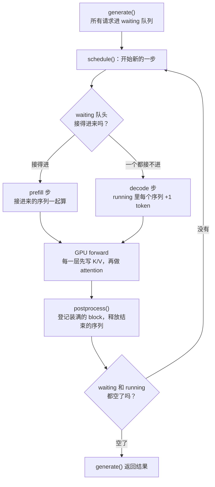
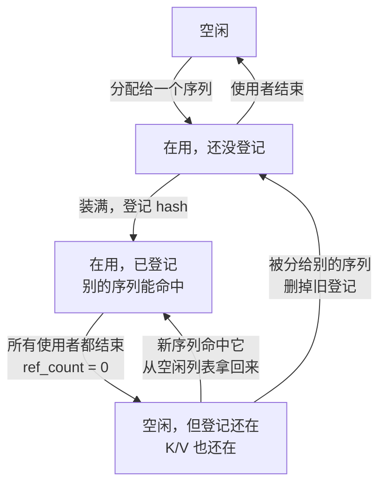

# nano-vllm 问答：调度和 prefix cache

读 nano-vllm [#219](https://github.com/GeeeekExplorer/nano-vllm/issues/219) 和 [#208](https://github.com/GeeeekExplorer/nano-vllm/issues/208) 时，我问过的问题和答案。这两个 issue 讲的是 prefix cache 里一个很小的细节，可要看懂它，得先弄清调度器每一步在做什么、block 怎么被共享、命中以后怎么算。问着问着就延伸到了调度器的整体设计：continuous batching、预留和抢占、prefill 和 decode 要不要放在同一步。

用中文写，方便自己复习。代码都对应 upstream [`bb823b3`](https://github.com/GeeeekExplorer/nano-vllm/tree/bb823b3e06983d71485a8e1f23715ebd87d98ef8)；“旧版”指 #218 合并之前的 `f64d821~1`（[`44a51af`](https://github.com/GeeeekExplorer/nano-vllm/tree/44a51afc8a7f60e75ce3f4ee94632430eff9de65)）。2026-10-10 整理，#219 做完后再补结论。

**目录**（先看第 1 部分建立全局，再按顺序往下）

1. 全局：调度器每一步在做什么（流程图 + 一次具体的运行）
2. 术语
3. prefix cache：block 怎么被共享（hash、字典、`ref_count`、一个 block 的一生）
4. 命中以后怎么算：一部分 K/V 读 cache，一部分现算（每层先写后读，一个命中 10 个 block 的例子）
5. 案例：#208 和 #219（时间线、按 block 画出每一步、调度器模拟、推理和真实引擎实验、PR #243）
6. 调度器的设计取舍：continuous batching、预留和抢占、混合 batch，和 mini-sglang、SGLang、vLLM 对比
7. 我的理解和纠正
8. 还没回答的问题

---

## 1. 全局：调度器每一步在做什么

调度器（`Scheduler`）决定每一步让哪些序列上 GPU。nano-vllm 的推理是一步一步走的：每一步先调度，再让 GPU 做一次 forward，最后收结果。一步要么是 **prefill**（新序列的 prompt 第一次过模型），要么是 **decode**（已经在跑的序列各生成 1 个 token），不会混在一起。



| 框 | 做什么 | 代码 |
|---|---|---|
| `generate()` | 把所有 prompt 变成序列，按顺序放进 waiting（先进先出） | [llm_engine.py L60-L70](https://github.com/GeeeekExplorer/nano-vllm/blob/bb823b3e06983d71485a8e1f23715ebd87d98ef8/nanovllm/engine/llm_engine.py#L60-L70) |
| 接得进来吗？ | 从 waiting **队头**一个个试，直到三者之一：这一步的 token 预算用完（`max_num_batched_tokens`，默认 16384）/ 这一步已经有 512 个序列（`max_num_seqs`）/ 队头那条要的 block 不够。**不会跳过队头**去接后面更短的。接进来时先查 prefix cache，命中的 block 直接共用，其余分配新 block。只有这一步的第一条能分段（chunked prefill），后面的放不下整条就停 | [scheduler.py L30-L52](https://github.com/GeeeekExplorer/nano-vllm/blob/bb823b3e06983d71485a8e1f23715ebd87d98ef8/nanovllm/engine/scheduler.py#L30-L52) |
| prefill 步 | 只要接进了至少一个序列，这一步就只做 prefill，正在 decode 的序列这一步暂停 | [L54-L55](https://github.com/GeeeekExplorer/nano-vllm/blob/bb823b3e06983d71485a8e1f23715ebd87d98ef8/nanovllm/engine/scheduler.py#L54-L55) |
| decode 步 | running 里每个序列送 1 个 token（每步最多 512 个序列）。跨进新 block（`len % 256 == 1`）时要一个新 block，没有空的就**抢占** running 队尾的序列 | [L57-L73](https://github.com/GeeeekExplorer/nano-vllm/blob/bb823b3e06983d71485a8e1f23715ebd87d98ef8/nanovllm/engine/scheduler.py#L57-L73) |
| GPU forward | 每一层先把这一步所有 token 的 K/V 写进各自的 block，再做 attention（第 4 部分） | [attention.py L62-L70](https://github.com/GeeeekExplorer/nano-vllm/blob/bb823b3e06983d71485a8e1f23715ebd87d98ef8/nanovllm/layers/attention.py#L62-L70) |
| `postprocess()` | 新版在这里给刚装满的 block 算 hash 并登记；每个序列追加新 token；遇到 EOS 或到达 `max_tokens` 的结束，释放 block | [scheduler.py L81-L92](https://github.com/GeeeekExplorer/nano-vllm/blob/bb823b3e06983d71485a8e1f23715ebd87d98ef8/nanovllm/engine/scheduler.py#L81-L92) |

### 一次具体的运行

假设 KV cache 有 160 个 block（约 4 万个 token，差不多是我 8 GB 显卡上的量），一批 prompt 每条 600 个 token（占 3 个 block），`max_tokens=100`：

```
step 1     prefill 27 条（token 预算 16384 ÷ 600 = 27）
step 2     prefill 26 条（只剩够 26 条的 block）→ running 53 条，空 block 剩 1 个
step 3     队头要 3 个 block，只有 1 个，接不进 → decode：53 条各生成 1 个 token
…          每一步都先试着接新的，接不进就 decode
step 50    A 遇到 EOS，postprocess 里结束，释放 3 个 block → 空 block 4 个
step 51    队头要 3 个，够了 → prefill 1 条（这一步其余 52 条暂停）
step 52    又接不进了 → decode 53 条
```

从这个例子能看出三件事，后面会分别展开：
- **batch 每一步都在重新组**：有序列结束，下一步就有新的补进来，不用等一整批做完（6.1）
- **进来时只给 prompt 分 block**：后面生成的 token 要的 block 没有预留，可能不够，不够就抢占（6.2）
- **接 1 条新序列，52 条正在生成的都要停一步**：prefill 和 decode 不在同一步（6.3）

---

## 2. 术语

| 词 | 意思 | 代码里 |
|---|---|---|
| 一步（step） | 调度一次、GPU forward 一次、收一次结果 | `LLMEngine.step` |
| prefill | 把 prompt 的 token 送进模型，算出它们的 K/V，并生成第一个 token | `is_prefill=True` |
| decode | 每个序列送 1 个 token（上一步生成的那个），生成下一个 | `is_prefill=False` |
| waiting / running | 还没进来（或被抢占回来）的序列 / 已经进来、正在生成的序列 | `Scheduler.waiting`、`Scheduler.running` |
| block | KV cache 里连续 256 个 token 的位置。一个序列的 K/V 分散存在几个 block 里 | `BlockManager.blocks` |
| `block_table` | 一个序列按顺序用到的 block 编号，比如 `[5, 9, 12]` | `seq.block_table` |
| slot | KV cache 里一个 token 的位置：`block 编号 × 256 + 在 block 里的第几个` | `slot_mapping` |
| hash、`hash_to_block_id` | 一个装满的 block 由它的 256 个 token（连同前面所有 token）算出的整数；字典记录“这个 hash 在哪个 block” | `compute_hash`、`hash_to_block_id` |
| `ref_count` | 一个 block 现在被几个序列用着 | `Block.ref_count` |
| `num_cached_tokens` | 这个序列开头有多少个 token 的 K/V 已经在 cache 里，这一步不用算 | `seq.num_cached_tokens` |
| `num_scheduled_tokens` | 这一步要算这个序列的多少个 token | `seq.num_scheduled_tokens` |
| 抢占（preempt） | block 不够时，把一个 running 序列踢回 waiting、释放它的 block，之后重新 prefill | `Scheduler.preempt` |

---

## 3. prefix cache：block 怎么被共享

很多请求开头是一样的：同一段 system prompt、多轮对话里上一轮的内容。开头一样，这段的 K/V 也一样，只需要算一次、存一份。这一部分讲 nano-vllm 怎么认出“一样”，以及共享的 block 怎么管理。

后面第 3 到第 5 部分都用同一个例子：**KV cache 一共 8 个 block，空闲列表是 `0, 1, …, 7`；A、B 是同一个 600-token 的 prompt（`[7] * 600`）。**

### 3.1 怎么认出“一样”：hash 和字典

每个**装满的** block，用它的 256 个 token 算一个 hash，并且把前一个 block 的 hash 也算进去。这样 hash 相同，就说明“从开头到这里的所有 token 都相同”，不只是这 256 个相同。

```
A 的 600 个 token
├─ 第 0 块：token 0–255    装满 → h0 = hash(这 256 个 token)
├─ 第 1 块：token 256–511  装满 → h1 = hash(h0, 这 256 个 token)
└─ 第 2 块：token 512–599  只有 88 个，没装满 → 不算 hash，不能共享

A 拿到 block 0、1、2；登记以后：hash_to_block_id = {h0: 0, h1: 1}
```

新序列进来时，算自己每个 block 的 hash 去查字典，查到了就直接用那个 block（`ref_count + 1`），这段 token 不用再算。代码：[`compute_hash`](https://github.com/GeeeekExplorer/nano-vllm/blob/bb823b3e06983d71485a8e1f23715ebd87d98ef8/nanovllm/engine/block_manager.py#L35-L41)、[`can_allocate`](https://github.com/GeeeekExplorer/nano-vllm/blob/bb823b3e06983d71485a8e1f23715ebd87d98ef8/nanovllm/engine/block_manager.py#L58-L73)（查）、[`allocate`](https://github.com/GeeeekExplorer/nano-vllm/blob/bb823b3e06983d71485a8e1f23715ebd87d98ef8/nanovllm/engine/block_manager.py#L75-L92)（用）。

两个限制：
- **没装满的 block 永远不共享**，因为不算 hash。prompt 只有 200 个 token，什么都共享不了
- 新版 `can_allocate` 只查前 `num_blocks - 1` 个 block（[L62](https://github.com/GeeeekExplorer/nano-vllm/blob/bb823b3e06983d71485a8e1f23715ebd87d98ef8/nanovllm/engine/block_manager.py#L62)），最后一块就算装满了也重算：至少要留 1 个 token 现算，才能拿到最后位置的 logits 去采样（4.1）

### 3.2 什么时候查字典，什么时候登记

“查”和“登记”是两件事，发生在不同的时刻：

| | 查字典（用别人的 block） | 登记（让以后的序列能用自己的 block） |
|---|---|---|
| **prefill**（序列刚进来） | 查：只在 `if not seq.block_table:` 时，也就是序列刚进来（或被抢占后重新进来）（[scheduler.py L35-L45](https://github.com/GeeeekExplorer/nano-vllm/blob/bb823b3e06983d71485a8e1f23715ebd87d98ef8/nanovllm/engine/scheduler.py#L35-L45)） | 旧版：分配 block 时就登记。新版：`postprocess` → [`hash_blocks`](https://github.com/GeeeekExplorer/nano-vllm/blob/bb823b3e06983d71485a8e1f23715ebd87d98ef8/nanovllm/engine/block_manager.py#L110-L120)，算完才登记 |
| **decode**（每步 +1 token） | **从来不查**：[`may_append`](https://github.com/GeeeekExplorer/nano-vllm/blob/bb823b3e06983d71485a8e1f23715ebd87d98ef8/nanovllm/engine/block_manager.py#L106-L108) 只是从空闲列表拿一个新 block | 某个 block 刚好装满时登记，留给以后进来的序列（比如多轮对话的下一轮）。旧版在 `may_append`（`len % 256 == 0`），新版在 `hash_blocks` |

一句话总结这一节，也是理解 #219 的关键：

> **共享只发生在序列进来的那一刻（prefill 查字典），能共享的只有装满的 block，而且只能共享“已经登记”的 block。旧版分配时就登记，新版算完才登记，区别只在同一步进来的序列之间。**

所以 decode 时就算 A、B 一模一样、生成的 token 也一样，它们新 token 所在的 block 也是两份，两个版本都是这样。

### 3.3 一个 block 的一生

block 用完以后不会马上被“清掉”。这一点决定了已经结束的序列，它的 block 还能不能被后来的序列命中：



| 变化 | 发生了什么 | 代码 |
|---|---|---|
| 分配 | 从空闲列表队头拿一个，`ref_count = 1` | [`_allocate_block` L43-L51](https://github.com/GeeeekExplorer/nano-vllm/blob/bb823b3e06983d71485a8e1f23715ebd87d98ef8/nanovllm/engine/block_manager.py#L43-L51) |
| 登记 | 字典里记下 `hash → block`；又有序列命中时 `ref_count + 1` | [`hash_blocks`](https://github.com/GeeeekExplorer/nano-vllm/blob/bb823b3e06983d71485a8e1f23715ebd87d98ef8/nanovllm/engine/block_manager.py#L110-L120)、[`allocate` L83-L84](https://github.com/GeeeekExplorer/nano-vllm/blob/bb823b3e06983d71485a8e1f23715ebd87d98ef8/nanovllm/engine/block_manager.py#L83-L84) |
| 使用者结束 | 每个使用者结束时 `ref_count - 1`，到 0 才放回空闲列表**队尾**；K/V 和字典里的那条都不动 | [`deallocate` L94-L101](https://github.com/GeeeekExplorer/nano-vllm/blob/bb823b3e06983d71485a8e1f23715ebd87d98ef8/nanovllm/engine/block_manager.py#L94-L101) |
| 结束后又被命中 | 把它从空闲列表里拿回来，接着用 | [`allocate` L85-L88](https://github.com/GeeeekExplorer/nano-vllm/blob/bb823b3e06983d71485a8e1f23715ebd87d98ef8/nanovllm/engine/block_manager.py#L85-L88) |
| 被分给别的序列 | 先删掉字典里指向它的旧登记，再分出去，K/V 会被新内容覆盖（不删的话就是 #163 的 bug：命中内容已经被覆盖的 block） | [L47-L48](https://github.com/GeeeekExplorer/nano-vllm/blob/bb823b3e06983d71485a8e1f23715ebd87d98ef8/nanovllm/engine/block_manager.py#L47-L48) |

`ref_count` 就是共享的记账方式。A、B 共用 block 0 时它是 2；A 先结束，变成 1，block 不动，B 接着用；B 也结束，变成 0，才放回空闲列表：

```python
for block_id in reversed(seq.block_table):
    block = self.blocks[block_id]
    block.ref_count -= 1          # 只减自己那一份
    if block.ref_count == 0:      # 没人用了才放回空闲列表
        self._deallocate_block(block_id)
```

---

## 4. 命中以后怎么算：一部分 K/V 读 cache，一部分现算

prefix cache 省的是计算：命中的 token 不用再过模型。可后面的 token 做 attention 时，还是要看到它们的 K/V。这一部分讲这两件事怎么同时成立。这也是第 5 部分判断 #208 会不会算错的基础。

### 4.1 为什么可以只算后半段

模型是 causal 的，每个 token 只看得到自己和前面的 token：

```
第 L 层 token i 的 K、V  ←  第 L-1 层 token 0…i 的输出  ←  …  ←  输入 token 0…i
```

所以 token 0–511 在 28 层里的 K/V，完全由 token 0–511 决定，和后面是什么 token、谁算、什么时候算都无关。A 和 B 前 512 个 token 一样，算出来的 K/V 就一模一样。

前缀 token 除了 K/V 还有用吗？没有：
- 它们每一层的输出，只是用来算下一层的 K/V，而 28 层的 K/V 都已经在 cache 里
- 它们自己的 logits 用不上，采样下一个 token 只要**最后一个**位置的 logits

所以前缀 token 根本不用再过一遍模型；但至少要留 1 个 token 现算，才有最后位置的 logits（[#114](https://github.com/GeeeekExplorer/nano-vllm/issues/114) 的 `seqlen_q = 0` 崩溃，就是一个都没留）。

### 4.2 代码里怎么做：query 只有新 token，key 是全部 token

以 B 为例：600 个 token，前 512 个命中 block 0、1。[`prepare_prefill`](https://github.com/GeeeekExplorer/nano-vllm/blob/bb823b3e06983d71485a8e1f23715ebd87d98ef8/nanovllm/engine/model_runner.py#L128-L170) 给 B 准备的输入：

| 变量 | B 的值 | 意思 |
|---|---|---|
| `start = num_cached_tokens` | 512 | 从第 512 个 token 开始算 |
| `input_ids` | token 512–599 | 只送 88 个 token 进模型 |
| `positions` | 512–599 | 真实位置，RoPE 要用 |
| `seqlen_q` / `seqlen_k` | 88 / 600 | 88 个 query，要看 600 个 key |
| `slot_mapping` | block 3 里的 88 个位置 | 新 token 的 K/V 写到哪 |
| `block_tables` | `[[0, 1, 3]]` | 600 个 key 分别在哪些 block |

每一层（[qwen3.py L77-L86](https://github.com/GeeeekExplorer/nano-vllm/blob/bb823b3e06983d71485a8e1f23715ebd87d98ef8/nanovllm/models/qwen3.py#L77-L86) → [attention.py L62-L70](https://github.com/GeeeekExplorer/nano-vllm/blob/bb823b3e06983d71485a8e1f23715ebd87d98ef8/nanovllm/layers/attention.py#L62-L70)）：

```
qkv 投影：只有 88 行            → 88 个 q、k、v（矩阵乘只算 88 行，不是 600 行）
RoPE：用位置 512–599 旋转 q、k   → 和“从头算”时这 88 个 token 得到的一样
store_kvcache：88 个 k、v 写进 block 3
attention：q = 88 行；k、v = 整个 cache，按 block_table [0, 1, 3] 读出 600 个 key
```

query 比 key 少时，causal mask 按“右下角对齐”：第 j 个 query 对应位置 512 + j，能看到位置 0 到 512 + j 的 key：

```
              key 位置 →   0 … 511  │ 512  513  …  599
query（位置 512）           ✔ … ✔   │  ✔    ✗   …   ✗
query（位置 513）           ✔ … ✔   │  ✔    ✔   …   ✗
…
query（位置 599）           ✔ … ✔   │  ✔    ✔   …   ✔
                            ↑ 从 block 0、1 读   ↑ 这一层刚写进 block 3
```

cache 里存的 K 是**已经做过 RoPE** 的（L85 先旋转，L86 再进 attention、写进 cache），用的是各自的真实位置 0–511；新 token 用 512–599 旋转，位置编码对得上。

### 4.3 K/V 是在 forward 里一层一层写进去的

KV cache 是启动时一次性分配好的一整块张量（[model_runner.py L115-L120](https://github.com/GeeeekExplorer/nano-vllm/blob/bb823b3e06983d71485a8e1f23715ebd87d98ef8/nanovllm/engine/model_runner.py#L115-L120)），每一层拿到属于自己的一片：

```python
self.kv_cache = torch.empty(2, 28 层, block 数, 256, 8 个 KV 头, 128)
module.k_cache = self.kv_cache[0, layer_id]
```

所以“block 5”指的是**每一层**里第 5 块的 256 个位置，28 层各有一份：第 10 层的 block 5 和第 9 层的 block 5 是两块不同的显存。一个序列的 `block_table = [5, 9, 12]`，意思是在每一层里都去读那一层的 5、9、12。block 不会移动，也不会合并：一个序列的 K/V 分散在几个不连续的 block 里，`block_table` 按顺序记下来，attention 按表去读（这就是 PagedAttention，[#190](issues/190-cuda-graph-block-tables.md) 里的 `block_tables` 就是这张表）。

一次 forward 里，整个 batch 一层一层往上走（[qwen3.py L180-L181](https://github.com/GeeeekExplorer/nano-vllm/blob/bb823b3e06983d71485a8e1f23715ebd87d98ef8/nanovllm/models/qwen3.py#L178-L183)），所有 token 走完第 L-1 层，才一起进入第 L 层。每一层里和 KV cache 有关的是三个 kernel，在同一个 GPU stream 上按顺序执行，前一个做完，后一个才开始：

| 顺序 | kernel | 做什么 |
|---|---|---|
| ① | qkv 投影（再做 RoPE） | 算出这一步所有 token 在这一层的 q、k、v，输入是它们上一层的输出 |
| ② | `store_kvcache` | 把 k、v 写进**这一层**的 cache ← 先写 |
| ③ | attention | 按 `block_table` 读这一层 cache 里的 K/V ← 再读 |

```
第 0 层：① 算 q、k、v → ② 写进第 0 层的 cache → ③ 读第 0 层的 cache
第 1 层：① → ② 写第 1 层 → ③ 读第 1 层
…
第 27 层
```

两点要注意：
- 存进 cache 的是 ① 算出来的 k、v（k 已经做过 RoPE），**不是 attention 的输出**。attention 的输出直接往后传给 MLP 和下一层，不存
- forward 开始时，这一步的新 token 在 28 层里的位置全是空的。每一层在 ② 里填好自己那一份，紧接着 ③ 才读，所以读到的永远是已经填好的

写到哪里由 `slot_mapping` 决定。decode 时每个序列只有 1 个新 token（[L181](https://github.com/GeeeekExplorer/nano-vllm/blob/bb823b3e06983d71485a8e1f23715ebd87d98ef8/nanovllm/engine/model_runner.py#L181)）：

```python
slot_mapping.append(seq.block_table[-1] * self.block_size + seq.last_block_num_tokens - 1)
```

写入的 kernel（[attention.py L11-L31](https://github.com/GeeeekExplorer/nano-vllm/blob/bb823b3e06983d71485a8e1f23715ebd87d98ef8/nanovllm/layers/attention.py#L11-L31)）：每个 token 读自己的 slot，`slot == -1` 就跳过（#190 里 CUDA graph 的空座位），否则把 k、v 写到 `slot × D` 的位置。forward 结束时，K/V 早就在各自的 block 里了。

### 4.4 例子：D 的前 10 个 block 命中

D 有 3000 个 token，一共 12 个 block（前 11 个装满，最后一块 184 个 token），前 10 个 block 命中了以前的步留下的 block：

```
D 的 block_table（12 块）
 [命中][命中][命中][命中][命中][命中][命中][命中][命中][命中][ 新 ][ 新 ]
  └──────── 前 10 块：token 0–2559，不进模型 ────────┘  └ token 2560–2999 ┘
                                                         只有这 440 个现算
```

`num_cached_tokens = 2560`，`num_scheduled_tokens = 440`。每一层：

```
第 L 层（只有 D 的 440 个 token 进模型）
  ① qkv：440 个 token 算出 q、k、v
  ② RoPE：用位置 2560–2999 旋转 q、k
  ③ store_kvcache：440 个 k、v 写进 D 的两个新 block（这一层的那一份）   ← 先写
  ④ attention：440 个 query 读 3000 个 key                                ← 再读
       前 2560 个：在命中的 10 个 block 里，早就写满了
       后 440 个：③ 刚写的
  ⑤ attention 的输出 → MLP → 下一层（不存）
```

28 层的矩阵乘都只算 440 行，而不是 3000 行，大约省了 85%；attention 要看的 key 还是 3000 个，这部分省不了。

D 命中的 block 在以前某一步里 **28 层都已经写满**，第几层读都没问题，这是 prefix cache 最普通的用法。第 5 部分 #208 那种“命中同一步里别人才开始算的 block”才是特殊情况。

### 4.5 同一个机制，几种用法

| 场景 | query（这一步送进来的） | key（要看的） |
|---|---|---|
| 普通 prefill（没命中） | 全部 600 个 | 600 个，全是这一步算的 |
| prefix cache 命中 | 后 88 个 | 600 个：512 个从 cache 读，88 个这一步算 |
| chunked prefill 的第 2 段 | 这一段的 token | 前几段从 cache 读 + 这一段 |
| decode | 1 个 | 全部历史从 cache 读 + 这 1 个 |

**query 是这一步的新 token，key 是到目前为止的所有 token**。decode 就是 query 长度为 1 的 prefill。省下的是矩阵乘（B 的 28 层都只算 88 行）；attention 要看的 key 还是 600 个，这部分省不了。

---

## 5. 案例：#208 和 #219

有了前面的基础，这两个 issue 其实在争同一件事：**“登记”放在哪一刻**。登记得早，同一步里后进来的序列就能共用前面的 block，省了计算，但用的是还没算的 block；登记得晚，安全，但同一步里的相同前缀共享不了。

### 5.1 时间线

```
2026-04-21  #208：同一步 prefill 里，后面的序列会命中前面序列“还没算”的 block
2026-04-21  评论里 fishAndShrimp 反驳：在 nano-vllm 里不会算错 → 04-23 报告人自己关了 issue
2026-04-26  维护者合并 #218（“fix chunked prefill bugs and refactor”，f64d821，合并后就是 bb823b3）：
            hash 改到 postprocess 的 hash_blocks 里才登记
2026-04-28  #219（fishAndShrimp）：同一步的两个相同前缀互相看不到，各占一份 block
2026-06-15  PR #243（fishAndShrimp）：在 hash_blocks 里事后合并
```

所以这是一道题：**#208 到底是不是 bug？如果是，防它的代价就是 #219，值不值？**

“同一步”是什么意思：prefill 循环是一个 `while`（第 1 部分的“接得进来吗”），A 放得下就给 A 分 block，接着看 B，B 也放得下就给 B 分。A、B 进同一个列表，在同一次 forward 里一起算。

### 5.2 按 block 画出每一步

下面每张图是某个时刻 KV cache 的快照，一个格子是一个 block（只画 0–6 号）。A、B 同时进来、在同一步 prefill；两个都结束以后，再来一条相同的 C（就是 5.4 实验里的第 2 次调用）。

- `user`：这个 block 现在被谁用着
- `K/V`：里面装的是哪些 token 的 K/V。`t0-255` 是第 0 到 255 个 token，`t512+` 是第 512 个以后的（没装满的最后一块），`empty` 是还没写
- `ref`：`ref_count`
- `dict->`：字典里哪个 hash 指向这个 block

先要分清两层：`dict->`、`user`、`block_table` 是 CPU 上的**记账**，记的只是 block 编号；`K/V` 是 GPU 上的**数据**。“B 看到 A”发生在记账这一层，那时 GPU 还一个 token 都没算。

**旧版：分配时就登记**（[旧版 `allocate` L79-L81](https://github.com/GeeeekExplorer/nano-vllm/blob/44a51afc8a7f60e75ce3f4ee94632430eff9de65/nanovllm/engine/block_manager.py#L59-L82)）

① schedule：分配 A。字典**马上**指向 0、1，可 `K/V` 一行全是 `empty`，GPU 还没算。这就是 #208 担心的状态

```
           0         1         2         3         4         5         6
      +---------+---------+---------+---------+---------+---------+---------+
user  |    A    |    A    |    A    |         |         |         |         |
K/V   |  empty  |  empty  |  empty  |  empty  |  empty  |  empty  |  empty  |
ref   |    1    |    1    |    1    |         |         |         |         |
dict->|   h0    |   h1    |         |         |         |         |         |
      +---------+---------+---------+---------+---------+---------+---------+
```

② schedule：分配 B。`schedule()` 是一条一条处理的，A 已经登记了，B 查字典就拿到 0、1，直接共用（`ref` 变 2），只为最后 88 个 token 分配 3。B “看到”的只是编号，block 里还是空的。`A.block_table = [0, 1, 2]`，`B.block_table = [0, 1, 3]`

```
           0         1         2         3         4         5         6
      +---------+---------+---------+---------+---------+---------+---------+
user  |   A B   |   A B   |    A    |    B    |         |         |         |
K/V   |  empty  |  empty  |  empty  |  empty  |  empty  |  empty  |  empty  |
ref   |    2    |    2    |    1    |    1    |         |         |         |
dict->|   h0    |   h1    |         |         |         |         |         |
      +---------+---------+---------+---------+---------+---------+---------+
```

③ GPU forward 跑完以后。每一层先写（A 的 600 个 token 写进 0、1、2，B 的 88 个写进 3），再读（A 按 `[0, 1, 2]`，B 按 `[0, 1, 3]`）。B 读到的 0、1 是 A 在同一层刚写的（逐层的细节见 5.4）

```
           0         1         2         3         4         5         6
      +---------+---------+---------+---------+---------+---------+---------+
user  |   A B   |   A B   |    A    |    B    |         |         |         |
K/V   | t0-255  |t256-511 |  t512+  |  t512+  |  empty  |  empty  |  empty  |
ref   |    2    |    2    |    1    |    1    |         |         |         |
dict->|   h0    |   h1    |         |         |         |         |         |
      +---------+---------+---------+---------+---------+---------+---------+
```

④ A、B 都结束。`ref` 降到 0，block 回到空闲列表，但 `K/V` 和 `dict->` 都还在（3.3）

```
           0         1         2         3         4         5         6
      +---------+---------+---------+---------+---------+---------+---------+
user  |         |         |         |         |         |         |         |
K/V   | t0-255  |t256-511 |  t512+  |  t512+  |  empty  |  empty  |  empty  |
ref   |    0    |    0    |    0    |    0    |         |         |         |
dict->|   h0    |   h1    |         |         |         |         |         |
      +---------+---------+---------+---------+---------+---------+---------+
```

⑤ 第 2 次调用：分配 C。命中 0、1，把它们从空闲列表拿回来；最后 88 个 token 分到 4，也就是实验里的 `C: [0, 1, 4]`

```
           0         1         2         3         4         5         6
      +---------+---------+---------+---------+---------+---------+---------+
user  |    C    |    C    |         |         |    C    |         |         |
K/V   | t0-255  |t256-511 |  t512+  |  t512+  |  t512+  |  empty  |  empty  |
ref   |    1    |    1    |    0    |    0    |    1    |         |         |
dict->|   h0    |   h1    |         |         |         |         |         |
      +---------+---------+---------+---------+---------+---------+---------+
```

**新版：算完才登记**

① schedule：分配 A。和旧版唯一的区别是 `dict->` 一行是空的

```
           0         1         2         3         4         5         6
      +---------+---------+---------+---------+---------+---------+---------+
user  |    A    |    A    |    A    |         |         |         |         |
K/V   |  empty  |  empty  |  empty  |  empty  |  empty  |  empty  |  empty  |
ref   |    1    |    1    |    1    |         |         |         |         |
dict->|         |         |         |         |         |         |         |
      +---------+---------+---------+---------+---------+---------+---------+
```

② schedule：分配 B。查字典，空的，**看不到 A**，只能自己分配 3、4、5

```
           0         1         2         3         4         5         6
      +---------+---------+---------+---------+---------+---------+---------+
user  |    A    |    A    |    A    |    B    |    B    |    B    |         |
K/V   |  empty  |  empty  |  empty  |  empty  |  empty  |  empty  |  empty  |
ref   |    1    |    1    |    1    |    1    |    1    |    1    |         |
dict->|         |         |         |         |         |         |         |
      +---------+---------+---------+---------+---------+---------+---------+
```

③ GPU forward。A、B 各算 600 个 token，同样的内容存了两份（0≡3，1≡4），这是 #219 的第一个后果

```
           0         1         2         3         4         5         6
      +---------+---------+---------+---------+---------+---------+---------+
user  |    A    |    A    |    A    |    B    |    B    |    B    |         |
K/V   | t0-255  |t256-511 |  t512+  | t0-255  |t256-511 |  t512+  |  empty  |
ref   |    1    |    1    |    1    |    1    |    1    |    1    |         |
dict->|         |         |         |         |         |         |         |
      +---------+---------+---------+---------+---------+---------+---------+
```

④-a postprocess：A 先登记

```
           0         1         2         3         4         5         6
      +---------+---------+---------+---------+---------+---------+---------+
user  |    A    |    A    |    A    |    B    |    B    |    B    |         |
K/V   | t0-255  |t256-511 |  t512+  | t0-255  |t256-511 |  t512+  |  empty  |
ref   |    1    |    1    |    1    |    1    |    1    |    1    |         |
dict->|   h0    |   h1    |         |         |         |         |         |
      +---------+---------+---------+---------+---------+---------+---------+
```

④-b postprocess：B 再登记。`h0`、`h1` 是同一个 key，后写的覆盖先写的（[`hash_blocks` L120](https://github.com/GeeeekExplorer/nano-vllm/blob/bb823b3e06983d71485a8e1f23715ebd87d98ef8/nanovllm/engine/block_manager.py#L110-L120) 就是一句普通的字典赋值），`dict->` 从 0、1 挪到了 3、4。这时 A 还在用 0、1，字典里却已经没有指向它们的登记了，这是 #219 的第二个后果

```
           0         1         2         3         4         5         6
      +---------+---------+---------+---------+---------+---------+---------+
user  |    A    |    A    |    A    |    B    |    B    |    B    |         |
K/V   | t0-255  |t256-511 |  t512+  | t0-255  |t256-511 |  t512+  |  empty  |
ref   |    1    |    1    |    1    |    1    |    1    |    1    |         |
dict->|         |         |         |   h0    |   h1    |         |         |
      +---------+---------+---------+---------+---------+---------+---------+
```

⑤ A、B 都结束

```
           0         1         2         3         4         5         6
      +---------+---------+---------+---------+---------+---------+---------+
user  |         |         |         |         |         |         |         |
K/V   | t0-255  |t256-511 |  t512+  | t0-255  |t256-511 |  t512+  |  empty  |
ref   |    0    |    0    |    0    |    0    |    0    |    0    |         |
dict->|         |         |         |   h0    |   h1    |         |         |
      +---------+---------+---------+---------+---------+---------+---------+
```

⑥ 第 2 次调用：分配 C。字典指向 3、4，所以 C 命中的是 **B 的** block，也就是实验里的 `C: [3, 4, 6]`

```
           0         1         2         3         4         5         6
      +---------+---------+---------+---------+---------+---------+---------+
user  |         |         |         |    C    |    C    |         |    C    |
K/V   | t0-255  |t256-511 |  t512+  | t0-255  |t256-511 |  t512+  |  t512+  |
ref   |    0    |    0    |    0    |    1    |    1    |    0    |    1    |
dict->|         |         |         |   h0    |   h1    |         |         |
      +---------+---------+---------+---------+---------+---------+---------+
```

两组图对着看：
- **B 能不能“看到” A**：看两个版本的 ②。旧版分配 A 时就有了 `dict->`，新版是空的
- **C 为什么旧版用 0、1，新版用 3、4**：字典最后指向谁，取决于谁最后往里写。新版 B 后登记，把 `dict->` 挪走了（④-b）；旧版 B 根本没有自己的 h0、h1 block（和 A 共用 0、1），无从覆盖，所以 `dict->` 一直停在 A、B 共用的 0、1
- **C 最后一块为什么旧版是 4、新版是 6**：释放的 block 排到空闲列表**队尾**，新分配的从**队头**拿。旧版 A、B 只用了 0–3，结束后空闲列表是 `[4, 5, 6, 7, 2, 3, 1, 0]`；新版用了 0–5，空闲列表是 `[6, 7, 2, 1, 0, 5, 4, 3]`

| | 旧版 | 新版（#218） | 新版 + PR #243 |
|---|---|---|---|
| 什么时候登记 | 分配时，GPU 还没算 | 算完以后 | 算完以后，发现重复就合并 |
| B 在这一步能用上 A 的 block 吗 | 能 | 不能 | 算完以后才合并 |
| B 要算几个 token | 88 | 600 | 600 |
| 这一步结束后占几个 block | 4 | 6 | 4 |
| 风险 | #208：命中了还没算的 block | #219：重复存储，以后还可能查不到 | 留到 #219 做完再判断 |

### 5.3 复现：调度器模拟

不用 GPU：脚本直接驱动真实的 `Scheduler` 和 `BlockManager`，模型那一步用假 token 代替，在 `schedule()` 之后和 `postprocess()` 之后各打印一次状态。两个版本的输出：

| | 旧版 `f64d821~1` | 新版 `bb823b3` |
|---|---|---|
| `schedule` 后 A 的 `block_table` | `[0, 1, 2]` | `[0, 1, 2]` |
| `schedule` 后 B 的 `block_table` | `[0, 1, 3]` | `[3, 4, 5]` |
| B 的 `num_cached_tokens` / `num_scheduled_tokens` | 512 / 88 | 0 / 600 |
| `ref_count` | `{0: 2, 1: 2, 2: 1, 3: 1}` | 全是 1 |
| 这一步 `free blocks` | 4/8 | 2/8 |
| `schedule` 后 `hash_to_block_id` | `{h0: 0, h1: 1}` | `{}` |
| `postprocess` 后 `hash_to_block_id` | `{h0: 0, h1: 1}`（没变） | `{h0: 3, h1: 4}`（B 覆盖了 A） |
| `postprocess` 后 `num_cached_tokens` | 601 | 600 |

和 5.2 推的完全一致。另外两个细节：
- A 的 block 2 和 B 的 block 3（新版是 5）装的是同样 88 个 token，但没装满，两个版本都不共享
- `postprocess` 后旧版 601、新版 600：旧版在 `append_token` 之后 `num_cached_tokens += 1`，把刚采样出来、K/V 还没写进 cache 的第 601 个 token 也算了进去；新版只加这一步真正算过的 600 个。哪个说的是实话，留在第 8 部分

### 5.4 #208 会不会算错？（推理和真实引擎实验）

关键在于：B 不重算前 512 个 token，它们的 K/V 完全靠读 block 0、1。**B 读的时候，A 写进去了吗？**

#### 推理：每一层先写后读

这一步的 batch 是 A 的 600 个 + B 的 88 个，共 688 行，同一次 forward。按 4.3，以第 10 层为例：

| | 做什么 | A | B |
|---|---|---|---|
| ① qkv | 688 个 token 一起算出第 10 层的 q、k、v | token 0–599 的 k、v（输入是它们第 9 层的输出） | token 512–599 的 k、v |
| ② `store_kvcache` | 把 688 个 k、v 写进**第 10 层**的 cache | 写进第 10 层的 block 0、1、2 | 写进第 10 层的 block 3 |
| ③ attention | 读第 10 层的 cache | 按 `[0, 1, 2]` 读 | 按 `[0, 1, 3]` 读：**第 10 层的 0、1 在 ② 里刚被 A 写满** |

第 10 层 attention 开始的那一刻，cache 是这样的（行是层，列是 block）：

```
            block 0    block 1    block 2    block 3
          +----------+----------+----------+----------+
layer 0   |  t0-255  | t256-511 |  t512+   |  t512+   |
layer 1   |  t0-255  | t256-511 |  t512+   |  t512+   |
  ...     |   ...    |   ...    |   ...    |   ...    |
layer 9   |  t0-255  | t256-511 |  t512+   |  t512+   |
layer 10  |  t0-255  | t256-511 |  t512+   |  t512+   |
layer 11  |  empty   |  empty   |  empty   |  empty   |
  ...     |   ...    |   ...    |   ...    |   ...    |
layer 27  |  empty   |  empty   |  empty   |  empty   |
          +----------+----------+----------+----------+
```

第 0–10 行是走到那一层时在 ② 里写的，第 10 行是刚刚写的；第 11–27 行还空着，但这时也没有人读它们。B 在第 10 层只读第 10 行，这一行已经满了。走到第 11 层，又是先在 ② 里写满第 11 行，再在 ③ 里读。5.2 旧版的 ③ 那张图，画的是 28 行全部写满以后的样子。

两个容易想偏的地方：
- **A 为什么能替 B 算出前 512 个 token 的 K/V？** A 的 600 个 token 全部在这个 batch 里，每一层都在算：它们第 10 层的 k、v 来自它们第 9 层的输出，而第 9 层 A 早就算完了。B 的前 512 个 token 在任何一层都没被算过；B 不需要它们每一层的输出，只需要它们每一层的 K/V，而 A 在每一层的 ② 里都恰好写好了
- **“A、B 同时算”是什么意思？** A、B 在**同一批 kernel 里**：一次矩阵乘算 688 行，一次 store 写 688 个，一次 attention 处理两个序列，所以同一个 kernel 内部是并行的。但 kernel 和 kernel 之间有先后，② 一定做完了 ③ 才开始

所以 #208 说“那时 0、1 里什么都还没有”，只在 schedule 那一刻成立。

#### 实验：真实引擎上跑一次

在同一个引擎里调用两次 `generate`，prompt 是我笔记里 #190 页面 Background 一节开头的 600 个 token，每条生成 32 个 token：
- 第 1 次 `generate([P, P])`：A、B 在同一步 prefill，旧版里 B 会命中 A 这一步才算的 block（#208 的情况）
- 第 2 次 `generate([P])`：C 命中第 1 次留下的、早就算完的 block（正常命中，对照组）

脚本在每次分配 block 时打印 `block_table`，并且默认把采样换成 argmax（真正的 greedy），另外用原来的采样器（温度 1e-5）跑了一次：

| | 旧版 greedy | 新版 greedy | 旧版，原来的采样器 |
|---|---|---|---|
| A 的 block | `[0, 1, 2]`，0 个命中 | `[0, 1, 2]`，0 个命中 | 同旧版 greedy |
| B 的 block | `[0, 1, 3]`，512 个命中（A 同一步的） | `[3, 4, 5]`，0 个命中 | 同旧版 greedy |
| C 的 block | `[0, 1, 4]`，512 个命中 | `[3, 4, 6]`，512 个命中（**B 的**） | 同旧版 greedy |
| A vs B | 完全一样 | 完全一样 | 完全一样 |
| A vs C | 完全一样 | 第 22 个 token 开始不同 | 第 13 个 token 开始不同 |

能看出的：
- **旧版里 B 和 A 完全一样**，C（正常命中）也一样。B 读的确实是 A 刚写好的数据，“同一步命中”和“正常命中”效果相同，和上面的推理一致
- **新版里 C 命中的是 B 的 block**，和 5.2 新版 ④-b 画的一样：字典被 B 覆盖了。#219 的第二个后果在真实引擎里也出现了

结果里还有几个现象（新版里 A 和 C 为什么分叉、旧版里为什么不分叉；为什么要用 argmax 而不是很小的温度），我做成了分析题，答案和纠正见 7.3。

#### 结论和前提

这个“没问题”依赖两个没写出来的条件：

| 条件 | 在 nano-vllm 里由什么保证 |
|---|---|
| 1. A 必须在 B 读的**同一次 forward 里**把那些 block 算出来 | 只有这一步的第一条序列能分段，而且分段的那条会把这一步的预算用完，后面没有别人。所以不会出现“B 命中了 A 下一步才算的 block”（fishAndShrimp 的第一条反驳） |
| 2. 每一层里，整个 batch 的 K/V **先全部写完**，attention 才开始读 | `store_kvcache` 和 attention 是两个分开的 kernel，先后执行（fishAndShrimp 4 月 23 日长评论的论证） |

少一个都会出事：比如允许 B 命中 A 下一步才会算的 block，B 读到的就是空的或旧的数据，而且不报错。所以在 nano-vllm 里，#208 更像是“依赖两个隐含条件”，而不是现在就会算错的 bug，上面的实验也支持这一点。和 #190 对比：#190 是一个上限被默认、却没人执行；这次的两个条件，代码里恰好都满足。

### 5.5 #219 的代价，和 PR #243

新版的代价：
1. **重复存储、重复计算**：同样的内容存了两份，B 多算了 512 个 token
2. **查不到**：从 B 登记的那一刻起（5.2 新版 ④-b），A 还在用的 0、1 就已经查不到了，以后再来相同前缀的序列只会命中 B 的 3、4（实验里的 C 就是这样）。等 B 结束、3、4 又被分给别人，字典里这两条也会被删掉（3.3 的最后一行），这段前缀就谁也查不到了，尽管 A 可能还在用

最常见的触发场景：离线批量推理 `llm.generate([p1, …, p100])`，100 个 prompt 开头是同一段很长的 system prompt。它们一起进来，第一步能放多少就 prefill 多少，在新版里第一步的这些请求谁也不和谁共享。跨步的共享不受影响：step 1 登记过的 block，step 2 进来的序列照样能命中。

**PR #243 的修法（late merge）**：在 `postprocess` 登记时，如果发现字典里已经有 `h0 → 0`，而且 block 0 还在用、token 也一样，就把 B 的第 0 块从 3 换成 0（`ref_count + 1`），释放 3；第 1 块同理。修好的是第 2 个代价和存储，计算已经花掉了。

---

## 6. 调度器的设计取舍

nano-vllm 为了代码简单，做了几个选择；生产级引擎在这些地方选得不一样。第 1 部分那次运行里看到的三件事，就是这几个选择的后果。

### 6.1 continuous batching：512 不是固定的 batch size

`max_num_seqs = 512` 是**每一步的上限**，也是录 CUDA graph 的最大 batch。nano-vllm 用的是 continuous batching：每一步都重新组 batch，结束的序列立刻离开，新的序列在下一个 prefill 步补进来。

| | 静态 batch | continuous batching（nano-vllm） |
|---|---|---|
| 什么时候组 batch | 一批开始时组一次 | 每一步都重新组 |
| 有序列先结束 | 空位一直空着，等最慢的那条 | 下一步就接新的进来 |

**什么时候接新的？** 没有固定时刻，每一步都检查：空闲 block 够队头那条的 prompt 用（扣掉 prefix cache 命中的），而且这一步的 token 预算还没用完。序列在 `postprocess` 里结束、释放 block，所以结束后的下一步就会尝试（第 1 部分 step 50–51）。

在我的笔记本上，真正卡住数量的是 KV cache 的容量，不是 512：600-token 的 prompt 最多同时跑 60 多条。另外 nano-vllm 进来时并不限制 running 的总数，512 只限制每一步：running 超过 512 条时，每步只 decode 前 512 条（[L58](https://github.com/GeeeekExplorer/nano-vllm/blob/bb823b3e06983d71485a8e1f23715ebd87d98ef8/nanovllm/engine/scheduler.py#L58)）。

batch 变小只发生在离线任务的尾巴上：快做完时 running 只剩几条。batch 小时，一步 decode 的时间主要花在读一遍模型权重上，12 条和 50 条差不多，每个 token 摊到的成本更高。真实 serving 里请求一直在进来，batch 一直是满的。

### 6.2 进来时要不要为生成的 token 预留 block

nano-vllm 进来时只给 prompt 分 block。decode 时某个序列要新 block 却没有空的，**一般不会报错，而是抢占**（[scheduler.py L58-L65](https://github.com/GeeeekExplorer/nano-vllm/blob/bb823b3e06983d71485a8e1f23715ebd87d98ef8/nanovllm/engine/scheduler.py#L58-L65)）：把 running 队尾（最晚进来）的序列踢掉，释放它的全部 block，插回 waiting 队头，等有空间时重新 prefill。被踢的序列重新进来时，原来的 block 如果还没被别人占，就能命中自己算过的部分（3.3）。只有所有人都踢光、这一个序列自己还是装不下时才会出错，这就是 [#274](issues/274-kv-cache-exhausted-assert.md)（我的 PR #280 把它改成正常结束，返回 `kv_cache_full`）。

这是“显存利用率”和“重算风险”之间的取舍：

| 策略 | 进来时预留 | 不够了怎么办 | 代价 | 谁这么做 |
|---|---|---|---|---|
| 不预留 | 只给 prompt | 抢占，被踢的重算 | 显存用得满，偶尔重算 | nano-vllm、vLLM |
| 全部预留 | prompt + `max_tokens` | 不会不够，不需要抢占 | `max_tokens` 只是上限，多数请求早早 EOS，预留的大多浪费，同时跑的序列变少 | mini-sglang（[prefill.py L47-L50](https://github.com/sgl-project/mini-sglang/blob/9a91cfafe754aa85daee49998176275667eb58f2/python/minisgl/scheduler/prefill.py#L47-L50)：`estimated_len = extend_len + req.output_len`，再加上正在 decode 的请求还可能生成的量，[L130-L136](https://github.com/sgl-project/mini-sglang/blob/9a91cfafe754aa85daee49998176275667eb58f2/python/minisgl/scheduler/prefill.py#L130-L136)） |
| 按估计预留 | prompt + 预计会生成的一部分 | 还不够就撤回一些 decode 请求 | 折中，靠估计 | SGLang（按我的了解，没对照代码） |

### 6.3 prefill 和 decode 要不要放在同一步

nano-vllm 一步只做一种，而且 prefill 优先。代价在第 1 部分 step 51：为了接 1 条新序列，52 条正在生成的都停了一步，prompt 越长停得越久。serving 里关心两个指标：
- **TTFT**（time to first token，第一个 token 多久出来）：prefill 优先，对它有利
- **TPOT / ITL**（之后每个 token 间隔多久）：被 prefill 打断，对它不利

生产级引擎的做法是 **chunked prefill + 混合 batch**：每一步先放 decode 的 token，剩下的 token 预算再塞一段 prefill（长 prompt 切成几段，分几步算），decode 就不会被整段 prefill 卡住。更进一步是 **PD 分离**：prefill 和 decode 放在不同的 GPU 上。

**混合 batch 里，decode 只算 1 个 token，和 prefill 段不冲突吗？** 不冲突，用的就是 4.5 的机制：矩阵乘那些层里每个 token 只是一行；attention 里每个序列只看自己的 key，靠 `cu_seqlens_q` / `cu_seqlens_k` 告诉 kernel 每个序列有几个 query、几个 key（[model_runner.py L140-L146](https://github.com/GeeeekExplorer/nano-vllm/blob/bb823b3e06983d71485a8e1f23715ebd87d98ef8/nanovllm/engine/model_runner.py#L140-L146)）。例如一个 decode 序列 D（已有 700 个 token）和一个 prefill 第 2 段 P（prompt 2048，第 1 段算了前 1024）放在同一步：

| 序列 | query | key | key 从哪里来 |
|---|---|---|---|
| D | 1 个（第 701 个） | 701 个 | 前 700 个以前写进它的 block；第 701 个这一层刚写 |
| P | 1024 个（第 1024–2047） | 2048 个 | 前 1024 个上一步写进 cache；后 1024 个这一层刚写 |

一次 attention 调用：`cu_seqlens_q = [0, 1, 1025]`，`cu_seqlens_k = [0, 701, 2749]`。

**那 nano-vllm 为什么不混？**
1. prefill 和 decode 用两个不同的 attention 调用（`flash_attn_varlen_func` 和 `flash_attn_with_kvcache`），要混就得统一成一个
2. decode 靠录好的固定形状的 CUDA graph（见 [QA-cuda-graph](QA-cuda-graph.md)），混合 batch 每步形状都不一样，录不了。vLLM 的办法大致是分段录：attention 以外的部分录成 graph，attention 每步正常调用

### 6.4 四个引擎放在一起

mini-sglang 在“混不混”这一点上和 nano-vllm 一样，prefill 优先、一步只做一种，作者在代码里留了 TODO（[scheduler.py L219-L224](https://github.com/sgl-project/mini-sglang/blob/9a91cfafe754aa85daee49998176275667eb58f2/python/minisgl/scheduler/scheduler.py#L219-L224)）：

```python
def _schedule_next_batch(self) -> ForwardInput | None:
    # TODO: support other policies: e.g. DECODE first
    batch = (
        self.prefill_manager.schedule_next_batch(self.prefill_budget)
        or self.decode_manager.schedule_next_batch()
    )
```

| | nano-vllm | mini-sglang | SGLang | vLLM V1 |
|---|---|---|---|---|
| 一步里混 prefill 和 decode | 不混 | 不混（有 TODO） | 默认不混；`--enable-mixed-chunk` 可以把 decode 混进分段 prefill 的那一步 | 默认就混：每步先放 decode，剩下的预算塞 prefill 段 |
| chunked prefill | 只有这一步的第一条能分段 | 预算（`max_extend_tokens=8192`）用完时，最后放进来的那条可以分段（[prefill.py L72-L77](https://github.com/sgl-project/mini-sglang/blob/9a91cfafe754aa85daee49998176275667eb58f2/python/minisgl/scheduler/prefill.py#L72-L77)） | 有，每段大小可配置 | 默认开启 |
| 进来时预留 | 只给 prompt，不够就抢占 | prompt + `output_len`，不抢占 | 按估计比例预留，不够就撤回 | 只给需要的，不够就抢占 |
| PD 分离 | 无 | 无 | 支持 | 支持 |
| prefix cache | hash + 字典，按 block 共享 | radix tree，按 token 共享 | radix tree | hash，按 block 共享 |

SGLang 和 vLLM 两列是按我对它们的了解写的，还没对照代码。mini-sglang 另外有 overlap scheduling（GPU 算这一步时 CPU 准备下一步），见 [mini-sglang 的 QA-overlap](../mini-sglang/QA-overlap.md)；它的 radix tree 见 [QA-kv-cache](../mini-sglang/QA-kv-cache.md)。

---

## 7. 我的理解和纠正

✅ 对 / ⚠️ 部分对 / ❌ 错。

### 7.1 1000 条 prompt 进来以后，到底发生了什么

学完前面几部分，我先用自己的话把整个过程写了一遍，大意是：

> 1000 条 prompt 按进来的顺序排队。调度器选最前面几条、能把 seq len 填满的，给它们算 block id；同一批里就算前缀完全相同，也指不到同一个 block（旧版可以）。算完以后把 K/V 放进 block，前缀相同的 block 会不会直接覆盖？还有剩下的序列，就继续给它们做 prefill，因为 prefill 优先级更高，一直到 block 满了为止；这时候就能用上前面算过的 KV cache。所有序列都放进去、block 还有多的，就开始 decode。遇到 EOS，这个序列的 block 就被逐出去；超过 block size 就生成一个新 block，之前的 block 整合到 KV cache 里。这样一直到全部完成。

大方向是对的，但有几处说错了，也有几处没说清楚。下面是对照代码以后，**实际发生的事情**。沿用第 1 部分的例子：KV cache 有 160 个 block，每条 prompt 600 个 token（占 3 个 block），`max_tokens=100`。

先看全貌：

| 步骤 | 发生了什么 |
|---|---|
| ① 排队 | 1000 条全部进 waiting，还没分配 block |
| ② 第 1 步 prefill | 从队头一条条接，每条先查 prefix cache；接到第 27 条，token 预算用完；不跳过队头；同一步里的序列彼此不共享（#219） |
| ③ GPU forward | 每一层先写 K/V 再做 attention，各写各的 block |
| ④ postprocess | 登记装满的 block；每条拿到自己生成的第一个 token |
| ⑤ 第 2 步 prefill | 又接 26 条，只剩 1 个空 block；能命中第 1 步登记的 block（跨步共享）；第 1 步的 27 条这一步在等 |
| ⑥ decode | 一条都接不进了才 decode；700 个 token 用 3 个 block 就够，不会抢占；序列跨进新 block 又没有空 block 时才抢占 |
| ⑦ 有序列结束 | `ref_count` 减到 0 才放回空闲列表，登记还在；下一步先接新的，其余 52 条停一步 |
| ⑧ block 不搬动 | 不合并，也不“整合进 KV cache” |
| ⑨ 收尾 | 离线任务的尾巴，batch 越来越小；最后按序列编号返回结果 |

每一步的细节：

**① 排队。** `generate` 把 1000 条 prompt 都变成序列，按顺序放进 waiting 队列。这时还没有分配任何 block，GPU 也还没开始算。

**② 第 1 步，prefill：从队头一条条接进来。** 调度器从 waiting 队头开始，一条一条往这一步里放。每放一条，先查 prefix cache：这条 prompt 开头那些装满的 block，有没有已经登记过的？有就直接共用（`ref_count + 1`），没有就从空闲列表分配新 block。一直放到三个条件之一先发生：这一步的 token 预算（16384）用完、这一步已经有 512 条、队头那条要的 block 不够。这里先碰到的是 token 预算：放了 27 条（16200 个 token）以后，第 28 条整条放不下（只有这一步的第一条允许分段），就停了。调度器不会跳过它去放后面更短的。

同一步里接进来的序列，在新版里彼此**不共享**：登记要等到这一步算完以后（#219，第 5 部分）。

**③ GPU 算这 27 条，K/V 写进各自的 block。** 每一层都是先把这一步所有 token 的 K/V 写进各自 block 里的位置（`slot_mapping` 指定），再做 attention。每条序列只往自己的 block 里写，不会覆盖别人的 block（4.3）。

**④ postprocess。** 每条序列开头两个装满的 block 算出 hash、登记进字典（新版在这里登记）。每条序列拿到自己生成的第一个 token，长度从 600 变成 601。

**⑤ 第 2 步，还是 prefill：继续接。** 下一步调度器还是先尝试接新的。这次接了 26 条，block 用掉 53 × 3 = 159 个，只剩 1 个。如果这些 prompt 和第 1 步的有相同的前缀，这一步就能命中第 1 步登记过的 block，这就是跨步共享。这一步里，第 1 步接进来的 27 条只能等着，没有生成新 token。

**⑥ 第 3 步起，decode：再也接不进了。** 队头要 3 个 block，只剩 1 个，一条都接不进，这一步才做 decode：running 里的 53 条各送 1 个 token、各生成 1 个 token。新 token 的 K/V 写进这条序列最后一个 block 的下一个位置。这个例子里序列最长 700 个 token，3 个 block 就装得下，不需要新 block。如果 `max_tokens` 更大，某条序列长到 769（跨进第 4 个 block）时就要一个新的；没有空 block 时，调度器会抢占 running 队尾的序列：释放它的 block，把它放回 waiting 队头，以后重新 prefill（6.2）。

**⑦ 有序列结束，就接新的进来。** 第 50 步，A 遇到 EOS，在 postprocess 里结束：它的 3 个 block 各自 `ref_count - 1`，减到 0 的放回空闲列表。放回去不等于清掉，K/V 和字典里的登记都还在，后来的序列还能命中（3.3）。下一步调度器又先尝试接新的：空 block 有 4 个，队头要 3 个，够了，于是这一步 prefill 1 条，其余 52 条暂停一步；再下一步接不进了，又回到 decode。batch 就这样一边有序列离开、一边有新序列补进来，不用等一整批做完（continuous batching，6.1）。

**⑧ block 从头到尾不搬动。** 一个序列的 K/V 始终待在它分到的那几个 block 里，block 不会合并，也不会“整合进 KV cache”：KV cache 本来就是启动时一次性分配好的一整块，block 只是其中的 256 行。`block_table` 记着这些 block 的顺序，attention 按这张表去读（4.3）。

**⑨ 收尾。** 1000 条快做完时，waiting 空了，running 里的序列越来越少，每步 decode 的 batch 越来越小，这是离线任务的“尾巴”，GPU 用得不满。等 waiting 和 running 都空了，`generate` 把所有结果按序列编号排好返回。

和我原来的说法对照：

| 我原来的说法 | 判断 | 差在哪 |
|---|---|---|
| 按进来的顺序排队 | ✅ | 补充：被抢占的序列会插回**队头**（①⑥） |
| 选最前面几条、能把 seq len 填满的 | ⚠️ | 标准是 token 预算、每步 512 条、队头要的 block 够不够，三者先到为止；而且不跳过队头（②） |
| 同一批里前缀相同也指不到同一个 block，旧版可以 | ✅ | 这就是 #219，只发生在同一步里；跨步照样共享（②⑤） |
| 前缀相同的 block 会不会直接覆盖？ | ⚠️ | **K/V 数据不覆盖**，各写各的 block，结果是存了两份；**被覆盖的只是字典里的一条登记**：后登记的盖掉先登记的，先登记的那条序列照样用自己的 block 算到结束（③④，5.2） |
| 继续 prefill，直到 block 满了 | ✅ | 补充：只要接进了至少一条，这一步就只做 prefill，正在 decode 的都暂停（⑤⑦） |
| 后面的能用前面算过的 KV cache | ✅ | 前面的序列已经结束也可以，只要它的 block 还没被分给别人（⑤⑦） |
| 所有序列都放进去、block 还有多的，就开始 decode | ⚠️ | 条件是这一步**一条都接不进**；有序列结束、释放了 block，下一步又会先 prefill（⑥⑦） |
| EOS 了，block 就被逐出去 | ⚠️ | 靠 `ref_count`：只减掉自己那份，减到 0 才放回空闲列表，而且内容和登记暂时都还在（⑦） |
| 超过 block size 就生成新 block，之前的 block 整合到 KV cache 里 | ❌ | **不会整合**：block 本来就是 KV cache 里的一段，不移动、不合并（⑧） |

### 7.2 其他几处

- ❌ **复现前的预测**：`block_table` 两个版本都预测对了，但 `num_cached_tokens / num_scheduled_tokens` 把两个版本写反了（旧版写成 0/600，新版写成 512/88）。判断方法：**block 共享了，cached token 就跟着变**。旧版 B 用了 A 的 0、1，前 512 个就不用自己算
- ⚠️ **“新版让新序列看不到以前的结果，只能重算”**：只对了一半。看不到的只是**同一步**里别人的结果，以前的步登记过的照样能命中（5.5）
- ⚠️ **“A、B 在同一个 prefill 里，prefill 反正都要重新算，所以 #208 没问题”**：结论方向对，理由错了。B 并没有重算前 512 个 token（`num_scheduled_tokens=88`），真正的理由是每一层先写后读（5.4）
- ❌ **真实引擎实验前的预测：“旧版里 A、B 不一样，因为 B 算的时候 block 里是空的”**：实际完全一样。我把 block 想成了只有一份；其实每一层都有自己的一份，forward 开始时 28 层都是空的，但每一层的 attention 读之前，那一层已经被 ② 写满了（5.4）
- ⚠️ **“新版里 C 命中的是 A 的 block”**：实际是 B 的。postprocess 里 B 后登记，把 A 的覆盖了（5.2 新版 ④-b）。和调度器模拟里看到的 `{h0: 3, h1: 4}` 是同一件事
- ⚠️ **“A、B 在 forward 里是同时算的，那 B 怎么读得到 A 的？”**：A、B 在同一批 kernel 里并行，但 kernel 之间有先后，每层的 store 做完 attention 才开始（5.4）
- ⚠️ **“每个 attention 算完以后再把结果塞进 cache”**：K/V 是在 attention **之前**写进去的，存的是 qkv 投影出来的 k、v，不是 attention 的输出（4.3、4.4）。我后来总结的“先算 q、k、v，再写进 KV cache，再做 attention”是对的 ✅

### 7.3 真实引擎实验后的分析题

5.4 的实验跑完以后，我答了四道分析题。

**1. 新版里 A 和 B 一样，A 和 C 却在第 22 个 token 分叉，为什么？** ⚠️

我答：kernel 的具体计算不一样，batch 1 和 batch 4 用的 kernel 不一样，normalization 也不一样。

- **方向对**：不同的 kernel、不同的计算顺序，在 bf16 下会有极小的数值差别。greedy 时如果某一步两个候选 token 的 logits 几乎打平，这点差别就能让选择翻过来；一旦有一个 token 不同，后面的上下文就不同了，之后全都不一样。A 和 C 前 21 个 token 一样、第 22 个才分叉，符合这种情况
- **但不是 decode 的 batch 大小**：旧版里 A、B 一起 decode（batch 2，两条序列用的是 batch 2 的 graph，不是 4），C 单独 decode（batch 1），32 个 token 却完全一样
- **新版里 A、C 的差别在 prefill 那一步**，有两处不同：
  - attention 路径：A、B 那一步谁都没命中，不带 `block_table`，attention 直接用这一步算出的 k、v；C 命中了 512 个，带 `block_table`，从 cache 里读。这是两种不同的 kernel 调用（第 3 题）
  - 那一步的 token 数：A、B 那一步一共 1200 个（新版 B 没命中，也算 600 个），C 那一步 88 个
- 旧版里 A、B、C 的 prefill 都带 `block_table`，结果完全一样，所以 **attention 路径最可疑**。要确定，还得做一个只改路径、不改其他东西的对照实验（第 8 部分第 1 题）
- normalization：RMSNorm 也是 `torch.compile` 按形状生成的 kernel（#190 里见过 `per` 和 `red` 两种），形状不同可能用不同的 kernel；但旧版的数据说明，这次的形状差别（688 行 vs 88 行）没有造成分叉

**2. 脚本为什么把采样换成 argmax，而不是只把温度设得很小？** ⚠️

我答：概率很接近时会被 logits 的差别掩盖，只能直接取最大的。

- 只对了一半。两个 token 的概率“很接近但不相等”时，温度很小其实没问题：logits 除以 1e-5，差距被放大十万倍，softmax 几乎全给最大的那个，还是选最大的
- 真正的问题是**完全相等**，加上**随机数**：
  - logits 是 bf16（`lm_head` 直接用 bf16 做矩阵乘，[embed_head.py L61](https://github.com/GeeeekExplorer/nano-vllm/blob/bb823b3e06983d71485a8e1f23715ebd87d98ef8/nanovllm/layers/embed_head.py#L61)）。bf16 在 16 附近只能分辨到 0.125：16.0、16.03、16.06 在 bf16 里都是 16.0，所以两个候选完全相等并不罕见
  - 完全相等时两边概率各一半，由 sampler 给每一行加的随机数（`exponential_`）决定选哪个。A、B 是两行，随机数不同，就可能选得不一样
  - argmax 遇到相等时固定选编号小的那个，每次结果都一样
- 旧版用原来的采样器跑的那次就是这样：“42.” 后面那个 token，“ So” 和 “\n” 打平了。greedy 时三条都选 “ So”；采样时 A、B 选了 “\n”，C 选了 “ So”。A、B 选得一样只是一半的运气，要是不一样，就会被误当成 #208 会算错的证据

**3. 同一步里 A 的 600 个 token 全是现算的，它的 attention 带不带 `block_table`？** ⚠️

我答：prefill 时不带，decode 时带。

- decode 时带，✅（`flash_attn_with_kvcache` 总是按 `block_table` 读）
- prefill 要看这一步的 batch。[model_runner.py L162](https://github.com/GeeeekExplorer/nano-vllm/blob/bb823b3e06983d71485a8e1f23715ebd87d98ef8/nanovllm/engine/model_runner.py#L162)（旧版 L163）`if cu_seqlens_k[-1] > cu_seqlens_q[-1]` 比的是**整个 batch 累加**的 key 数和 query 数：
  - 旧版：B 命中了 512 个，整个 batch 的 key 是 600 + 600 = 1200，query 是 600 + 88 = 688，1200 > 688，于是整个 batch 都准备 `block_table`，attention 里 `k, v = k_cache, v_cache`。A 虽然没命中，也从 cache 里读，读的是自己在 `store_kvcache` 里刚写的
  - 新版：谁都没命中，1200 = 1200，不带
- 所以同一个 A，在两个版本里走的是不同的 attention 路径，这正是第 1 题的线索

**4. 这个实验能证明 #208 在 nano-vllm 里“不会算错”吗？** ⚠️

我答：当这个序列太长了……（没写完）

- **证明了什么**：在这一个场景里（两条相同的 600-token prompt、同一步进来、没有分段、单卡、greedy、生成 32 个 token），“同一步命中”和“自己算”“正常命中”的结果完全一样，和 5.4 的推理一致。但实验只能举例，证明“所有情况都不会错”靠的是代码的保证
- **“太长”的方向是对的，它对应条件 1**：A 长到这一步的 token 预算（16384）放不下，就要分好几步算。旧版 A 一进来就把**所有**装满的 block 都登记了，包括下一步才会算的那些。能不能有别的序列在中间命中这些还没算的 block？nano-vllm 里不能：分段的那条会把这一步的预算用完，后面不接别人（[scheduler.py L42-L43](https://github.com/GeeeekExplorer/nano-vllm/blob/bb823b3e06983d71485a8e1f23715ebd87d98ef8/nanovllm/engine/scheduler.py#L42-L43)），下一步又先接着算它。这是调度器的规则保证的，实验没测到。如果调度器允许别的序列和它出现在同一步（比如 mini-sglang 允许预算用完时最后放进来的那条分段），就要重新检查条件 1
- **条件 2** 只在这份代码里成立：`store_kvcache` 和 attention 是同一个 stream 上的两个 kernel。换一个引擎，比如两件事放在不同的 stream 上，结论就要重新看
- 多卡（tensor parallel）、更多条序列、不同的长度，都没测

---

## 8. 还没回答的问题

1. **第 7.3 题 1 的原因，到底是 attention 路径，还是 prefill 那一步的 token 数？** 设计一个只改一个变量的对照实验。比如在新版上，让 A 所在的 batch 里多一条命中缓存的序列，A 的 attention 就会改走带 `block_table` 的路径，看 A 的输出会不会变成旧版那样
2. **既然旧版没算错，#218 把登记挪到 `postprocess` 图的是什么？** 提示：#218 的标题是 “fix chunked prefill bugs”。如果以后允许多条序列同时分段，5.4 的条件 1 还成立吗？
3. **旧版 601、新版 600，哪个说的是实话？** 第 601 个 token 的 K/V 现在在 cache 里吗？什么时候才写进去？
4. **#219 要不要修？** 想想 5.5 的离线批量场景，重复算的 512 个 token 和多占的 block 各值多少
5. **PR #243 修得对不对？** 合并前检查了哪些条件？有没有漏掉的情况？
6. **#219 的“查不到”能完整复现出来吗？** 实验里 C 命中 B 的 block，已经说明字典被覆盖了。还差后半段：让 B 先结束、它的 block 被别的请求占掉，再来一个前缀相同的请求，看它能不能命中 A 还在用的 block
