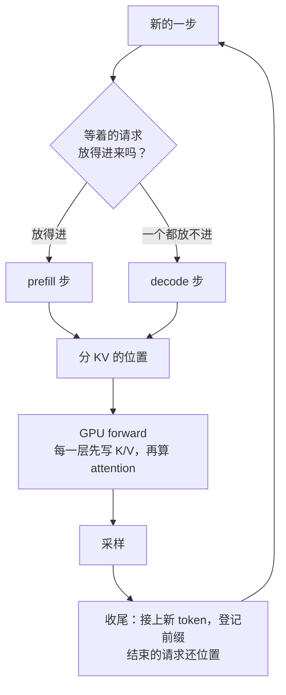

# nano-vllm 问答：和 mini-sglang 有什么区别

读完两边的主干代码以后，我问的一个大问题：nano-vllm 和 mini-sglang 到底有什么区别？这一页用同一个例子，把两边一步一步对照着走一遍。mini-sglang 的文件夹里有同样的一份（[QA-vs-nano-vllm](../mini-sglang/QA-vs-nano-vllm.md)），两份正文一样。SGLang 本体在这些地方怎么做，见 [SGLang 的 QA-vs-mini-sglang](../sglang/QA-vs-mini-sglang.md)。

代码：mini-sglang [`9a91cfa`](https://github.com/sgl-project/mini-sglang/tree/9a91cfafe754aa85daee49998176275667eb58f2)，nano-vllm [`bb823b3`](https://github.com/GeeeekExplorer/nano-vllm/tree/bb823b3e06983d71485a8e1f23715ebd87d98ef8)。2026-10-12 整理，10-14 补了用调度器模拟把整个例子跑完的结果（3.1）。

**结论先说**

- 两个都是把一个大框架缩小成几千行：nano-vllm 缩的是 vLLM，mini-sglang 缩的是 SGLang。主干一样：每一步重新选人，prefill 优先，一步只做一种，KV cache 分页存，每一层先写 K/V 再算 attention，decode 用 CUDA graph，多卡按 head 切（第 1 部分）
- **KV cache 一格多大**：nano-vllm 一个 block 放 256 个 token，前缀缓存按 block 比 hash；mini-sglang 一格放 1 个 token，前缀缓存是一棵 radix 树，按 token 匹配（第 2 部分）
- **显存不够怎么办**：nano-vllm 先放进来，不够了再抢占，被抢的以后重算；mini-sglang 进场时就按 prompt + `max_tokens` 把位置预留好，从不抢占。同一个例子用调度器模拟跑完：nano-vllm 1030 步、抢占 569 次、prefill 一共算了 840,950 个 token；mini-sglang 1259 步、不抢占、prefill 正好是 prompt 的 500,000 个（第 3 部分）
- **两步之间**：nano-vllm 每一步都等 GPU 算完、CPU 记完账，才发下一步；mini-sglang 先发下一步，再处理上一步的结果（overlap scheduling）（第 4 部分）
- **一个程序，还是一个服务**：nano-vllm 一个进程，`generate()` 全部跑完才返回；mini-sglang 起服务时有三种进程，结果一个 token 一个 token 地发回去（第 5 部分）

**目录**

1. 共同的主干（流程图，每一步两边怎么做，贯穿全文的例子）
2. KV cache 一格多大，决定了前缀缓存怎么做
3. 显存不够怎么办：抢占，还是预留（3.1 整个例子跑完：调度器模拟）
4. 每一步之间，GPU 要不要等 CPU
5. 一个程序，还是一个服务
6. 其他小区别（KV cache 开多大、CUDA graph、多卡）
7. 自测（还没答）

---

## 1. 共同的主干

两个引擎都是一步一步走的：每一步先选这一步跑哪些请求，再让 GPU forward 一次，最后收结果。一步要么是 prefill（新请求的 prompt 第一次过模型），要么是 decode（正在跑的请求各生成 1 个 token），不会混在一起；每一步都先试 prefill，一个都放不进来才 decode。



区别都在框里面：

| 框 | nano-vllm | mini-sglang | 见 |
|---|---|---|---|
| 放得进来吗？ | waiting 队首开始，看空 block 够不够 prompt 用；只有这一步的第一个请求能被切开（[scheduler.py L30-L52](https://github.com/GeeeekExplorer/nano-vllm/blob/bb823b3e06983d71485a8e1f23715ebd87d98ef8/nanovllm/engine/scheduler.py#L30-L52)） | pending_list 队首开始，看 prompt + `max_tokens` 预留得下不（[prefill.py L39-L63](https://github.com/sgl-project/mini-sglang/blob/9a91cfafe754aa85daee49998176275667eb58f2/python/minisgl/scheduler/prefill.py#L39-L63)）；预算最后剩下的零头会把下一个请求切开（[L72-L77](https://github.com/sgl-project/mini-sglang/blob/9a91cfafe754aa85daee49998176275667eb58f2/python/minisgl/scheduler/prefill.py#L72-L77)） | 3 |
| decode 步 | running 里每步最多 512 个；要新 block 却没有空的，就抢占（[L57-L73](https://github.com/GeeeekExplorer/nano-vllm/blob/bb823b3e06983d71485a8e1f23715ebd87d98ef8/nanovllm/engine/scheduler.py#L57-L73)） | running 里的全部（[decode.py L32-L35](https://github.com/sgl-project/mini-sglang/blob/9a91cfafe754aa85daee49998176275667eb58f2/python/minisgl/scheduler/decode.py#L32-L35)），从不抢占 | 3 |
| 分 KV 的位置 | 调度时就分 block，一个 block 放 256 个 token | 选好以后在 `_prepare_batch` 里分，一格放 1 个 token，编号写进 GPU 上的 page table（[scheduler.py L204-L217](https://github.com/sgl-project/mini-sglang/blob/9a91cfafe754aa85daee49998176275667eb58f2/python/minisgl/scheduler/scheduler.py#L204-L217)） | 2 |
| GPU forward | Triton kernel 写 K/V，flash-attn 按 block 表读（[attention.py L59-L75](https://github.com/GeeeekExplorer/nano-vllm/blob/bb823b3e06983d71485a8e1f23715ebd87d98ef8/nanovllm/layers/attention.py#L59-L75)） | CUDA kernel 写 K/V，FlashInfer 按一串格子编号读（[fi.py L176-L188](https://github.com/sgl-project/mini-sglang/blob/9a91cfafe754aa85daee49998176275667eb58f2/python/minisgl/attention/fi.py#L176-L188)） | 2 |
| 采样 | `.tolist()` 等 GPU 算完，把 token 拿回 CPU（[model_runner.py L218](https://github.com/GeeeekExplorer/nano-vllm/blob/bb823b3e06983d71485a8e1f23715ebd87d98ef8/nanovllm/engine/model_runner.py#L218)） | token 留在 GPU 上的 `token_pool` 里，同时异步拷一份回 CPU（[engine.py L199-L206](https://github.com/sgl-project/mini-sglang/blob/9a91cfafe754aa85daee49998176275667eb58f2/python/minisgl/engine/engine.py#L199-L206)） | 4 |
| 收尾 | 写满的 block 算 hash 登记；结束的序列把 block 还回去（[scheduler.py L81-L92](https://github.com/GeeeekExplorer/nano-vllm/blob/bb823b3e06983d71485a8e1f23715ebd87d98ef8/nanovllm/engine/scheduler.py#L81-L92)） | prompt 插进 radix 树并锁住；结束的请求整条插进树、解锁，留着等驱逐（[cache.py L55-L79](https://github.com/sgl-project/mini-sglang/blob/9a91cfafe754aa85daee49998176275667eb58f2/python/minisgl/scheduler/cache.py#L55-L79)） | 2 |
| 回到下一步 | 收尾做完，才开始下一步 | overlap：先发下一步，再收尾上一步（[scheduler.py L83-L106](https://github.com/sgl-project/mini-sglang/blob/9a91cfafe754aa85daee49998176275667eb58f2/python/minisgl/scheduler/scheduler.py#L83-L106)） | 4 |

### 贯穿全文的例子

同一时刻来了 1000 个请求，每个 prompt 500 个 token，最多生成 300 个（`ignore_eos`，都会生成满）。KV cache 两边一样大，都能放 262144 个 token：nano-vllm 是 1024 个 block × 256，mini-sglang 是 262144 格。其他用各自的默认值：

- nano-vllm：每步最多 512 个序列（`max_num_seqs`），一步 prefill 最多 16384 个 token（`max_num_batched_tokens`）
- mini-sglang：同时最多 256 个请求（`max_running_req`，也就是 page table 的行数），一步 prefill 最多 8192 个 token（`max_extend_tokens`）

第一步两边就不一样：

- nano-vllm：32 个请求，一共 16000 个 token。第 33 个只剩 384 的预算，又不是这一步的第一个，等下一步。
- mini-sglang：16 个请求是 8000 个 token，剩下的 192 切给第 17 个请求：它这一步先算 192 个，剩下 308 个下一步接着算。这一步正好 8192 个 token。

---

## 2. KV cache 一格多大，决定了前缀缓存怎么做

**nano-vllm：一个 block 放 256 个 token。** 一个序列的 K/V 存在几个 block 里，序列自己带一张 block 表，比如 `[5, 9, 12]`。前缀缓存按 block 做：一个 block 写满了，就用它的 256 个 token 连同前面那个 block 的 hash 算出一个 hash，登记进字典（[block_manager.py L110-L120](https://github.com/GeeeekExplorer/nano-vllm/blob/bb823b3e06983d71485a8e1f23715ebd87d98ef8/nanovllm/engine/block_manager.py#L110-L120)）。新请求进来，一个 block 一个 block 地查字典。没写满的 block 不缓存。细节见 [QA-scheduling 第 3 部分](QA-scheduling.md)。

**mini-sglang：一格放 1 个 token。** 每个请求占 page table 的一行，第 j 列是它第 j 个 token 的 K/V 放在哪一格。前缀缓存是一棵 radix 树，树上的每个节点是一段 token 和它们的格子编号。新请求进来，拿 prompt（除了最后一个 token）去树里匹配，能匹配多长就复用多长（[cache.py L27-L30](https://github.com/sgl-project/mini-sglang/blob/9a91cfafe754aa85daee49998176275667eb58f2/python/minisgl/scheduler/cache.py#L27-L30)）。细节见 [QA-kv-cache](../mini-sglang/QA-kv-cache.md)。

**例子：** 1000 个请求共用一段 400 token 的 system prompt，后面各接 100 个 token 的问题。第一个请求算完、登记好以后，再进来的请求：

- nano-vllm 能复用 256 个：第一个 block 全是 system prompt；第二个 block 里只有 144 个 system prompt 的 token，还混着 112 个问题的 token，hash 对不上。
- mini-sglang 能复用全部 400 个。

同一步一起进来的请求另说，见第 7 部分的自测。

**请求结束以后：**

- nano-vllm：block 还回空闲队列，但内容和 hash 还留着；在这个 block 被分给别人之前，前缀相同的请求还能命中。
- mini-sglang：整条序列（prompt 加上生成的 token）插进树里，然后解锁。格子不还回空闲列表，而是变成"可以驱逐的"。等空格子不够分了，才从树上驱逐最久没用过的叶子节点，一次一整个节点（[cache.py L106-L113](https://github.com/sgl-project/mini-sglang/blob/9a91cfafe754aa85daee49998176275667eb58f2/python/minisgl/scheduler/cache.py#L106-L113)）。所以一格有三种状态：空闲的、在树里可以驱逐的、正在用的。

**一格放 1 个 token 的代价：**

- decode 时，每个请求每一步都要一个新格子。nano-vllm 要每 256 个 token 才要一个新 block。
- page table 很大：257 行（256 个请求，加 1 行给 CUDA graph 补位用的空请求）× 40960 列（`max_seq_len`）。所以它放在 GPU 上，分格子、算每个 token 的 K/V 写到哪（`out_loc`）都是 GPU 上的张量操作（[scheduler.py L204-L217](https://github.com/sgl-project/mini-sglang/blob/9a91cfafe754aa85daee49998176275667eb58f2/python/minisgl/scheduler/scheduler.py#L204-L217)）。nano-vllm 的 `slot_mapping` 是在 CPU 上用 Python 一个一个算出来的。
- attention kernel 要能处理一格一个 token。flash-attn 的分页接口要求 block 是 256 的倍数，所以 mini-sglang 用 FlashInfer：它按一串格子编号去读，不用把 K/V 拷到一起（见 [QA-kv-cache](../mini-sglang/QA-kv-cache.md)）。

---

## 3. 显存不够怎么办：抢占，还是预留

```
nano-vllm：  先放进来，不够了再踢人（被踢的以后要重算）
mini-sglang：先算够了再放进来（放进来的不会被踢）
```

**nano-vllm：** 进场时只要 prompt 的 block。decode 时，一个序列长到要一个新 block（长度除以 256 余 1），却没有空的，就把 running 里最晚进来的序列抢占掉：它的 block 全部还回去，它被放回 waiting 的最前面，以后把 prompt 和已经生成的 token 一起重新算（[scheduler.py L58-L65](https://github.com/GeeeekExplorer/nano-vllm/blob/bb823b3e06983d71485a8e1f23715ebd87d98ef8/nanovllm/engine/scheduler.py#L58-L65)、[L75-L79](https://github.com/GeeeekExplorer/nano-vllm/blob/bb823b3e06983d71485a8e1f23715ebd87d98ef8/nanovllm/engine/scheduler.py#L75-L79)）。

**mini-sglang：** 进场时就把整个回答的位置预留好。对每个请求，看"prompt 里还要算的 token 数 + `max_tokens` + 已经预留出去的"是不是不超过"空格子 + 可以驱逐的格子"（[prefill.py L46-L53](https://github.com/sgl-project/mini-sglang/blob/9a91cfafe754aa85daee49998176275667eb58f2/python/minisgl/scheduler/prefill.py#L46-L53)）。"已经预留出去的"是正在 decode 的请求还要生成多少个 token（[decode.py L27-L30](https://github.com/sgl-project/mini-sglang/blob/9a91cfafe754aa85daee49998176275667eb58f2/python/minisgl/scheduler/decode.py#L27-L30)），加上这一步前面已经放进来的请求要的格子。放不下就停，后面的不再看。进了场就一直跑到结束，代码里没有抢占。

**例子里：**

- nano-vllm（调度器模拟，[实验 001](../../experiments/001-preemption-1000-requests/)）：前 16 步 prefill，每步 32 个，512 个序列各占 2 个 block，1024 个 block 正好用完。第 29 步长度到了 513，512 个序列都要第 3 个 block，抢占了 171 个；第 285 步又都要第 4 个 block，再抢占 85 个。
- mini-sglang：最先用完的是 page table 的 256 行，不是 KV cache。256 个请求每个预留 500 + 300 = 800 格，一共 204800 格，比 262144 少，所以从头到尾格子都够，用不着抢占。
- 换成我笔记本上 mini-sglang 实际开出来的 47008 格：47008 ÷ 800 ≈ 58.8，同时只能跑 58 个。

整个例子跑完是什么样，见 3.1。

**取舍：** nano-vllm 同时跑的请求多，代价是可能要重算；mini-sglang 从不重算，代价是很保守：`max_tokens` 只是上限，请求要是很早就遇到 eos，多预留的位置就白占了，同时跑的请求也就少了。代码在这里留了一句 `# TODO: better estimate policy`（[prefill.py L46](https://github.com/sgl-project/mini-sglang/blob/9a91cfafe754aa85daee49998176275667eb58f2/python/minisgl/scheduler/prefill.py#L46)）。和 SGLang、vLLM 的对比见 [QA-scheduling 6.2 和 6.4](QA-scheduling.md)。

**进来时的长度检查**也是同一个思路：mini-sglang 收到请求时，prompt 不比 `max_seq_len` 短的直接丢掉，prompt 加 `max_tokens` 超过 `max_seq_len` 的，把 `max_tokens` 改小（[scheduler.py L177-L189](https://github.com/sgl-project/mini-sglang/blob/9a91cfafe754aa85daee49998176275667eb58f2/python/minisgl/scheduler/scheduler.py#L177-L189)）。`max_seq_len` 又不会超过 KV cache 的总格子数，所以进来的请求最后总能放得下。nano-vllm 进来时不做这些检查：一个整个 KV cache 都放不下的序列会让它崩掉（[#274](issues/274-kv-cache-exhausted-assert.md)），一个长过 `max_model_len` 的序列会让 CUDA graph 出错（[#190](issues/190-cuda-graph-block-tables.md)）。

### 3.1 整个例子跑完：调度器模拟

两边都用调度器模拟跑：调度器是真的（mini-sglang 是真的 `Scheduler` 和 radix 树，nano-vllm 是真的 `Scheduler` 和 `BlockManager`），只把模型那一步换成假的，每个请求每一步"生成"一个固定的 token。例子里是 `ignore_eos`，每个请求都生成满 300 个，所以调度的每一步和真模型跑出来的一样。nano-vllm 的结果见 [实验 001](../../experiments/001-preemption-1000-requests/)。mini-sglang 这边，我先照着代码一步一步推出 1259 步，2026-10-14 再跑模拟，每个数都对上了。

| | nano-vllm | mini-sglang |
|---|---|---|
| 一共几步 | 1030（prefill 56 步，decode 974 步） | 1259（prefill 63 步，decode 1196 步） |
| 抢占 | 569 次 | 0 |
| prefill 一共算了多少 token | 840,950，其中 340,950 是被抢占的序列重算的 | 500,000，正好是 1000 个 prompt，一个都没重算 |
| 一步 decode 最多几个请求 | 512，抢占以后是 341、256 | 256 |
| 第一批进场停在哪 | 第 16 步，block 用完了 | 第 16 步，page table 的 256 行用完了 |

mini-sglang 这一边是这样走的（数字是每一步交给 GPU 那一刻的值）：

| 步 | 发生了什么 | 例子里的数 |
|---|---|---|
| 1–15 | prefill，每步正好 8192 个 token：放满整个的请求以后，剩下的预算切给下一个请求 | 每步 17 或 18 个请求，其中 1 个被切开 |
| 16 | 先算完上一步被切开的那个，再放 10 个新的，page table 的 256 行就满了 | 11 个请求，5120 个 token |
| 17–315 | decode，256 个请求一起，长度从 501 长到 800。格子是进场时预留好的，从来不会不够 | 空格子从 134144 降到 57600 |
| 315 | 256 个请求同时生成满 300 个，结束。整条序列（799 个 token）留在 radix 树里，变成可以驱逐的 | 可驱逐 204544 |
| 316–331 | 第二批 256 个 prefill。空格子只有 57600，到第 323 步就不够了，开始驱逐第一批留下的 | 驱逐一次一整个节点，凑够就停，所以之后空格子一直只有几十到几百 |
| 332–945 | 第二批 decode（到第 630 步结束），第三批同样走一遍（631–945） | |
| 946–1259 | 最后 232 个：15 步 prefill（第 960 步只剩 3 个请求，1312 个 token），然后 299 步 decode | |

另外两个结果：

- **overlap 开和关，跑出来都是 1259 步**。每一步放谁、算多少 token、空格子和可驱逐的格子有多少，全都一样；只有"正在用的格子"（`protected`）那一列不一样，见第 7 部分第 3、4 题。在这个例子里，overlap 没有改变调度的决定。
- **换成我笔记本的 47008 格**：每批 58 个。4 步 prefill（第 4 步先算完被切开的那个，再放 8 个新的，预留就不够了），加 299 步 decode，一批 303 步；17 批 58 个，最后一批 14 个，一共 5451 步。

步数不是时间：mini-sglang 一步 prefill 最多 8192 个 token，nano-vllm 是 16384；decode 时 mini-sglang 一步 256 个请求，nano-vllm 一开始是 512 个。所以 1259 步比 1030 步多，并不说明 mini-sglang 慢。能说明的是：它一个 token 都没有重算。

---

## 4. 每一步之间，GPU 要不要等 CPU

**nano-vllm：** 采样以后有一个 `.tolist()`（[model_runner.py L218](https://github.com/GeeeekExplorer/nano-vllm/blob/bb823b3e06983d71485a8e1f23715ebd87d98ef8/nanovllm/engine/model_runner.py#L218)），把 token 从 GPU 拷回 CPU，CPU 得等 GPU 把这一步全部算完。拿到 token 以后，CPU 才做收尾、下一步的调度、拼下一步的张量。这段时间 GPU 空着。

```
nano-vllm：  GPU ███░░███░░███░░     ░ = GPU 在等 CPU 记账、拼张量
mini-sglang：GPU ███████████████     CPU 的活藏在 GPU 计算的后面
```

**mini-sglang：** `overlap_loop` 每一圈做的是：收消息 → 选出下一步 → 发给 GPU（不等它算完）→ 再处理上一步的结果（[scheduler.py L83-L106](https://github.com/sgl-project/mini-sglang/blob/9a91cfafe754aa85daee49998176275667eb58f2/python/minisgl/scheduler/scheduler.py#L83-L106)）。能先发下一步，是因为下一步要的东西 CPU 都已经知道了：

- **长度**：每个请求的 `cached_len`、`device_len` 在发出去的时候就在 CPU 上加好了（[engine.py L199-L200](https://github.com/sgl-project/mini-sglang/blob/9a91cfafe754aa85daee49998176275667eb58f2/python/minisgl/engine/engine.py#L199-L200)）。要几个新格子、谁到了 `max_tokens`，都知道。
- **输入的 token**：CPU 不用知道它是什么。采样出来的 token 直接在 GPU 上写进 `token_pool`，下一步的输入也从 `token_pool` 里取（[scheduler.py L227-L233](https://github.com/sgl-project/mini-sglang/blob/9a91cfafe754aa85daee49998176275667eb58f2/python/minisgl/scheduler/scheduler.py#L227-L233)）。GPU 按顺序执行，先写后读，一定读得到。

CPU 不知道的只有 token 的值。所以代价是调度器手里的信息晚一步：

- 遇到 eos 的请求要晚一步才发现，会白跑一步，结果丢掉；
- 第 k 步刚算完的 prompt，要等第 k+1 步发出去以后才插进 radix 树，第 k+1 步进来的、前缀相同的请求就命中不了。这就是 PR #142 / #154 修的那个 bug 的起点。

设 `MINISGL_DISABLE_OVERLAP_SCHEDULING=1` 可以关掉 overlap，走 `normal_loop`，就和 nano-vllm 一样每一步都等。细节见 [QA-overlap](../mini-sglang/QA-overlap.md)。

---

## 5. 一个程序，还是一个服务

**nano-vllm：** 一个进程（多卡时每张卡再多一个），`generate()` 把所有请求跑完，一起返回。

**mini-sglang：** 起服务时有三种进程，互相用 ZMQ 传消息（[launch.py L64-L104](https://github.com/sgl-project/mini-sglang/blob/9a91cfafe754aa85daee49998176275667eb58f2/python/minisgl/server/launch.py#L64-L104)）：

- **API server**：收 HTTP 请求，把结果流式发回去；
- **tokenizer / detokenizer**：文字和 token 互相转换，默认是同一个进程；
- **scheduler**：每张卡一个，是唯一碰 GPU 的进程。调度和模型都在这里。

每一步收尾时，每个请求刚生成的 token 都会发回去，所以用户是一个字一个字地收到结果。它也有离线的 `LLM`：只有一个进程，`LLM` 本身就是 `Scheduler` 的子类，只是换了收消息和发结果的方式（[llm.py L28](https://github.com/sgl-project/mini-sglang/blob/9a91cfafe754aa85daee49998176275667eb58f2/python/minisgl/llm/llm.py#L28)）。细节见 [QA-processes](../mini-sglang/QA-processes.md)。

---

## 6. 其他小区别

| | nano-vllm | mini-sglang |
|---|---|---|
| KV cache 开多大 | 先假装跑一次最大的 prefill，量出临时显存的峰值，剩下的给 KV cache（[model_runner.py L91-L113](https://github.com/GeeeekExplorer/nano-vllm/blob/bb823b3e06983d71485a8e1f23715ebd87d98ef8/nanovllm/engine/model_runner.py#L91-L113)） | 加载模型前的空闲显存 × 0.9，减掉模型占的（[engine.py L159-L162](https://github.com/sgl-project/mini-sglang/blob/9a91cfafe754aa85daee49998176275667eb58f2/python/minisgl/engine/engine.py#L159-L162)），不量峰值 |
| CUDA graph 录哪些大小 | 1、2、4、8，然后每 16 个一张，一直到 512（[model_runner.py L234](https://github.com/GeeeekExplorer/nano-vllm/blob/bb823b3e06983d71485a8e1f23715ebd87d98ef8/nanovllm/engine/model_runner.py#L234)） | 1、2、4，然后每 8 个一张，到 160；空闲显存大于 80 GiB 时才录到 256（[graph.py L49-L67](https://github.com/sgl-project/mini-sglang/blob/9a91cfafe754aa85daee49998176275667eb58f2/python/minisgl/engine/graph.py#L49-L67)）。更大的 decode batch 走 eager，例子里一步 decode 有 256 个请求，所以一步都没用上 CUDA graph |
| graph 的缓冲区 | block 表只有 `max_model_len` ÷ 256 列，序列长过 `max_model_len` 就放不下（[#190](issues/190-cuda-graph-block-tables.md)） | 按 `max_seq_len` 开，请求进来时已经被限制在 `max_seq_len` 以内 |
| 补齐到录过的大小 | 多出来的位置 `slot_mapping` 填 -1，写 K/V 时跳过（[model_runner.py L206](https://github.com/GeeeekExplorer/nano-vllm/blob/bb823b3e06983d71485a8e1f23715ebd87d98ef8/nanovllm/engine/model_runner.py#L206)、[attention.py L23](https://github.com/GeeeekExplorer/nano-vllm/blob/bb823b3e06983d71485a8e1f23715ebd87d98ef8/nanovllm/layers/attention.py#L23)） | 补 dummy 请求：page table 多一行，整行指向多开的一个 dummy 格子，K/V 写进那里（[graph.py L160-L166](https://github.com/sgl-project/mini-sglang/blob/9a91cfafe754aa85daee49998176275667eb58f2/python/minisgl/engine/graph.py#L160-L166)、[engine.py L98](https://github.com/sgl-project/mini-sglang/blob/9a91cfafe754aa85daee49998176275667eb58f2/python/minisgl/engine/engine.py#L98)） |
| 多卡：谁调度 | 卡 0 调度，用共享内存把这一步的序列发给其他卡（[model_runner.py L76-L89](https://github.com/GeeeekExplorer/nano-vllm/blob/bb823b3e06983d71485a8e1f23715ebd87d98ef8/nanovllm/engine/model_runner.py#L76-L89)） | 每张卡各自调度。卡 0 把收到的消息转发给其他卡（[io.py L88-L107](https://github.com/sgl-project/mini-sglang/blob/9a91cfafe754aa85daee49998176275667eb58f2/python/minisgl/scheduler/io.py#L88-L107)），规则一样，选出来的 batch 就一样。running 是一个 set，不同进程里的顺序不一样，所以 decode 前按 uid 排序（PR #113，[decode.py L35](https://github.com/sgl-project/mini-sglang/blob/9a91cfafe754aa85daee49998176275667eb58f2/python/minisgl/scheduler/decode.py#L35)） |
| 多卡：KV cache 放多少 | 每张卡按自己的空闲显存算 block 数，调度器只用卡 0 的（nano-vllm #187） | 所有卡取空闲显存的最小值，相差超过 2 GiB 直接报错（[engine.py L178-L187](https://github.com/sgl-project/mini-sglang/blob/9a91cfafe754aa85daee49998176275667eb58f2/python/minisgl/engine/engine.py#L178-L187)） |
| 多卡：KV head 比卡少 | 不支持（[qwen3.py L34](https://github.com/GeeeekExplorer/nano-vllm/blob/bb823b3e06983d71485a8e1f23715ebd87d98ef8/nanovllm/models/qwen3.py#L34)） | 复制 KV head（[attention.py L34](https://github.com/sgl-project/mini-sglang/blob/9a91cfafe754aa85daee49998176275667eb58f2/python/minisgl/layers/attention.py#L34)） |
| 多卡：采样 | logits 收集到卡 0，只有卡 0 采样（[embed_head.py L63-L65](https://github.com/GeeeekExplorer/nano-vllm/blob/bb823b3e06983d71485a8e1f23715ebd87d98ef8/nanovllm/layers/embed_head.py#L63-L65)） | logits all_gather 到每张卡，每张卡都自己采样（[embedding.py L99-L102](https://github.com/sgl-project/mini-sglang/blob/9a91cfafe754aa85daee49998176275667eb58f2/python/minisgl/layers/embedding.py#L99-L102)） |

---

## 7. 自测（还没答）

1. `max_tokens` 设成 4000，但大多数请求生成 100 个 token 左右就遇到 eos。KV cache 有 47008 个 token 的位置时，mini-sglang 同时能跑几个请求？nano-vllm 呢？这种情况下哪个更好？
   提示：mini-sglang 每个请求要预留多少格？nano-vllm 进场时要几个 block？
2. 1000 个请求共用一段 400 token 的 system prompt，同时到达。第一步 prefill 的那些请求，两个引擎各能复用多少前缀？第二步进来的呢？
   提示：nano-vllm 看 [#219](issues/219-same-step-prefix-sharing.md)（block 什么时候登记）；mini-sglang 看第 4 部分（overlap 让插进树晚一步）。mini-sglang 这边可以用调度器模拟验证：把 prompt 写成具体的 token，开头相同就会命中 radix 树。
3. 3.1 的模拟里，overlap 开和关的 `protected`（锁住、正在用的格子）那一列总差一步：第 2 步发出时，overlap 关是 8000，开是 0；之后每个 prefill 步都是这样。为什么？
   提示：表里的数是第 k 步交给 GPU 那一刻的值。第 1 步那 16 个完整的请求，prompt 是什么时候插进 radix 树、锁住的？这和第 4 部分说的"晚一步"是同一个时间窗口。
4. decode 时，overlap 开的 `protected` 是 128011，关是 128000；最后一批是 116003 和 116000。多出来的 11 和 3，正好是每批最后一个 prefill 步的请求数（第 16 步 11 个，第 960 步 3 个）。为什么偏偏是这些请求，各多了一个 token 在树里？
   提示：`cache_req` 插进树的是 `input_ids[:cached_len]`。overlap 开时，第 16 步的结果要等第 17 步发出以后才处理；第 17 步发出时，`complete_one` 已经对这 11 个请求做了什么？前面那些 prefill 步的请求为什么没有多？
