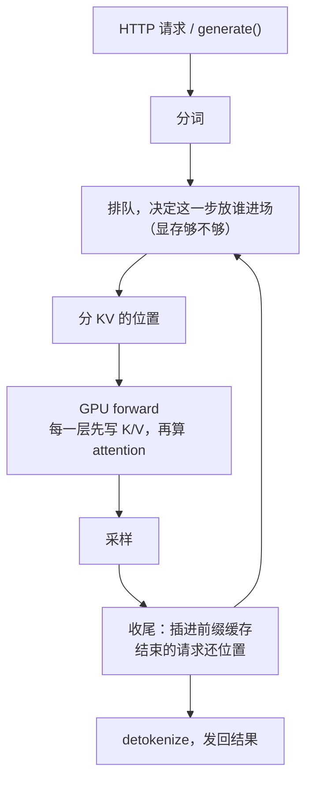

# SGLang 问答：mini-sglang 精简了什么（和 nano-vllm 一起看）

准备学 SGLang 之前问的：mini-sglang 和 SGLang 有什么区别？它舍掉了哪些、精简了哪些？顺便把 nano-vllm 也放进来，三个引擎一起对照。mini-sglang 和 nano-vllm 之间一步一步的对照，见 [mini-sglang 的 QA-vs-nano-vllm](../mini-sglang/QA-vs-nano-vllm.md)。

代码：SGLang `main` 的 [`e9400c5`](https://github.com/sgl-project/sglang/tree/e9400c5a8f3a0d0312a37aecef694f5edfd69341)（2026-10-13），mini-sglang [`9a91cfa`](https://github.com/sgl-project/mini-sglang/tree/9a91cfafe754aa85daee49998176275667eb58f2)，nano-vllm [`bb823b3`](https://github.com/GeeeekExplorer/nano-vllm/tree/bb823b3e06983d71485a8e1f23715ebd87d98ef8)。SGLang 改得很快，行号只对这个提交。2026-10-13 整理。

**结论先说**

- **mini-sglang 是 SGLang 的骨架**：一个请求走的路径、进程的分工、四个核心机制（radix cache、chunked prefill、overlap scheduling、decode 的 CUDA graph 加张量并行）都留下了；代码只有 SGLang 运行时的约 1/108（第 1 部分）
- **精简一：核心路径上每个节点的"策略"都换成了最简单的一种**。排队只有先来先到；进场按 `max_tokens` 全额预留，SGLang 则对正在跑的请求打折估计，估少了再 retract；一格只放 1 个 token；只有一种 KV 池（第 2、3 部分）
- **A1 的修法在 SGLang 里就有**：prefill 完插进 radix 树以后，SGLang 把树里那份的格子编号写回请求自己的那一行，mini-sglang 少了这一步（第 4 部分）
- **精简二：整块功能直接不要**：量化、投机解码、结构化输出、LoRA、多模态、PD 分离、HiCache、DP / EP / PP、RL 的权重更新……SGLang 的 527 个启动参数，mini-sglang 留了 20 个（第 6 部分）
- **读 SGLang 的办法**：先把它当成"单卡、不开投机解码、不开结构化输出"的 mini-sglang，沿着同一条请求路径读，多出来的分支先认出是哪个功能、跳过（第 7 部分）

**目录**

1. 有多大
2. 一个请求的路径：三个引擎每一步怎么做（流程图 + 大表）
3. 进场时怎么算显存，不够了怎么办：SGLang 在 nano-vllm 和 mini-sglang 中间
4. radix cache：SGLang 写回了 mini-sglang 没写回的那几行
5. overlap、CUDA graph、KV cache 开多大
6. 整块舍掉的功能
7. 以后读 SGLang：mini-sglang 的文件对应 SGLang 的哪里
8. 自测（还没答）

---

## 1. 有多大

| | 文件数 | 行数 |
|---|---|---|
| nano-vllm（`nanovllm/`） | 19 | 1,385 |
| mini-sglang（`python/minisgl/`） | 90 | 8,090 |
| SGLang 运行时（`python/sglang/srt/`） | 2,021 | 876,501 |
| SGLang 整个 Python 包（`python/sglang/`） | 4,379 | 1,659,159 |

行数是把所有 `.py` 文件接起来数的，包括空行和注释。SGLang 整个包比运行时多出来的，主要是图像和视频的扩散生成（`multimodal_gen`，约 45 万行）和 kernel（约 26 万行）。mini-sglang 的发布博客（2025-12）说的是"5k 行对将近 300k 行"，口径不一样，SGLang 这一年也长了不少。

几个对应文件的大小更直观：SGLang 的 `managers/scheduler.py` 有 6,155 行，mini-sglang 的 `scheduler/scheduler.py` 是 267 行。

---

## 2. 一个请求的路径：三个引擎每一步怎么做

三个引擎走的是同一条路：



差别都在框里：

| | nano-vllm | mini-sglang | SGLang |
|---|---|---|---|
| 进程 | 1 个 | API server、tokenizer（兼 detokenizer）、每张卡一个 scheduler | 主进程跑 HTTP 和 TokenizerManager，**分词在主进程里**（[engine.py L1127](https://github.com/sgl-project/sglang/blob/e9400c5a8f3a0d0312a37aecef694f5edfd69341/python/sglang/srt/entrypoints/engine.py#L1127)）；每个 (pp, tp) rank 一个 scheduler；detokenizer 单独一个进程；dp > 1 时多一个 DP controller |
| 排队顺序 | 先来先到 | 先来先到 | **默认也是 fcfs**（[schedule.py L82-L98](https://github.com/sgl-project/sglang/blob/e9400c5a8f3a0d0312a37aecef694f5edfd69341/python/sglang/srt/arg_groups/fields/schedule.py#L82-L98)）；可选 lpm（最长前缀优先）、dfs-weight、hrrn、lof 等。等着的请求超过 128 个时，lpm 和 hrrn 退回 fcfs，因为挨个匹配前缀太贵（[schedule_policy.py L300-L311](https://github.com/sgl-project/sglang/blob/e9400c5a8f3a0d0312a37aecef694f5edfd69341/python/sglang/srt/managers/schedule_policy.py#L300-L311)） |
| 分段 prefill | 每步 16384 个 token，只切这一步的第一个请求 | 每步 8192 个，预算用完时切最后放进来的那个 | 每段的大小按显存定：< 20 GB 是 2048，< 60 GB 是 4096，< 160 GB 是 8192，再大是 16384（[memory_hook.py L89-L180](https://github.com/sgl-project/sglang/blob/e9400c5a8f3a0d0312a37aecef694f5edfd69341/python/sglang/srt/arg_groups/memory_hook.py#L89-L180)）。同一时间只有一个请求被切着 |
| prefill 和 decode 混不混 | 不混 | 不混 | 默认不混；`--enable-mixed-chunk` 可以把 decode 混进分段 prefill 的那一步（[schedule.py L202-L205](https://github.com/sgl-project/sglang/blob/e9400c5a8f3a0d0312a37aecef694f5edfd69341/python/sglang/srt/arg_groups/fields/schedule.py#L202-L205)） |
| 进场时怎么算显存 | 只看 prompt 要的 block | prompt + `max_tokens` 全额预留 | 新请求要全额放得下，正在跑的请求打折算（第 3 部分） |
| 显存不够了 | 抢占最晚进来的，以后重算 | 不会发生，进场时预留好了 | **retract**：先退生成得最少的（第 3 部分） |
| KV 一格放几个 token | 256 | 1 | 默认 1，可以设更大；有的 attention 后端强制 64 或 128 |
| KV 池 | 普通 MHA | 普通 MHA | 还有 MLA（DeepSeek）、滑动窗口、mamba 和线性 attention，以及 FP8、FP4 的 KV |
| 前缀缓存 | 写满的 block 算 hash | radix 树，LRU 驱逐 | radix 树；驱逐策略有 lru（默认）、lfu、slru、priority、tlru（[memory.py L25-L42](https://github.com/sgl-project/sglang/blob/e9400c5a8f3a0d0312a37aecef694f5edfd69341/python/sglang/srt/arg_groups/fields/memory.py#L25-L42)）；HiCache 能把 KV 放到 CPU 内存和存储；不同的 LoRA 前缀分开存 |
| 插进树以后 | 不需要写回 | **不写回**（A1） | **写回**（第 4 部分） |
| 两步之间 | 每步等 GPU 算完 | overlap，默认开 | overlap，默认开，思路和 mini-sglang 一样（第 5 部分） |
| 同时跑多少 | 每步 512 | 256（page table 的行数） | 按 KV cache 的大小算，落在 2048 到 4096 之间（[kv_cache_configurator.py L2786-L2799](https://github.com/sgl-project/sglang/blob/e9400c5a8f3a0d0312a37aecef694f5edfd69341/python/sglang/srt/mem_cache/kv_cache_configurator.py#L2786-L2799)） |
| 采样参数 | temperature、max_tokens、ignore_eos | 再加 top_k、top_p | 再加 min_p、三种 penalty、stop 字符串、json_schema / regex / ebnf、n、beam、logit_bias、seed、logprobs 等（[sampling_params.py L112-L152](https://github.com/sgl-project/sglang/blob/e9400c5a8f3a0d0312a37aecef694f5edfd69341/python/sglang/srt/sampling/sampling_params.py#L112-L152)） |
| 多卡 | TP | TP | TP、PP、DP、DP attention、context parallel、EP（DeepEP 等）、two-batch overlap、EPLB |

---

## 3. 进场时怎么算显存，不够了怎么办

三种做法：

```
nano-vllm：  先放进来，不够了再踢人（被踢的以后重算）
mini-sglang：先按最坏情况算够了再放进来（不会被踢，但放进来的少）
SGLang：     按"大概会生成多少"放进来，估少了再退一些出去
```

**SGLang 怎么估。** 判断一个新请求能不能进场时（`PrefillAdder`）：

- **新请求自己要全额放得下**：prompt 里要算的 token，加上 `max_tokens`（最多按 4096 算），这一点和 mini-sglang 一样（[schedule_policy.py L1314-L1319](https://github.com/sgl-project/sglang/blob/e9400c5a8f3a0d0312a37aecef694f5edfd69341/python/sglang/srt/managers/schedule_policy.py#L1314-L1319)）。
- **正在跑的请求打折算**：每个只按 `new_token_ratio × 还要生成的 token 数` 计（[L754-L763](https://github.com/sgl-project/sglang/blob/e9400c5a8f3a0d0312a37aecef694f5edfd69341/python/sglang/srt/managers/schedule_policy.py#L754-L763)）。mini-sglang 是按 1 算。
- **ratio 怎么变**：从 0.7 开始，每个没出问题的 decode 步降一点，600 步降到 0.7 × 0.14 = 0.098；空闲时回到 0.7（[new_token_ratio_tracker.py L21-L49](https://github.com/sgl-project/sglang/blob/e9400c5a8f3a0d0312a37aecef694f5edfd69341/python/sglang/srt/managers/scheduler_components/new_token_ratio_tracker.py#L21-L49)，默认值在 [environ.py L595-L599](https://github.com/sgl-project/sglang/blob/e9400c5a8f3a0d0312a37aecef694f5edfd69341/python/sglang/srt/environ.py#L595-L599)）。
- **`ignore_eos` 的请求按 1.0 算**，因为它一定会生成满。

所以拿我们那个例子（1000 个请求，每个 prompt 500、生成 300，`ignore_eos`），SGLang 和 mini-sglang 的估计是一样的。差别出现在真实的流量里：大多数请求早早遇到 eos，SGLang 能同时放进更多的请求。

**估少了：retract。** decode 时要新的位置却不够（`check_decode_mem`），SGLang 就退掉一些请求（[schedule_batch.py L3300-L3306](https://github.com/sgl-project/sglang/blob/e9400c5a8f3a0d0312a37aecef694f5edfd69341/python/sglang/srt/managers/schedule_batch.py#L3300-L3306)）。和 nano-vllm 的抢占比：

- **退谁**：先退**生成得最少**的，丢掉的工作最少；一样多就先退 prompt 最长的，它放出来的位置多（[L3384-L3423](https://github.com/sgl-project/sglang/blob/e9400c5a8f3a0d0312a37aecef694f5edfd69341/python/sglang/srt/managers/schedule_batch.py#L3384-L3423)）。nano-vllm 是踢**最晚进来**的那个。
- **KV 怎么办**：它自己后面那段 KV 释放掉，但已经在 radix 树里的 prompt 前缀留着，变成可以驱逐的。重新进场时，大概率能命中自己的 prompt，不用全算。
- **之后**：按留下来的请求实际生成的比例，把 ratio 重新估高一些，再慢慢往下降。

---

## 4. radix cache：SGLang 写回了 mini-sglang 没写回的那几行

一个请求 prefill 完、还没结束时，要把它的 prompt 插进 radix 树。如果插的时候发现这段前缀已经在树里了（比如同一步里另一个请求刚插过），就有两份一样的 KV：树里一份，这个请求自己算的一份。

mini-sglang 的 `cache_req`（[cache.py L55-L79](https://github.com/sgl-project/mini-sglang/blob/9a91cfafe754aa85daee49998176275667eb58f2/python/minisgl/scheduler/cache.py#L55-L79)）做了三件事：插进树、把自己那份重复的释放掉、把锁换到新的节点上。**但请求自己的 page table 还指着刚释放的那些格子。** 这些格子以后分给别人，这个请求读到的就是别人的 K/V。这是 backlog 里的 A1，PR #142 / #154 修的就是它，来龙去脉见 [mini-sglang 的 QA-overlap](../mini-sglang/QA-overlap.md)。

SGLang 做同一件事的函数叫 `checkpoint`（以前叫 `cache_unfinished_req`）。读起来最清楚的是普通 `RadixCache` 里的版本（[radix_cache.py L510-L543](https://github.com/sgl-project/sglang/blob/e9400c5a8f3a0d0312a37aecef694f5edfd69341/python/sglang/srt/mem_cache/radix_cache.py#L510-L543)）：

1. 插进树，把自己那份重复的释放掉（[L504-L507](https://github.com/sgl-project/sglang/blob/e9400c5a8f3a0d0312a37aecef694f5edfd69341/python/sglang/srt/mem_cache/radix_cache.py#L504-L507)）；
2. 再匹配一次，拿到树里那份的格子编号；
3. **把这些编号写回请求自己的那一行**（`req_to_token`，相当于 mini-sglang 的 page table）：

```python
self.req_to_token_pool.write(
    (req.kv.req_pool_idx, slice(req.kv.cache_protected_len, len(new_indices))),
    new_indices[req.kv.cache_protected_len :],
)
```

4. 记下哪些格子归树管（`cache_protected_len`），把锁换到新的节点上。

默认用的 `UnifiedRadixCache` 也是这样，写回在 [unified_radix_cache.py L1190-L1193](https://github.com/sgl-project/sglang/blob/e9400c5a8f3a0d0312a37aecef694f5edfd69341/python/sglang/srt/mem_cache/unified_radix_cache.py#L1190-L1193)。mini-sglang 少的就是第 2、3 步。

---

## 5. overlap、CUDA graph、KV cache 开多大

**overlap。** 机制和 mini-sglang 一样：先发下一步，再处理上一步的结果（[scheduler.py L1975-L2048](https://github.com/sgl-project/sglang/blob/e9400c5a8f3a0d0312a37aecef694f5edfd69341/python/sglang/srt/managers/scheduler.py#L1975-L2048)）；下一步的输入 token 从一个按请求行号索引的 GPU 缓冲区里取（`FutureMap`，[overlap_utils.py L117-L118](https://github.com/sgl-project/sglang/blob/e9400c5a8f3a0d0312a37aecef694f5edfd69341/python/sglang/srt/managers/overlap_utils.py#L117-L118)），相当于 mini-sglang 的 `token_pool`。默认开（[schedule.py L187-L193](https://github.com/sgl-project/sglang/blob/e9400c5a8f3a0d0312a37aecef694f5edfd69341/python/sglang/srt/arg_groups/fields/schedule.py#L187-L193)）。SGLang 多出来的是一堆"什么时候自动关掉"的判断：开了 PP、扩散语言模型、某些 mamba 缓存策略、跑在 CPU 上等。

**CUDA graph。**

- decode 录到多大的 batch，按显存定：< 20 GB 只录到 8（我的 8 GB 笔记本就是这一档），80 GB 的卡在 tp < 4 时录到 256（[memory_hook.py L89-L180](https://github.com/sgl-project/sglang/blob/e9400c5a8f3a0d0312a37aecef694f5edfd69341/python/sglang/srt/arg_groups/memory_hook.py#L89-L180)）。
- 录哪些大小：1、2、4、8、12，然后 16 到 256 每 8 个一张，再往上间隔更大（[cuda_graph_hook.py L462-L494](https://github.com/sgl-project/sglang/blob/e9400c5a8f3a0d0312a37aecef694f5edfd69341/python/sglang/srt/arg_groups/cuda_graph_hook.py#L462-L494)）。mini-sglang 是 1、2、4，然后每 8 个一张到 160；nano-vllm 是 1、2、4、8，然后每 16 个一张到 512。
- 补齐：`req_to_token` 的第 0 行和 KV 的第 0 格留给补齐用，和 mini-sglang 多开一行、多开一格的 dummy 是同一个思路。
- **prefill 也录 CUDA graph**（按这一步的 token 数分档），mini-sglang 和 nano-vllm 都只录 decode。

**KV cache 开多大。** 三个引擎三种做法：

- nano-vllm：先假装跑一次最大的 prefill，量出临时显存的峰值，剩下的给 KV cache；
- mini-sglang：加载模型前的空闲显存乘 0.9，减掉模型占的；
- SGLang：也不跑测量，而是按显卡大小、分段大小、CUDA graph 的大小等算出要留多少显存，剩下的给 KV cache。

---

## 6. 整块舍掉的功能

| 方面 | SGLang | mini-sglang |
|---|---|---|
| 模型 | 247 个模型文件；80 种多模态架构，19 种 embedding / reward 模型 | 6 种架构（Llama、Qwen2、Qwen3、Qwen3-MoE、Mistral 两种） |
| attention 后端 | 23 种（FlashInfer、FA3、FA4、Triton、FlashMLA、TRT-LLM、AITER 等） | 3 种：FlashInfer、FlashAttention、TRT-LLM |
| 硬件 | CUDA、ROCm、昇腾 NPU、Intel XPU、CPU、Apple（MPS 和 MLX）、摩尔线程 | 只有 CUDA |
| 量化 | 31 种方法（FP8、AWQ、GPTQ、FP4 等），KV cache 也能用 FP8 / FP4 | 没有 |
| 加速 | 投机解码 8 种（EAGLE、EAGLE3、NGRAM、standalone 等，[spec_info.py L32-L47](https://github.com/sgl-project/sglang/blob/e9400c5a8f3a0d0312a37aecef694f5edfd69341/python/sglang/srt/speculative/spec_info.py#L32-L47)）、prefill CUDA graph、torch.compile、确定性推理 | 都没有 |
| 输出控制 | 结构化输出（xgrammar、outlines、llguidance）、40 多个 tool-call parser、30 多个 reasoning parser、beam search | 都没有 |
| 服务 | PD 分离（mooncake、nixl 等）、HiCache、session、多 LoRA、监控和 tracing；OpenAI、Anthropic、Ollama 风格的接口，原生 `/generate`，gRPC，约 87 个 HTTP 路由 | 4 个路由：`/generate`、`/v1`、`/v1/chat/completions`、`/v1/models` |
| 并行 | TP、PP、DP、DP attention、context parallel、EP、two-batch overlap、EPLB、弹性 EP | 只有 TP |
| RL | 在线更新权重（从磁盘、分布式、tensor、IPC）、释放和恢复显存、weight_sync、checkpoint engine、Ray | 没有 |
| 启动参数 | 527 个 | 20 个 |

另外，SGLang 名字里那个最早的前端语言（`sgl.function`、`sgl.gen`）还在，在 `python/sglang/lang` 里。

---

## 7. 以后读 SGLang：mini-sglang 的文件对应 SGLang 的哪里

| mini-sglang（`python/minisgl/`） | SGLang（`python/sglang/srt/`） |
|---|---|
| `scheduler/scheduler.py`（`overlap_loop`、`normal_loop`） | `managers/scheduler.py`（`event_loop_overlap`、`event_loop_normal`） |
| `scheduler/prefill.py`（`PrefillAdder`） | `managers/schedule_policy.py`（`PrefillAdder`、排队策略）+ `mem_cache/prefill_budget.py` |
| `scheduler/decode.py` | `managers/schedule_batch.py`（`check_decode_mem`、retract） |
| `scheduler/cache.py` + `kvcache/radix_cache.py` | `mem_cache/radix_cache.py`、`unified_radix_cache.py`、`common.py` |
| `scheduler/table.py`（page table、`token_pool`） | `mem_cache/memory_pool.py`（`ReqToTokenPool`）+ `mem_cache/allocator/` + `managers/overlap_utils.py`（`FutureMap`） |
| `engine/engine.py` | `model_executor/model_runner.py` + `mem_cache/kv_cache_configurator.py` |
| `engine/graph.py` | `model_executor/` 下的 CUDA graph runner |
| `tokenizer/` | `managers/tokenizer_manager.py`、`managers/detokenizer_manager.py` |
| `server/api_server.py` | `entrypoints/http_server.py`、`entrypoints/openai/` |

读法：先把 SGLang 当成"单卡、不开投机解码、不开结构化输出"的 mini-sglang，沿着同一条请求路径读。遇到多出来的分支，先认出它属于第 6 部分的哪个功能，跳过；骨架读通以后，再一个功能一个功能地加回来。

---

## 8. 自测（还没答）

1. 去掉 `ignore_eos`，大多数请求生成 100 个 token 左右就遇到 eos，`max_tokens` 还是 300，KV cache 有 47008 个 token 的位置。SGLang 第一批大约能同时放进几个请求？跑了几百步、ratio 降下来以后呢？和 mini-sglang 的 58 个比，差在哪？
   提示：新请求按全额检查，正在跑的请求按 ratio 打折。
2. 把 A1 的场景放到 SGLang 里：第 k+1 步进来的请求又算了一遍别人已经插进树的前缀，`checkpoint` 时会发生什么？最后它的 `req_to_token` 指向哪一份 KV？
   提示：第 4 部分的第 1 到 3 步。
